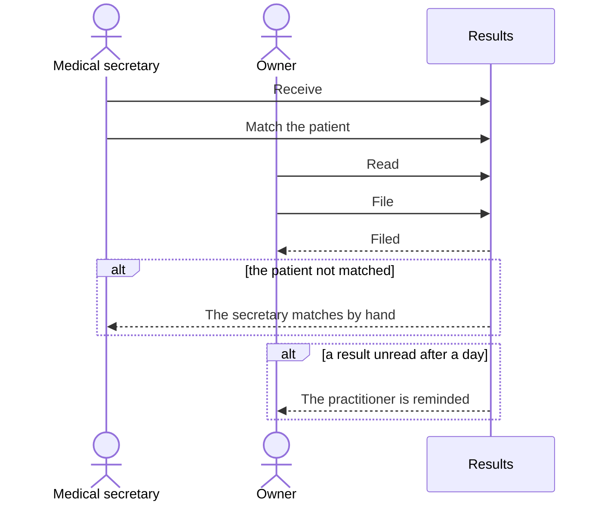

🏠 [Specs](../../../../README.md) › 🏷️ [Sectors](../../../README.md) › 🩺 [SC09 Health practices](../../README.md) ›
📝 [Use cases](../README.md) › 📝 [Use cases: FL-SC09-04 Health exchanges](README.md) ›
📝 UC-SC09-10 Receive lab and imaging results

# 📝 UC-SC09-10 Receive lab and imaging results

**Status:** ✅ specified

## Summary

Results arrive from labs, are matched to the patient's record, and the practitioner reads them; abnormal ones are
flagged.

## Personas

- [U13 Owner](../../../../01-users/personas/u13-owner.md)
- [U33 Medical secretary](../../../../01-users/personas/u33-medical-secretary.md)

## Goal

No result lost or unread.

## Trigger

A result arrives.

## Frequency

Daily.

## Preconditions

- The SC09 sector pack is installed for the company,
  [UC-F14-02](../../../../02-functional/f14-plugin-store/use-cases/01-find-and-install/uc-f14-02-install-a-plugin-or-sector-pack.md),
  and its users have their roles,
  [UC-F1-06](../../../../02-functional/f01-administration/use-cases/04-edit-a-role/uc-f01-06-edit-a-role-and-its-record-rules.md).

## Postconditions

- **Success:** the result is matched and read.
- **Failed:** the result waits for a manual match.

## Main flow

1. Results arrive on [S-SC09-10 Results](../../screens/04-health-exchanges/s-sc09-10-results.md) through secure
   messaging.
2. The result is matched.
3. The practitioner reads it.
4. It is filed in the record.

## Alternative flows

- 3a. An abnormal result: it is flagged to the practitioner first.

## Error flows

- 2e. The patient not matched: the secretary matches by hand.
- 3e. A result unread after a day: the practitioner is reminded.
- Any step: a call to a service or an outside system fails: it is retried first
  ([BR-F3-32](../../../../02-functional/f03-assistant/business-rules/br-f03-32-retry-before-an-error.md)), then the
  error message pattern ([D122](../../../../06-decisions/ux/d122-error-message-standard.md)) says what failed; what was
  typed is kept.

## Business rules

- [BR-SC09-08 Record shared with the national record](../../business-rules/br-sc09-08-record-shared-with-the-national-record.md)
- [BR-SC09-03 Secrecy by default](../../business-rules/br-sc09-03-secrecy-by-default.md)

## Entities

- [E-SC09-03 Clinical record entry](../../data/e-sc09-03-clinical-record-entry.md)
- [E-SC09-08 Health exchange](../../data/e-sc09-08-health-exchange.md)

## Permissions

The owner and medical secretary roles; the record rules of their role and site apply,
[UC-F1-06](../../../../02-functional/f01-administration/use-cases/04-edit-a-role/uc-f01-06-edit-a-role-and-its-record-rules.md).

## Notifications

None beyond the in-app updates of the records concerned.

## Audit events

Every creation, change and state change of clinical record entry, health exchange records, with who, when and the values
before and after (T3).

## AI involvement

The AI assistant answers questions on the clinical record entry, health exchange records of this use case, with links,
and prepares them as drafts the user confirms. It works within the user's rights,
[BR-F3-34](../../../../02-functional/f03-assistant/business-rules/br-f03-34-every-capability-is-reachable-from-the-assistant.md),
and never deletes or does anything irreversible without the user's confirmation,
[BR-F3-07](../../../../02-functional/f03-assistant/business-rules/br-f03-07-no-deletes-no-irreversible-acts.md).

## API, MCP and A2A exposure

Through the API and webhooks (T5) and the MCP and A2A gateway (T6), with the caller's rights,
[BR-F3-34](../../../../02-functional/f03-assistant/business-rules/br-f03-34-every-capability-is-reachable-from-the-assistant.md),
reading, creating and changing the records of this use case; nothing irreversible without a person's confirmation.

## Screens

- [S-SC09-10 Results](../../screens/04-health-exchanges/s-sc09-10-results.md)

## Flowchart

See [FL-SC09-04 Health exchanges](../../flows/fl-sc09-04-health-exchanges.md#flowchart).

## Sequence diagram

## Acceptance criteria

1. **Given** the example health centre's lab report for J. Martin **when** it arrives **then** it is matched and shows
   unread to Dr B..
2. **Given** a lab report with a misspelt name **when** it arrives **then** the secretary matches by hand.

## Non-functional notes

[D408](../../../../06-decisions/technical/d408-performance-and-profiles.md)'s targets
([performance](../../../../05-non-functional/performance.md)): 95 % of screens within 1 second; lists paged on the
server, the first page within 1 second; reports within 5 seconds or in the background. WCAG 2.2 AA and RGAA
([D46](../../../../06-decisions/ux/d46-accessibility-standard.md)).

## Regulatory references

None specific to this use case; the sector's legal rules are listed in [SC09 regulatory](../../regulatory.md).

## Related use cases

- [UC-SC09-09 Share with the national health record and secure messaging](uc-sc09-09-share-with-the-national-health-record-and-secure-messaging.md)

## Open questions

None.

---

⬅️ [UC-SC09-09](uc-sc09-09-share-with-the-national-health-record-and-secure-messaging.md) · ⬆️ [Up](README.md) ·
➡️ [UC-SC09-11 Teleconsult](uc-sc09-11-teleconsult.md)
