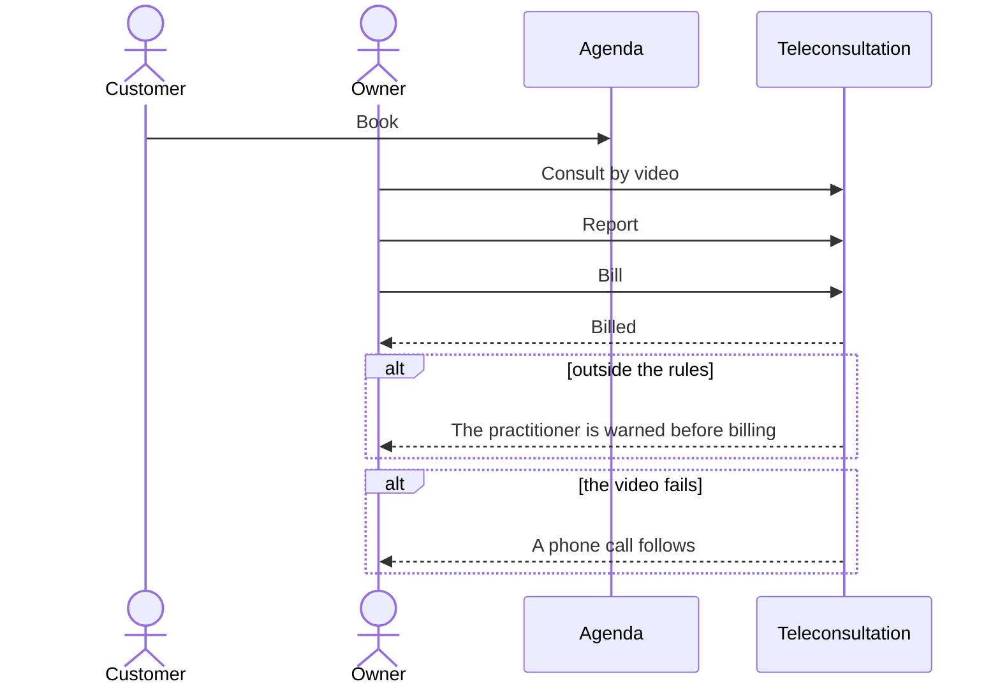

🏠 [Specs](../../../../README.md) › 🏷️ [Sectors](../../../README.md) › 🩺 [SC09 Health practices](../../README.md) ›
📝 [Use cases](../README.md) › 📝 [Use cases: FL-SC09-04 Health exchanges](README.md) › 📝 UC-SC09-11 Teleconsult

# 📝 UC-SC09-11 Teleconsult

**Status:** ✅ specified

## Summary

The patient books a video consultation; the practitioner consults through the shared client video meetings, writes the
report and bills within the rules.

## Personas

- [U13 Owner](../../../../01-users/personas/u13-owner.md)
- [U09 Customer](../../../../01-users/personas/u09-customer.md)

## Goal

Teleconsultations done and billed within the rules.

## Trigger

A patient chooses a video consultation.

## Frequency

Several a week.

## Preconditions

- The SC09 sector pack is installed for the company,
  [UC-F14-02](../../../../02-functional/f14-plugin-store/use-cases/01-find-and-install/uc-f14-02-install-a-plugin-or-sector-pack.md),
  and its users have their roles,
  [UC-F1-06](../../../../02-functional/f01-administration/use-cases/04-edit-a-role/uc-f01-06-edit-a-role-and-its-record-rules.md).

## Postconditions

- **Success:** the report is in the record and the act billed.
- **Failed:** the consultation is rebooked in person.

## Main flow

1. The patient books a video slot
   ([UC-SC09-01](../01-appointments/uc-sc09-01-book-appointments-online-and-at-the-desk.md)).
2. The practitioner consults on
   [S-SC09-11 Teleconsultation](../../screens/04-health-exchanges/s-sc09-11-teleconsultation.md),
   [UC-F4-25](../../../../02-functional/f04-meetings/use-cases/12-rooms-and-client-video/uc-f04-25-hold-a-client-video-meeting.md).
3. The report goes to the record ([BR-SC09-11](../../business-rules/br-sc09-11-teleconsultation-within-the-rules.md)).
4. The act is billed as a teleconsultation.

## Alternative flows

- 2a. Phone only: the act is billed as the rules allow.

## Error flows

- 4e. Outside the rules: the practitioner is warned before billing.
- 2e. The video fails: a phone call follows.
- Any step: a call to a service or an outside system fails: it is retried first
  ([BR-F3-32](../../../../02-functional/f03-assistant/business-rules/br-f03-32-retry-before-an-error.md)), then the
  error message pattern ([D122](../../../../06-decisions/ux/d122-error-message-standard.md)) says what failed; what was
  typed is kept.

## Business rules

- [BR-SC09-11 Teleconsultation within the rules](../../business-rules/br-sc09-11-teleconsultation-within-the-rules.md)

## Entities

- [E-SC09-01 Appointment](../../data/e-sc09-01-appointment.md)
- [E-SC09-03 Clinical record entry](../../data/e-sc09-03-clinical-record-entry.md)

## Permissions

The owner and customer roles; the record rules of their role and site apply,
[UC-F1-06](../../../../02-functional/f01-administration/use-cases/04-edit-a-role/uc-f01-06-edit-a-role-and-its-record-rules.md).

## Notifications

None beyond the in-app updates of the records concerned.

## Audit events

Every creation, change and state change of appointment, clinical record entry records, with who, when and the values
before and after (T3).

## AI involvement

The AI assistant answers questions on the appointment, clinical record entry records of this use case, with links, and
prepares them as drafts the user confirms. It works within the user's rights,
[BR-F3-34](../../../../02-functional/f03-assistant/business-rules/br-f03-34-every-capability-is-reachable-from-the-assistant.md),
and never deletes or does anything irreversible without the user's confirmation,
[BR-F3-07](../../../../02-functional/f03-assistant/business-rules/br-f03-07-no-deletes-no-irreversible-acts.md).

## API, MCP and A2A exposure

Through the API and webhooks (T5) and the MCP and A2A gateway (T6), with the caller's rights,
[BR-F3-34](../../../../02-functional/f03-assistant/business-rules/br-f03-34-every-capability-is-reachable-from-the-assistant.md),
reading, creating and changing the records of this use case; nothing irreversible without a person's confirmation.

## Screens

- [S-SC09-01 Agenda](../../screens/01-appointments/s-sc09-01-agenda.md)
- [S-SC09-11 Teleconsultation](../../screens/04-health-exchanges/s-sc09-11-teleconsultation.md)

## Flowchart

See [FL-SC09-04 Health exchanges](../../flows/fl-sc09-04-health-exchanges.md#flowchart).

## Sequence diagram

## Acceptance criteria

1. **Given** the example health centre's video consultation of J. Martin with Dr B. **when** it ends **then** the report
   is in his record.
2. **Given** a teleconsultation outside the reimbursement conditions **when** it is billed **then** the practitioner is
   warned before billing.

## Non-functional notes

[D408](../../../../06-decisions/technical/d408-performance-and-profiles.md)'s targets
([performance](../../../../05-non-functional/performance.md)): 95 % of screens within 1 second; lists paged on the
server, the first page within 1 second; reports within 5 seconds or in the background. WCAG 2.2 AA and RGAA
([D46](../../../../06-decisions/ux/d46-accessibility-standard.md)).

## Regulatory references

Legal values from the France country pack:
[CR-FR-138 Teleconsultation](../../../../10-country-packs/france/health-practice/cr-fr-138-teleconsultation.md).

## Related use cases

- [UC-SC09-01 Book appointments online and at the desk](../01-appointments/uc-sc09-01-book-appointments-online-and-at-the-desk.md)

## Open questions

None.

---

⬅️ [UC-SC09-10 Receive lab and imaging results](uc-sc09-10-receive-lab-and-imaging-results.md) · ⬆️ [Up](README.md) ·
➡️ [UC-SC09-12](../05-practice-organisation/uc-sc09-12-manage-schedules-rooms-and-equipment.md)
