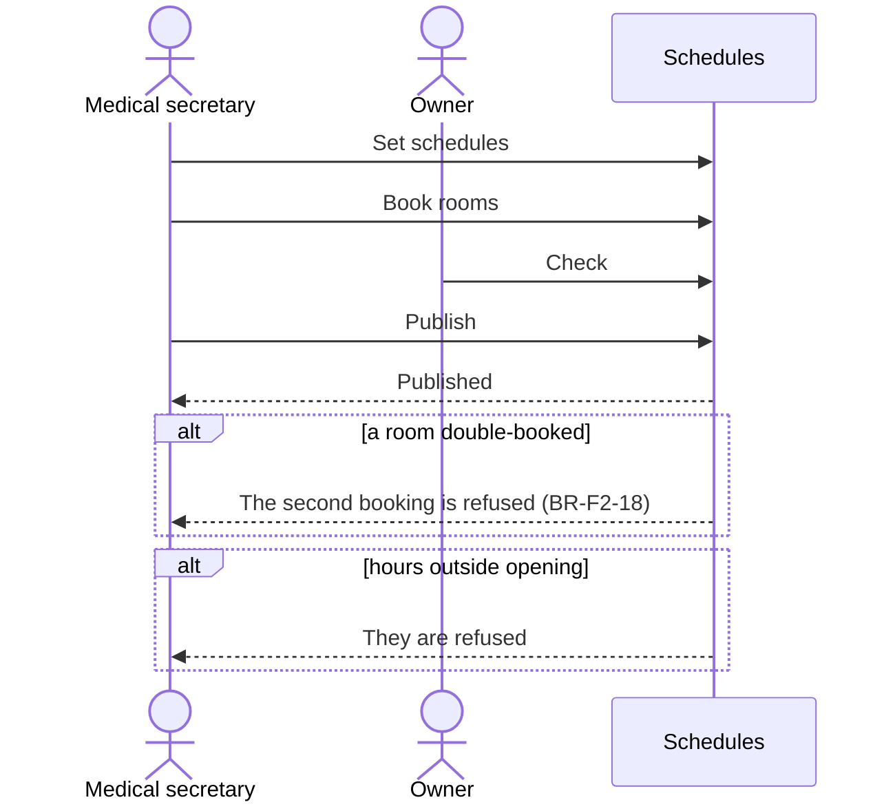

🏠 [Specs](../../../../README.md) › 🏷️ [Sectors](../../../README.md) › 🩺 [SC09 Health practices](../../README.md) ›
📝 [Use cases](../README.md) › 📝 [Use cases: FL-SC09-05 Practice organisation](README.md) ›
📝 UC-SC09-12 Manage schedules, rooms and equipment

# 📝 UC-SC09-12 Manage schedules, rooms and equipment

**Status:** ✅ specified

## Summary

The medical secretary sets practitioners' schedules and books rooms and equipment on the shared booking engine, then
publishes.

## Personas

- [U33 Medical secretary](../../../../01-users/personas/u33-medical-secretary.md)
- [U13 Owner](../../../../01-users/personas/u13-owner.md)

## Goal

Rooms and equipment never double-booked.

## Trigger

The weekly planning, or a locum.

## Frequency

Weekly.

## Preconditions

- The SC09 sector pack is installed for the company,
  [UC-F14-02](../../../../02-functional/f14-plugin-store/use-cases/01-find-and-install/uc-f14-02-install-a-plugin-or-sector-pack.md),
  and its users have their roles,
  [UC-F1-06](../../../../02-functional/f01-administration/use-cases/04-edit-a-role/uc-f01-06-edit-a-role-and-its-record-rules.md).

## Postconditions

- **Success:** schedules are published.
- **Failed:** the old schedules stay.

## Main flow

1. The secretary sets schedules on [S-SC09-12 Schedules](../../screens/05-practice-organisation/s-sc09-12-schedules.md).
2. Rooms and equipment are booked,
   [UC-F2-19](../../../../02-functional/f02-no-code-configuration/use-cases/08-views-and-bookings/uc-f02-19-book-a-resource.md).
3. Practitioners check their week.
4. The schedules open online booking.

## Alternative flows

- 1a. A locum's schedule: the locum's hours replace the practitioner's.

## Error flows

- 2e. A room double-booked: the second booking is refused,
  [BR-F2-18](../../../../02-functional/f02-no-code-configuration/business-rules/br-f02-18-one-booking-per-resource-and-slot.md).
- 1e. Hours outside opening: they are refused.
- Any step: a call to a service or an outside system fails: it is retried first
  ([BR-F3-32](../../../../02-functional/f03-assistant/business-rules/br-f03-32-retry-before-an-error.md)), then the
  error message pattern ([D122](../../../../06-decisions/ux/d122-error-message-standard.md)) says what failed; what was
  typed is kept.

## Business rules

- [BR-SC09-03 Secrecy by default](../../business-rules/br-sc09-03-secrecy-by-default.md)
- [BR-F2-18 One booking per resource and slot](../../../../02-functional/f02-no-code-configuration/business-rules/br-f02-18-one-booking-per-resource-and-slot.md)

## Entities

- [E-SC09-01 Appointment](../../data/e-sc09-01-appointment.md)
- [E-SC09-09 Consulting room](../../data/e-sc09-09-consulting-room.md)
- [E-F2-17 Bookable resource setting](../../../../02-functional/f02-no-code-configuration/data/e-f02-17-bookable-resource-setting.md)

## Permissions

The medical secretary and owner roles; the record rules of their role and site apply,
[UC-F1-06](../../../../02-functional/f01-administration/use-cases/04-edit-a-role/uc-f01-06-edit-a-role-and-its-record-rules.md).

## Notifications

None beyond the in-app updates of the records concerned.

## Audit events

Every creation, change and state change of appointment, room, bookable resource setting records, with who, when and the
values before and after (T3).

## AI involvement

The AI assistant answers questions on the appointment, room, bookable resource setting records of this use case, with
links, and prepares them as drafts the user confirms. It works within the user's rights,
[BR-F3-34](../../../../02-functional/f03-assistant/business-rules/br-f03-34-every-capability-is-reachable-from-the-assistant.md),
and never deletes or does anything irreversible without the user's confirmation,
[BR-F3-07](../../../../02-functional/f03-assistant/business-rules/br-f03-07-no-deletes-no-irreversible-acts.md).

## API, MCP and A2A exposure

Through the API and webhooks (T5) and the MCP and A2A gateway (T6), with the caller's rights,
[BR-F3-34](../../../../02-functional/f03-assistant/business-rules/br-f03-34-every-capability-is-reachable-from-the-assistant.md),
reading, creating and changing the records of this use case; nothing irreversible without a person's confirmation.

## Screens

- [S-SC09-12 Schedules](../../screens/05-practice-organisation/s-sc09-12-schedules.md)

## Flowchart

See [FL-SC09-05 Practice organisation](../../flows/fl-sc09-05-practice-organisation.md#flowchart).

## Sequence diagram

## Acceptance criteria

1. **Given** the example health centre's 8 rooms and 9 practitioners **when** the week is published **then** each room
   shows one booking per slot.
2. **Given** room 2 booked by Dr B. and a physiotherapist on Monday at 09:00 **when** it is booked **then** the second
   booking is refused,
   [BR-F2-18](../../../../02-functional/f02-no-code-configuration/business-rules/br-f02-18-one-booking-per-resource-and-slot.md).

## Non-functional notes

[D408](../../../../06-decisions/technical/d408-performance-and-profiles.md)'s targets
([performance](../../../../05-non-functional/performance.md)): 95 % of screens within 1 second; lists paged on the
server, the first page within 1 second; reports within 5 seconds or in the background. WCAG 2.2 AA and RGAA
([D46](../../../../06-decisions/ux/d46-accessibility-standard.md)).

## Regulatory references

None specific to this use case; the sector's legal rules are listed in [SC09 regulatory](../../regulatory.md).

## Related use cases

- [UC-SC09-01 Book appointments online and at the desk](../01-appointments/uc-sc09-01-book-appointments-online-and-at-the-desk.md)

## Open questions

None.

---

⬅️ [UC-SC09-11 Teleconsult](../04-health-exchanges/uc-sc09-11-teleconsult.md) · ⬆️ [Up](README.md) ·
➡️ [UC-SC09-13 Share costs between partners](uc-sc09-13-share-costs-between-partners.md)
