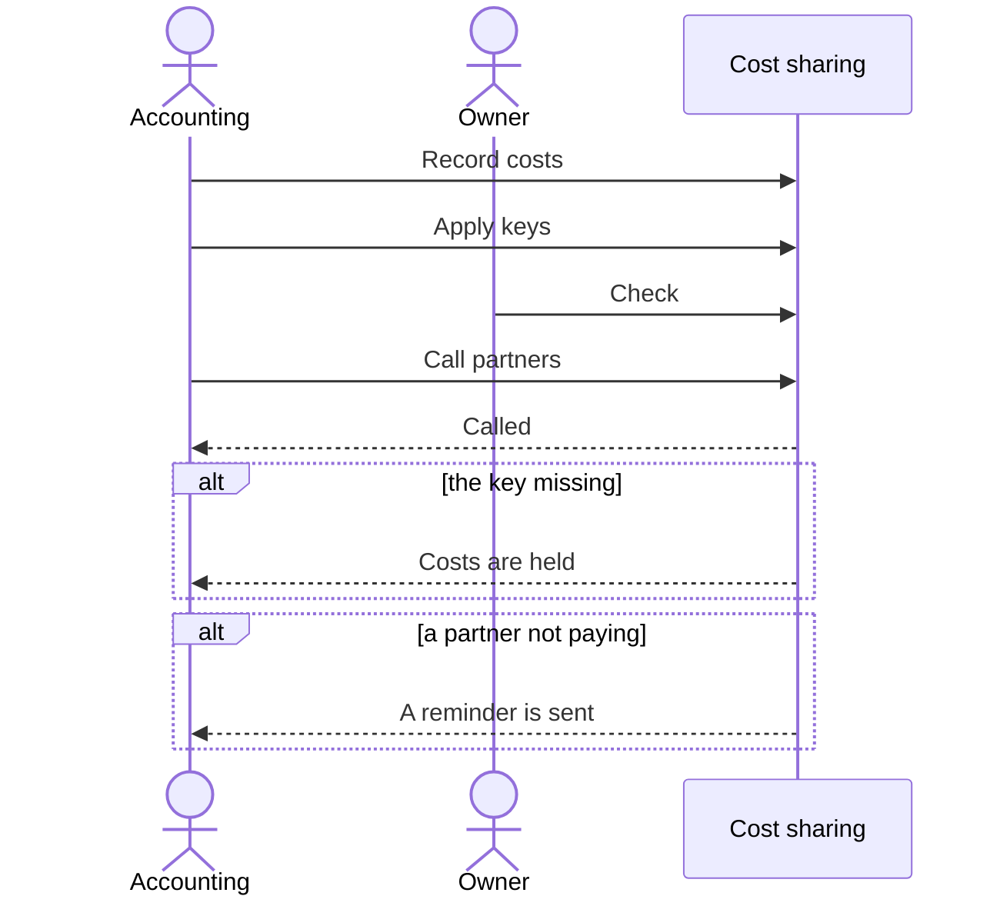

🏠 [Specs](../../../../README.md) › 🏷️ [Sectors](../../../README.md) › 🩺 [SC09 Health practices](../../README.md) ›
📝 [Use cases](../README.md) › 📝 [Use cases: FL-SC09-05 Practice organisation](README.md) ›
📝 UC-SC09-13 Share costs between partners

# 📝 UC-SC09-13 Share costs between partners

**Status:** ✅ specified

## Summary

Accounting records shared costs, applies the partners' key and calls each partner's share.

## Personas

- [U13 Owner](../../../../01-users/personas/u13-owner.md)
- [U05 Accounting](../../../../01-users/personas/u05-accounting.md)

## Goal

Costs shared fairly as agreed.

## Trigger

Month end.

## Frequency

Monthly.

## Preconditions

- The SC09 sector pack is installed for the company,
  [UC-F14-02](../../../../02-functional/f14-plugin-store/use-cases/01-find-and-install/uc-f14-02-install-a-plugin-or-sector-pack.md),
  and its users have their roles,
  [UC-F1-06](../../../../02-functional/f01-administration/use-cases/04-edit-a-role/uc-f01-06-edit-a-role-and-its-record-rules.md).

## Postconditions

- **Success:** each partner is called their share.
- **Failed:** costs are held.

## Main flow

1. Accounting records shared costs on
   [S-SC09-13 Cost sharing](../../screens/05-practice-organisation/s-sc09-13-cost-sharing.md).
2. The key splits them ([BR-SC09-12](../../business-rules/br-sc09-12-costs-shared-by-the-key.md)).
3. Partners check their share.
4. Each partner is called.

## Alternative flows

- 2a. A change of key: it applies from its date.

## Error flows

- 2e. The key missing: costs are held.
- 4e. A partner not paying: a reminder is sent.
- Any step: a call to a service or an outside system fails: it is retried first
  ([BR-F3-32](../../../../02-functional/f03-assistant/business-rules/br-f03-32-retry-before-an-error.md)), then the
  error message pattern ([D122](../../../../06-decisions/ux/d122-error-message-standard.md)) says what failed; what was
  typed is kept.

## Business rules

- [BR-SC09-12 Costs shared by the key](../../business-rules/br-sc09-12-costs-shared-by-the-key.md)

## Entities

- [E-SC09-10 Shared cost](../../data/e-sc09-10-shared-cost.md)

## Permissions

The owner and accounting roles; the record rules of their role and site apply,
[UC-F1-06](../../../../02-functional/f01-administration/use-cases/04-edit-a-role/uc-f01-06-edit-a-role-and-its-record-rules.md).

## Notifications

None beyond the in-app updates of the records concerned.

## Audit events

Every creation, change and state change of shared cost records, with who, when and the values before and after (T3).

## AI involvement

The AI assistant answers questions on the shared cost records of this use case, with links, and prepares them as drafts
the user confirms. It works within the user's rights,
[BR-F3-34](../../../../02-functional/f03-assistant/business-rules/br-f03-34-every-capability-is-reachable-from-the-assistant.md),
and never deletes or does anything irreversible without the user's confirmation,
[BR-F3-07](../../../../02-functional/f03-assistant/business-rules/br-f03-07-no-deletes-no-irreversible-acts.md).

## API, MCP and A2A exposure

Through the API and webhooks (T5) and the MCP and A2A gateway (T6), with the caller's rights,
[BR-F3-34](../../../../02-functional/f03-assistant/business-rules/br-f03-34-every-capability-is-reachable-from-the-assistant.md),
reading, creating and changing the records of this use case; nothing irreversible without a person's confirmation.

## Screens

- [S-SC09-13 Cost sharing](../../screens/05-practice-organisation/s-sc09-13-cost-sharing.md)

## Flowchart

See [FL-SC09-05 Practice organisation](../../flows/fl-sc09-05-practice-organisation.md#flowchart).

## Sequence diagram

## Acceptance criteria

1. **Given** the example health centre's rent shared equally **when** November is called **then** each partner owes
   1,000 EUR.
2. **Given** a new cost without key **when** the month closes **then** costs are held.

## Non-functional notes

[D408](../../../../06-decisions/technical/d408-performance-and-profiles.md)'s targets
([performance](../../../../05-non-functional/performance.md)): 95 % of screens within 1 second; lists paged on the
server, the first page within 1 second; reports within 5 seconds or in the background. WCAG 2.2 AA and RGAA
([D46](../../../../06-decisions/ux/d46-accessibility-standard.md)).

## Regulatory references

None specific to this use case; the sector's legal rules are listed in [SC09 regulatory](../../regulatory.md).

## Related use cases

- [UC-SC09-15 Keep practice accounts](uc-sc09-15-keep-practice-accounts.md)

## Open questions

None.

---

⬅️ [UC-SC09-12 Manage schedules, rooms and equipment](uc-sc09-12-manage-schedules-rooms-and-equipment.md) ·
⬆️ [Up](README.md) ·
➡️ [UC-SC09-14 Trace consumables and sterilisation](uc-sc09-14-trace-consumables-and-sterilisation.md)
