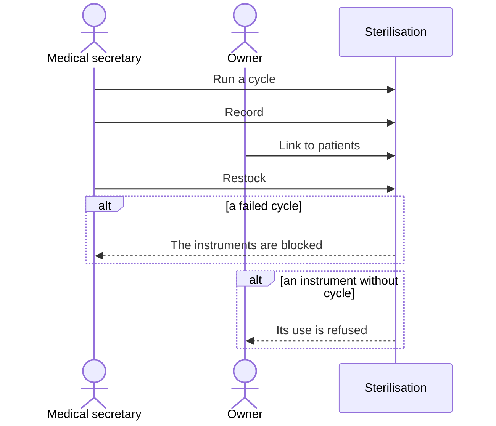

🏠 [Specs](../../../../README.md) › 🏷️ [Sectors](../../../README.md) › 🩺 [SC09 Health practices](../../README.md) ›
📝 [Use cases](../README.md) › 📝 [Use cases: FL-SC09-05 Practice organisation](README.md) ›
📝 UC-SC09-14 Trace consumables and sterilisation

# 📝 UC-SC09-14 Trace consumables and sterilisation

**Status:** ✅ specified

## Summary

The medical secretary runs and records sterilisation cycles and links instruments to the patients they served.

## Personas

- [U33 Medical secretary](../../../../01-users/personas/u33-medical-secretary.md)
- [U13 Owner](../../../../01-users/personas/u13-owner.md)

## Goal

Every instrument traced to its cycle and patients.

## Trigger

A sterilisation cycle.

## Frequency

Daily.

## Preconditions

- The SC09 sector pack is installed for the company,
  [UC-F14-02](../../../../02-functional/f14-plugin-store/use-cases/01-find-and-install/uc-f14-02-install-a-plugin-or-sector-pack.md),
  and its users have their roles,
  [UC-F1-06](../../../../02-functional/f01-administration/use-cases/04-edit-a-role/uc-f01-06-edit-a-role-and-its-record-rules.md).

## Postconditions

- **Success:** the cycle is recorded and linked.
- **Failed:** the instruments are blocked.

## Main flow

1. The cycle is run and recorded on
   [S-SC09-14 Sterilisation](../../screens/05-practice-organisation/s-sc09-14-sterilisation.md).
2. Result and instruments are recorded ([BR-SC09-13](../../business-rules/br-sc09-13-sterilisation-traced.md)).
3. Instruments used are linked to patients.
4. Consumables are restocked,
   [UC-F7-05](../../../../02-functional/f07-purchasing-and-stock/use-cases/03-replenish/uc-f07-05-replenish-stock.md).

## Alternative flows

- 3a. Single-use items: the lot is recorded instead.

## Error flows

- 2e. A failed cycle: the instruments are blocked.
- 3e. An instrument without cycle: its use is refused.
- Any step: a call to a service or an outside system fails: it is retried first
  ([BR-F3-32](../../../../02-functional/f03-assistant/business-rules/br-f03-32-retry-before-an-error.md)), then the
  error message pattern ([D122](../../../../06-decisions/ux/d122-error-message-standard.md)) says what failed; what was
  typed is kept.

## Business rules

- [BR-SC09-13 Sterilisation traced](../../business-rules/br-sc09-13-sterilisation-traced.md)

## Entities

- [E-SC09-11 Sterilisation cycle](../../data/e-sc09-11-sterilisation-cycle.md)

## Permissions

The medical secretary and owner roles; the record rules of their role and site apply,
[UC-F1-06](../../../../02-functional/f01-administration/use-cases/04-edit-a-role/uc-f01-06-edit-a-role-and-its-record-rules.md).

## Notifications

None beyond the in-app updates of the records concerned.

## Audit events

Every creation, change and state change of sterilisation cycle records, with who, when and the values before and after
(T3).

## AI involvement

The AI assistant answers questions on the sterilisation cycle records of this use case, with links, and prepares them as
drafts the user confirms. It works within the user's rights,
[BR-F3-34](../../../../02-functional/f03-assistant/business-rules/br-f03-34-every-capability-is-reachable-from-the-assistant.md),
and never deletes or does anything irreversible without the user's confirmation,
[BR-F3-07](../../../../02-functional/f03-assistant/business-rules/br-f03-07-no-deletes-no-irreversible-acts.md).

## API, MCP and A2A exposure

Through the API and webhooks (T5) and the MCP and A2A gateway (T6), with the caller's rights,
[BR-F3-34](../../../../02-functional/f03-assistant/business-rules/br-f03-34-every-capability-is-reachable-from-the-assistant.md),
reading, creating and changing the records of this use case; nothing irreversible without a person's confirmation.

## Screens

- [S-SC09-14 Sterilisation](../../screens/05-practice-organisation/s-sc09-14-sterilisation.md)

## Flowchart

See [FL-SC09-05 Practice organisation](../../flows/fl-sc09-05-practice-organisation.md#flowchart).

## Sequence diagram

## Acceptance criteria

1. **Given** the example health centre's cycle C-88 on 12 November, kit 4 **when** kit 4 is used for J. Martin **then**
   J. Martin is linked to C-88.
2. **Given** cycle C-88 failing **when** it is recorded **then** the instruments are blocked.

## Non-functional notes

[D408](../../../../06-decisions/technical/d408-performance-and-profiles.md)'s targets
([performance](../../../../05-non-functional/performance.md)): 95 % of screens within 1 second; lists paged on the
server, the first page within 1 second; reports within 5 seconds or in the background. WCAG 2.2 AA and RGAA
([D46](../../../../06-decisions/ux/d46-accessibility-standard.md)).

## Regulatory references

None specific to this use case; the sector's legal rules are listed in [SC09 regulatory](../../regulatory.md).

## Related use cases

- [UC-SC09-12 Manage schedules, rooms and equipment](uc-sc09-12-manage-schedules-rooms-and-equipment.md)

## Open questions

None.

---

⬅️ [UC-SC09-13 Share costs between partners](uc-sc09-13-share-costs-between-partners.md) · ⬆️ [Up](README.md) ·
➡️ [UC-SC09-15 Keep practice accounts](uc-sc09-15-keep-practice-accounts.md)
