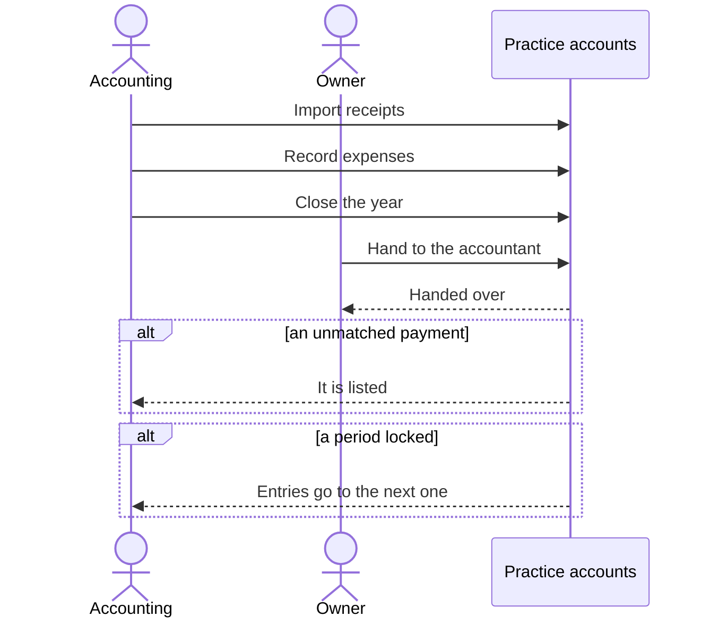

🏠 [Specs](../../../../README.md) › 🏷️ [Sectors](../../../README.md) › 🩺 [SC09 Health practices](../../README.md) ›
📝 [Use cases](../README.md) › 📝 [Use cases: FL-SC09-05 Practice organisation](README.md) ›
📝 UC-SC09-15 Keep practice accounts

# 📝 UC-SC09-15 Keep practice accounts

**Status:** ✅ specified

## Summary

Accounting imports receipts from insurers and patients, records expenses and closes the year of the liberal practice.

## Personas

- [U05 Accounting](../../../../01-users/personas/u05-accounting.md)
- [U13 Owner](../../../../01-users/personas/u13-owner.md)

## Goal

Practice accounts ready for the accountant.

## Trigger

Daily imports and the year end.

## Frequency

Daily; yearly close.

## Preconditions

- The SC09 sector pack is installed for the company,
  [UC-F14-02](../../../../02-functional/f14-plugin-store/use-cases/01-find-and-install/uc-f14-02-install-a-plugin-or-sector-pack.md),
  and its users have their roles,
  [UC-F1-06](../../../../02-functional/f01-administration/use-cases/04-edit-a-role/uc-f01-06-edit-a-role-and-its-record-rules.md).

## Postconditions

- **Success:** the year is closed.
- **Failed:** unmatched lines are listed.

## Main flow

1. Receipts are imported on
   [S-SC09-15 Practice accounts](../../screens/05-practice-organisation/s-sc09-15-practice-accounts.md),
   [UC-F8-06](../../../../02-functional/f08-accounting/use-cases/03-bank-and-collect/uc-f08-06-connect-banks-and-reconcile.md).
2. Expenses are recorded,
   [UC-F8-03](../../../../02-functional/f08-accounting/use-cases/02-purchase-to-pay/uc-f08-03-process-supplier-bills.md).
3. Accounting closes the year,
   [UC-F8-10](../../../../02-functional/f08-accounting/use-cases/05-close-report-and-consolidate/uc-f08-10-close-the-period-and-the-year.md).
4. The accountant gets access,
   [UC-F8-14](../../../../02-functional/f08-accounting/use-cases/01-set-up-and-post/uc-f08-14-work-with-the-external-accountant.md).

## Alternative flows

- 4a. An external accountant: the accountant closes.

## Error flows

- 1e. An unmatched payment: it is listed.
- 3e. A period locked: entries go to the next one.
- Any step: a call to a service or an outside system fails: it is retried first
  ([BR-F3-32](../../../../02-functional/f03-assistant/business-rules/br-f03-32-retry-before-an-error.md)), then the
  error message pattern ([D122](../../../../06-decisions/ux/d122-error-message-standard.md)) says what failed; what was
  typed is kept.

## Business rules

- [BR-SC09-07 Insurers' returns reconciled](../../business-rules/br-sc09-07-returns-reconciled.md)

## Entities

- [E-SC09-06 Insurer return](../../data/e-sc09-06-insurer-return.md)
- [E-SC09-10 Shared cost](../../data/e-sc09-10-shared-cost.md)

## Permissions

The accounting and owner roles; the record rules of their role and site apply,
[UC-F1-06](../../../../02-functional/f01-administration/use-cases/04-edit-a-role/uc-f01-06-edit-a-role-and-its-record-rules.md).

## Notifications

None beyond the in-app updates of the records concerned.

## Audit events

Every creation, change and state change of insurer return, shared cost records, with who, when and the values before and
after (T3).

## AI involvement

The AI assistant answers questions on the insurer return, shared cost records of this use case, with links, and prepares
them as drafts the user confirms. It works within the user's rights,
[BR-F3-34](../../../../02-functional/f03-assistant/business-rules/br-f03-34-every-capability-is-reachable-from-the-assistant.md),
and never deletes or does anything irreversible without the user's confirmation,
[BR-F3-07](../../../../02-functional/f03-assistant/business-rules/br-f03-07-no-deletes-no-irreversible-acts.md).

## API, MCP and A2A exposure

Through the API and webhooks (T5) and the MCP and A2A gateway (T6), with the caller's rights,
[BR-F3-34](../../../../02-functional/f03-assistant/business-rules/br-f03-34-every-capability-is-reachable-from-the-assistant.md),
reading, creating and changing the records of this use case; nothing irreversible without a person's confirmation.

## Screens

- [S-SC09-15 Practice accounts](../../screens/05-practice-organisation/s-sc09-15-practice-accounts.md)

## Flowchart

See [FL-SC09-05 Practice organisation](../../flows/fl-sc09-05-practice-organisation.md#flowchart).

## Sequence diagram

## Acceptance criteria

1. **Given** the example health centre's 120 care sheets paid in a day **when** the bank lines are imported **then**
   they are matched.
2. **Given** a CPAM payment of 21 EUR without care sheet **when** it is imported **then** it is listed.

## Non-functional notes

[D408](../../../../06-decisions/technical/d408-performance-and-profiles.md)'s targets
([performance](../../../../05-non-functional/performance.md)): 95 % of screens within 1 second; lists paged on the
server, the first page within 1 second; reports within 5 seconds or in the background. WCAG 2.2 AA and RGAA
([D46](../../../../06-decisions/ux/d46-accessibility-standard.md)).

## Regulatory references

None specific to this use case; the sector's legal rules are listed in [SC09 regulatory](../../regulatory.md).

## Related use cases

- [UC-SC09-13 Share costs between partners](uc-sc09-13-share-costs-between-partners.md)

## Open questions

None.

---

⬅️ [UC-SC09-14 Trace consumables and sterilisation](uc-sc09-14-trace-consumables-and-sterilisation.md) ·
⬆️ [Up](README.md) ·
➡️ [UC-SC09-16 Manage locums and fee retrocession](uc-sc09-16-manage-locums-and-fee-retrocession.md)
