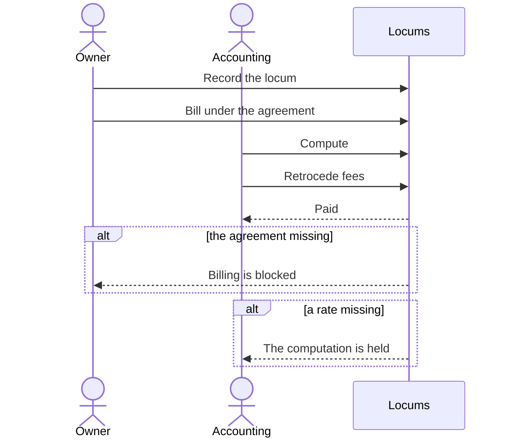

🏠 [Specs](../../../../README.md) › 🏷️ [Sectors](../../../README.md) › 🩺 [SC09 Health practices](../../README.md) ›
📝 [Use cases](../README.md) › 📝 [Use cases: FL-SC09-05 Practice organisation](README.md) ›
📝 UC-SC09-16 Manage locums and fee retrocession

# 📝 UC-SC09-16 Manage locums and fee retrocession

**Status:** ✅ specified

## Summary

A practitioner records a locum's agreement, bills under it and retrocedes the agreed share of fees.

## Personas

- [U13 Owner](../../../../01-users/personas/u13-owner.md)
- [U05 Accounting](../../../../01-users/personas/u05-accounting.md)

## Goal

Locums paid as agreed.

## Trigger

A locum period.

## Frequency

A few a year.

## Preconditions

- The SC09 sector pack is installed for the company,
  [UC-F14-02](../../../../02-functional/f14-plugin-store/use-cases/01-find-and-install/uc-f14-02-install-a-plugin-or-sector-pack.md),
  and its users have their roles,
  [UC-F1-06](../../../../02-functional/f01-administration/use-cases/04-edit-a-role/uc-f01-06-edit-a-role-and-its-record-rules.md).

## Postconditions

- **Success:** fees are retroceded.
- **Failed:** billing under the locum is blocked.

## Main flow

1. The practitioner records the agreement on
   [S-SC09-16 Locums](../../screens/05-practice-organisation/s-sc09-16-locums.md).
2. Acts are billed under the agreement.
3. The retrocession is computed.
4. The share is paid,
   [UC-F8-04](../../../../02-functional/f08-accounting/use-cases/02-purchase-to-pay/uc-f08-04-pay-suppliers.md).

## Alternative flows

- 1a. Several locums: each has its agreement.

## Error flows

- 1e. The agreement missing: billing is blocked.
- 3e. A rate missing: the computation is held.
- Any step: a call to a service or an outside system fails: it is retried first
  ([BR-F3-32](../../../../02-functional/f03-assistant/business-rules/br-f03-32-retry-before-an-error.md)), then the
  error message pattern ([D122](../../../../06-decisions/ux/d122-error-message-standard.md)) says what failed; what was
  typed is kept.

## Business rules

- [BR-SC09-12 Costs shared by the key](../../business-rules/br-sc09-12-costs-shared-by-the-key.md)

## Entities

- [E-SC09-12 Locum agreement](../../data/e-sc09-12-locum-agreement.md)

## Permissions

The owner and accounting roles; the record rules of their role and site apply,
[UC-F1-06](../../../../02-functional/f01-administration/use-cases/04-edit-a-role/uc-f01-06-edit-a-role-and-its-record-rules.md).

## Notifications

None beyond the in-app updates of the records concerned.

## Audit events

Every creation, change and state change of locum agreement records, with who, when and the values before and after (T3).

## AI involvement

The AI assistant answers questions on the locum agreement records of this use case, with links, and prepares them as
drafts the user confirms. It works within the user's rights,
[BR-F3-34](../../../../02-functional/f03-assistant/business-rules/br-f03-34-every-capability-is-reachable-from-the-assistant.md),
and never deletes or does anything irreversible without the user's confirmation,
[BR-F3-07](../../../../02-functional/f03-assistant/business-rules/br-f03-07-no-deletes-no-irreversible-acts.md).

## API, MCP and A2A exposure

Through the API and webhooks (T5) and the MCP and A2A gateway (T6), with the caller's rights,
[BR-F3-34](../../../../02-functional/f03-assistant/business-rules/br-f03-34-every-capability-is-reachable-from-the-assistant.md),
reading, creating and changing the records of this use case; nothing irreversible without a person's confirmation.

## Screens

- [S-SC09-16 Locums](../../screens/05-practice-organisation/s-sc09-16-locums.md)

## Flowchart

See [FL-SC09-05 Practice organisation](../../flows/fl-sc09-05-practice-organisation.md#flowchart).

## Sequence diagram

## Acceptance criteria

1. **Given** the example health centre's Dr K. in August at 70 % with 10,000 EUR of fees **when** August is computed
   **then** 7,000 EUR is retroceded to Dr K..
2. **Given** Dr K. with no agreement in August **when** acts are billed **then** billing is blocked.

## Non-functional notes

[D408](../../../../06-decisions/technical/d408-performance-and-profiles.md)'s targets
([performance](../../../../05-non-functional/performance.md)): 95 % of screens within 1 second; lists paged on the
server, the first page within 1 second; reports within 5 seconds or in the background. WCAG 2.2 AA and RGAA
([D46](../../../../06-decisions/ux/d46-accessibility-standard.md)).

## Regulatory references

None specific to this use case; the sector's legal rules are listed in [SC09 regulatory](../../regulatory.md).

## Related use cases

- [UC-SC09-13 Share costs between partners](uc-sc09-13-share-costs-between-partners.md)

## Open questions

None.

---

⬅️ [UC-SC09-15 Keep practice accounts](uc-sc09-15-keep-practice-accounts.md) · ⬆️ [Up](README.md) ·
➡️ [UC-SC09-17 Honour patients' rights](../06-compliance-and-certification/uc-sc09-17-honour-patients-rights.md)
