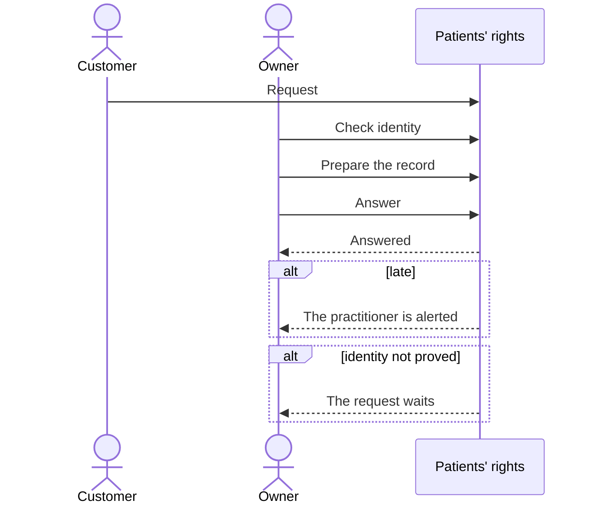

🏠 [Specs](../../../../README.md) › 🏷️ [Sectors](../../../README.md) › 🩺 [SC09 Health practices](../../README.md) ›
📝 [Use cases](../README.md) › 📝 [Use cases: FL-SC09-06 Compliance and certification](README.md) ›
📝 UC-SC09-17 Honour patients' rights

# 📝 UC-SC09-17 Honour patients' rights

**Status:** ✅ specified

## Summary

A practitioner receives a patient's request for their record, prepares it and answers within the legal deadline, keeping
consents, secrecy and objections.

## Personas

- [U13 Owner](../../../../01-users/personas/u13-owner.md)
- [U09 Customer](../../../../01-users/personas/u09-customer.md)

## Goal

Rights honoured on time.

## Trigger

A patient's request.

## Frequency

A few a month.

## Preconditions

- The SC09 sector pack is installed for the company,
  [UC-F14-02](../../../../02-functional/f14-plugin-store/use-cases/01-find-and-install/uc-f14-02-install-a-plugin-or-sector-pack.md),
  and its users have their roles,
  [UC-F1-06](../../../../02-functional/f01-administration/use-cases/04-edit-a-role/uc-f01-06-edit-a-role-and-its-record-rules.md).

## Postconditions

- **Success:** the request is answered on time.
- **Failed:** the request is late and alerts.

## Main flow

1. The patient sends the request on
   [S-SC09-17 Patients' rights](../../screens/06-compliance-and-certification/s-sc09-17-patients-rights.md).
2. The practitioner checks the identity.
3. The record is exported.
4. The answer is sent ([BR-SC09-10](../../business-rules/br-sc09-10-access-answered-within-the-deadline.md)).

## Alternative flows

- 1a. A request by an heir: the heir's right is checked first.

## Error flows

- 4e. Late: the practitioner is alerted.
- 2e. Identity not proved: the request waits.
- Any step: a call to a service or an outside system fails: it is retried first
  ([BR-F3-32](../../../../02-functional/f03-assistant/business-rules/br-f03-32-retry-before-an-error.md)), then the
  error message pattern ([D122](../../../../06-decisions/ux/d122-error-message-standard.md)) says what failed; what was
  typed is kept.

## Business rules

- [BR-SC09-10 Record access answered in time](../../business-rules/br-sc09-10-access-answered-within-the-deadline.md)
- [BR-SC09-03 Secrecy by default](../../business-rules/br-sc09-03-secrecy-by-default.md)

## Entities

- [E-SC09-02 Patient](../../data/e-sc09-02-patient.md)
- [E-SC09-03 Clinical record entry](../../data/e-sc09-03-clinical-record-entry.md)

## Permissions

The owner and customer roles; the record rules of their role and site apply,
[UC-F1-06](../../../../02-functional/f01-administration/use-cases/04-edit-a-role/uc-f01-06-edit-a-role-and-its-record-rules.md).

## Notifications

None beyond the in-app updates of the records concerned.

## Audit events

Every creation, change and state change of patient, clinical record entry records, with who, when and the values before
and after (T3).

## AI involvement

The AI assistant answers questions on the patient, clinical record entry records of this use case, with links, and
prepares them as drafts the user confirms. It works within the user's rights,
[BR-F3-34](../../../../02-functional/f03-assistant/business-rules/br-f03-34-every-capability-is-reachable-from-the-assistant.md),
and never deletes or does anything irreversible without the user's confirmation,
[BR-F3-07](../../../../02-functional/f03-assistant/business-rules/br-f03-07-no-deletes-no-irreversible-acts.md).

## API, MCP and A2A exposure

Through the API and webhooks (T5) and the MCP and A2A gateway (T6), with the caller's rights,
[BR-F3-34](../../../../02-functional/f03-assistant/business-rules/br-f03-34-every-capability-is-reachable-from-the-assistant.md),
reading, creating and changing the records of this use case; nothing irreversible without a person's confirmation.

## Screens

- [S-SC09-17 Patients' rights](../../screens/06-compliance-and-certification/s-sc09-17-patients-rights.md)

## Flowchart

See [FL-SC09-06 Compliance and certification](../../flows/fl-sc09-06-compliance-and-certification.md#flowchart).

## Sequence diagram

## Acceptance criteria

1. **Given** the example health centre's J. Martin asking for his record **when** it is answered **then** he gets his
   record in a file.
2. **Given** a request of 2 November unanswered **when** the deadline nears **then** the practitioner is alerted.

## Non-functional notes

[D408](../../../../06-decisions/technical/d408-performance-and-profiles.md)'s targets
([performance](../../../../05-non-functional/performance.md)): 95 % of screens within 1 second; lists paged on the
server, the first page within 1 second; reports within 5 seconds or in the background. WCAG 2.2 AA and RGAA
([D46](../../../../06-decisions/ux/d46-accessibility-standard.md)).

## Regulatory references

Legal values from the France country pack:
[CR-FR-131 Patients' access to their medical record](../../../../10-country-packs/france/health-practice/cr-fr-131-medical-record-access.md).

## Related use cases

- [UC-SC09-04 Keep the clinical record](../02-patient-file-and-care/uc-sc09-04-keep-the-clinical-record.md)

## Open questions

None.

---

⬅️ [UC-SC09-16](../05-practice-organisation/uc-sc09-16-manage-locums-and-fee-retrocession.md) · ⬆️ [Up](README.md) ·
➡️ [UC-SC09-18 Report activity and quality indicators](uc-sc09-18-report-activity-and-quality-indicators.md)
