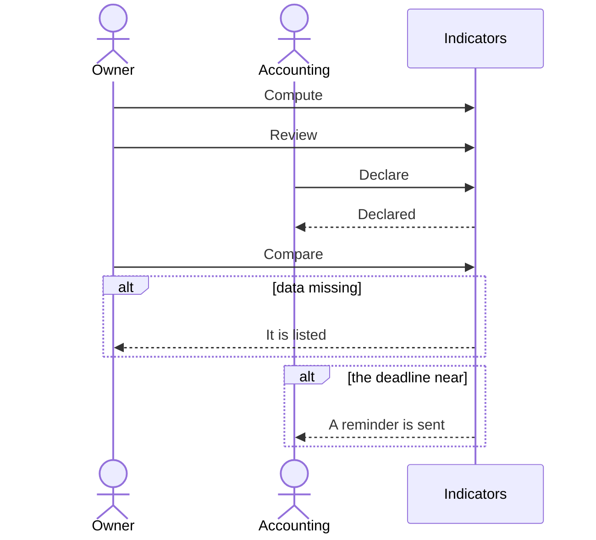

🏠 [Specs](../../../../README.md) › 🏷️ [Sectors](../../../README.md) › 🩺 [SC09 Health practices](../../README.md) ›
📝 [Use cases](../README.md) › 📝 [Use cases: FL-SC09-06 Compliance and certification](README.md) ›
📝 UC-SC09-18 Report activity and quality indicators

# 📝 UC-SC09-18 Report activity and quality indicators

**Status:** ✅ specified

## Summary

The practitioner computes activity and quality indicators, reviews and declares them.

## Personas

- [U13 Owner](../../../../01-users/personas/u13-owner.md)
- [U05 Accounting](../../../../01-users/personas/u05-accounting.md)

## Goal

Indicators declared on time.

## Trigger

The reporting period.

## Frequency

Yearly.

## Preconditions

- The SC09 sector pack is installed for the company,
  [UC-F14-02](../../../../02-functional/f14-plugin-store/use-cases/01-find-and-install/uc-f14-02-install-a-plugin-or-sector-pack.md),
  and its users have their roles,
  [UC-F1-06](../../../../02-functional/f01-administration/use-cases/04-edit-a-role/uc-f01-06-edit-a-role-and-its-record-rules.md).

## Postconditions

- **Success:** indicators are declared.
- **Failed:** missing data is listed.

## Main flow

1. Indicators are computed on
   [S-SC09-18 Quality indicator](../../screens/06-compliance-and-certification/s-sc09-18-quality-indicator.md).
2. The practitioner reviews them.
3. They are declared.
4. The practitioner compares with last year.

## Alternative flows

- 1a. Indicators by specialty: each specialty has its own.

## Error flows

- 1e. Data missing: it is listed.
- 3e. The deadline near: a reminder is sent.
- Any step: a call to a service or an outside system fails: it is retried first
  ([BR-F3-32](../../../../02-functional/f03-assistant/business-rules/br-f03-32-retry-before-an-error.md)), then the
  error message pattern ([D122](../../../../06-decisions/ux/d122-error-message-standard.md)) says what failed; what was
  typed is kept.

## Business rules

- [BR-SC09-01 Health practices follow the country pack](../../business-rules/br-sc09-01-health-practices-follow-the-country-pack.md)

## Entities

- [E-SC09-05 Care sheet](../../data/e-sc09-05-care-sheet.md)

## Permissions

The owner and accounting roles; the record rules of their role and site apply,
[UC-F1-06](../../../../02-functional/f01-administration/use-cases/04-edit-a-role/uc-f01-06-edit-a-role-and-its-record-rules.md).

## Notifications

None beyond the in-app updates of the records concerned.

## Audit events

Every creation, change and state change of care sheet records, with who, when and the values before and after (T3).

## AI involvement

The AI assistant answers questions on the care sheet records of this use case, with links, and prepares them as drafts
the user confirms. It works within the user's rights,
[BR-F3-34](../../../../02-functional/f03-assistant/business-rules/br-f03-34-every-capability-is-reachable-from-the-assistant.md),
and never deletes or does anything irreversible without the user's confirmation,
[BR-F3-07](../../../../02-functional/f03-assistant/business-rules/br-f03-07-no-deletes-no-irreversible-acts.md).

## API, MCP and A2A exposure

Through the API and webhooks (T5) and the MCP and A2A gateway (T6), with the caller's rights,
[BR-F3-34](../../../../02-functional/f03-assistant/business-rules/br-f03-34-every-capability-is-reachable-from-the-assistant.md),
reading, creating and changing the records of this use case; nothing irreversible without a person's confirmation.

## Screens

- [S-SC09-18 Quality indicator](../../screens/06-compliance-and-certification/s-sc09-18-quality-indicator.md)

## Flowchart

See [FL-SC09-06 Compliance and certification](../../flows/fl-sc09-06-compliance-and-certification.md#flowchart).

## Sequence diagram

## Acceptance criteria

1. **Given** the example health centre's 2026 activity **when** indicators are computed **then** they show acts by
   practitioner.
2. **Given** acts without code **when** indicators are computed **then** it is listed.

## Non-functional notes

[D408](../../../../06-decisions/technical/d408-performance-and-profiles.md)'s targets
([performance](../../../../05-non-functional/performance.md)): 95 % of screens within 1 second; lists paged on the
server, the first page within 1 second; reports within 5 seconds or in the background. WCAG 2.2 AA and RGAA
([D46](../../../../06-decisions/ux/d46-accessibility-standard.md)).

## Regulatory references

None specific to this use case; the sector's legal rules are listed in [SC09 regulatory](../../regulatory.md).

## Related use cases

- [UC-SC09-17 Honour patients' rights](uc-sc09-17-honour-patients-rights.md)

## Open questions

None.

---

⬅️ [UC-SC09-17 Honour patients' rights](uc-sc09-17-honour-patients-rights.md) · ⬆️ [Up](README.md) ·
➡️ [UC-SC09-19 Keep the software's certifications current](uc-sc09-19-keep-the-software-s-certifications-current.md)
