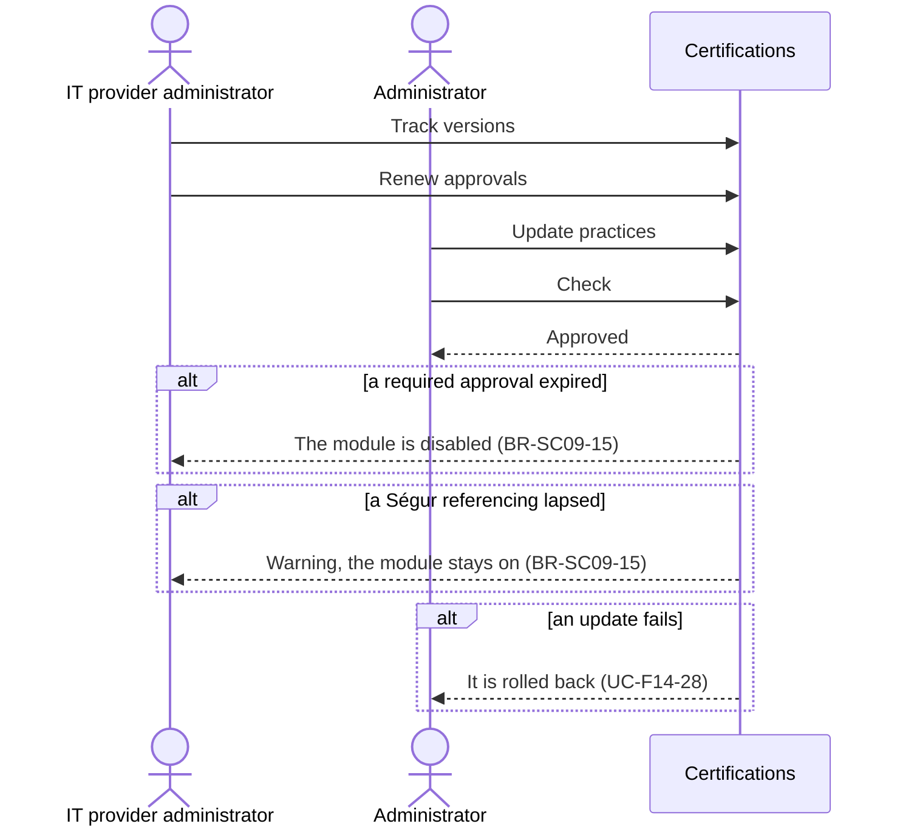

🏠 [Specs](../../../../README.md) › 🏷️ [Sectors](../../../README.md) › 🩺 [SC09 Health practices](../../README.md) ›
📝 [Use cases](../README.md) › 📝 [Use cases: FL-SC09-06 Compliance and certification](README.md) ›
📝 UC-SC09-19 Keep the software's certifications current

# 📝 UC-SC09-19 Keep the software's certifications current

**Status:** ✅ specified

## Summary

The IT provider administrator tracks the certified modules' versions and approvals, renews them, and updates practices;
a module whose required approval expired is disabled, and a lapsed Ségur referencing only warns.

## Personas

- [U11 IT provider administrator](../../../../01-users/personas/u11-provider-admin.md)
- [U07 Administrator](../../../../01-users/personas/u07-administrator.md)

## Goal

Billing and health modules always approved.

## Trigger

A new specification or an expiry.

## Frequency

Yearly.

## Preconditions

- The SC09 sector pack is installed for the company,
  [UC-F14-02](../../../../02-functional/f14-plugin-store/use-cases/01-find-and-install/uc-f14-02-install-a-plugin-or-sector-pack.md),
  and its users have their roles,
  [UC-F1-06](../../../../02-functional/f01-administration/use-cases/04-edit-a-role/uc-f01-06-edit-a-role-and-its-record-rules.md).

## Postconditions

- **Success:** the module is approved and practices updated.
- **Failed:** the module is disabled when a required approval has expired; a lapsed Ségur referencing only warns.

## Main flow

1. The provider tracks modules on
   [S-SC09-19 Certifications](../../screens/06-compliance-and-certification/s-sc09-19-certifications.md).
2. Approvals are renewed.
3. The administrator updates the module,
   [UC-F14-03](../../../../02-functional/f14-plugin-store/use-cases/01-find-and-install/uc-f14-03-update-with-compatibility-checks.md).
4. The module shows its new approval.

## Alternative flows

- 1a. New specifications: the work is planned before their date.

## Error flows

- 2e. A required approval (such as SESAM-Vitale,
  [CR-FR-132](../../../../10-country-packs/france/health-practice/cr-fr-132-sesam-vitale-approval.md)) has expired: the
  module is disabled ([BR-SC09-15](../../business-rules/br-sc09-15-certifications-kept-current.md)).
- 2f. A Ségur referencing has lapsed: the provider is warned and the module stays on, as the referencing is a State
  funding scheme and not an obligation of the practice
  ([BR-SC09-15](../../business-rules/br-sc09-15-certifications-kept-current.md),
  [CR-FR-136](../../../../10-country-packs/france/health-practice/cr-fr-136-segur-labels.md)).
- 3e. An update fails: it is rolled back,
  [UC-F14-28](../../../../02-functional/f14-plugin-store/use-cases/06-release-channels-and-rollback/uc-f14-28-roll-back-to-the-previous-version.md).
- Any step: a call to a service or an outside system fails: it is retried first
  ([BR-F3-32](../../../../02-functional/f03-assistant/business-rules/br-f03-32-retry-before-an-error.md)), then the
  error message pattern ([D122](../../../../06-decisions/ux/d122-error-message-standard.md)) says what failed; what was
  typed is kept.

## Business rules

- [BR-SC09-15 Certifications kept current](../../business-rules/br-sc09-15-certifications-kept-current.md)

## Entities

- [E-SC09-13 Certified module](../../data/e-sc09-13-certified-module.md)

## Permissions

The IT provider administrator and administrator roles; the record rules of their role and site apply,
[UC-F1-06](../../../../02-functional/f01-administration/use-cases/04-edit-a-role/uc-f01-06-edit-a-role-and-its-record-rules.md).

## Notifications

None beyond the in-app updates of the records concerned.

## Audit events

Every creation, change and state change of certified module records, with who, when and the values before and after
(T3).

## AI involvement

The AI assistant answers questions on the certified module records of this use case, with links, and prepares them as
drafts the user confirms. It works within the user's rights,
[BR-F3-34](../../../../02-functional/f03-assistant/business-rules/br-f03-34-every-capability-is-reachable-from-the-assistant.md),
and never deletes or does anything irreversible without the user's confirmation,
[BR-F3-07](../../../../02-functional/f03-assistant/business-rules/br-f03-07-no-deletes-no-irreversible-acts.md).

## API, MCP and A2A exposure

Through the API and webhooks (T5) and the MCP and A2A gateway (T6), with the caller's rights,
[BR-F3-34](../../../../02-functional/f03-assistant/business-rules/br-f03-34-every-capability-is-reachable-from-the-assistant.md),
reading, creating and changing the records of this use case; nothing irreversible without a person's confirmation.

## Screens

- [S-SC09-19 Certifications](../../screens/06-compliance-and-certification/s-sc09-19-certifications.md)

## Flowchart

See [FL-SC09-06 Compliance and certification](../../flows/fl-sc09-06-compliance-and-certification.md#flowchart).

## Sequence diagram

## Acceptance criteria

1. **Given** the example health centre's care sheets module 1.4 valid to 2027-11 **when** it is renewed **then** the new
   date shows.
2. **Given** the care sheets module with its SESAM-Vitale approval valid to 2027-11 **when** it is December 2027
   **then** the module is disabled ([BR-SC09-15](../../business-rules/br-sc09-15-certifications-kept-current.md)).
3. **Given** a module whose Ségur referencing lapsed in December 2027 **when** the provider opens the certifications
   **then** a warning shows and the module stays on.

## Non-functional notes

[D408](../../../../06-decisions/technical/d408-performance-and-profiles.md)'s targets
([performance](../../../../05-non-functional/performance.md)): 95 % of screens within 1 second; lists paged on the
server, the first page within 1 second; reports within 5 seconds or in the background. WCAG 2.2 AA and RGAA
([D46](../../../../06-decisions/ux/d46-accessibility-standard.md)).

## Regulatory references

Legal values from the France country pack:
[CR-FR-132 SESAM-Vitale approval of billing software](../../../../10-country-packs/france/health-practice/cr-fr-132-sesam-vitale-approval.md),
[CR-FR-136 Ségur software labels and secure health messaging](../../../../10-country-packs/france/health-practice/cr-fr-136-segur-labels.md).

## Related use cases

- [UC-SC09-06 Bill health insurance with the Carte Vitale](../03-insurance-billing/uc-sc09-06-bill-health-insurance-with-the-carte-vitale.md)

## Open questions

None.

---

⬅️ [UC-SC09-18 Report activity and quality indicators](uc-sc09-18-report-activity-and-quality-indicators.md) ·
⬆️ [Up](README.md) · ➡️ [UC-SC09-20](../01-appointments/uc-sc09-20-ask-the-assistant-about-the-practice.md)
