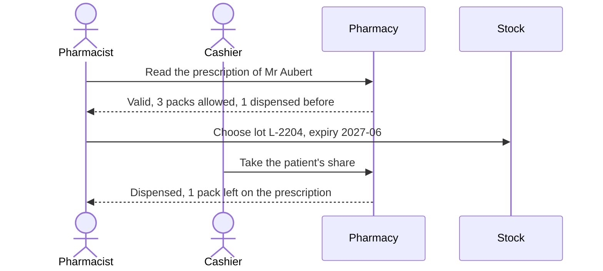

🏠 [Specs](../../../../README.md) › 🏷️ [Sectors](../../../README.md) › 🩺 [SC09 Health practices](../../README.md) ›
📝 [Use cases](../README.md) › 📝 [Use cases: FL-SC09-07 Pharmacy, eyewear, vets, dental and health centres](README.md) ›
📝 UC-SC09-21 Dispense in a pharmacy

# 📝 UC-SC09-21 Dispense in a pharmacy

**Status:** ✅ specified

## Summary

A pharmacy hands out medicines to patients. The pharmacist reads the prescription (on paper or electronic), checks it is
valid and still has quantities left, prepares the medicines with their lot and expiry, and records each dispensation.
The cashier at the counter takes the patient's share and the third-party payment is prepared for the health insurance.

## Personas

- [U36 Professional](../../../../01-users/personas/u36-professional.md)
- [U17 Cashier](../../../../01-users/personas/u17-cashier.md)

## Goal

Every prescription medicine leaves the pharmacy against a valid prescription, with its lot and expiry written down, and
no medicine is handed out when the prescription does not allow it.

## Trigger

A patient brings a prescription, an electronic prescription is read at the counter, or a repeat is due.

## Frequency

Dozens to hundreds of dispensations a day in one pharmacy.

## Preconditions

- The patient exists with their insurance ([E-SC09-02 Patient](../../data/e-sc09-02-patient.md)).
- The prescription is recorded or fetched ([E-SC09-04 Prescription](../../data/e-sc09-04-prescription.md)).
- The medicines are stock items with their lots
  ([E-F7-06 Item](../../../../02-functional/f07-purchasing-and-stock/data/e-f07-06-item.md)).

## Postconditions

- **Succeeded:** the dispensation is saved ([E-SC09-14 Dispensation](../../data/e-sc09-14-dispensation.md)) with the
  medicines, lots and prices; the stock is reduced and the prescription shows what is left.
- **Failed:** nothing is dispensed; the reason (no prescription, ended, nothing left) is shown to the pharmacist.

## Main flow

1. The pharmacist opens the pharmacy screen
   ([S-SC09-21 Pharmacy](../../screens/07-pharmacy-vets-dental-and-centres/s-sc09-21-pharmacy.md)) and reads the
   prescription, or the cashier scans the patient's card and the electronic prescription
   ([UC-SC09-05](../02-patient-file-and-care/uc-sc09-05-write-prescriptions-and-e-prescriptions.md)).
2. SimpleERP checks the prescription: prescriber, date, medicines, quantities, and what is left
   ([BR-SC09-16](../../business-rules/br-sc09-16-prescription-medicines-need-a-valid-prescription.md)).
3. The pharmacist chooses the packs by lot and expiry; the screen proposes the oldest lot first and warns of a medicine
   the patient already has.
4. The cashier takes the patient's share; the part for the health insurance goes to the third-party payment
   ([UC-SC09-07](../03-insurance-billing/uc-sc09-07-handle-third-party-payment-and-insurers-returns.md)).
5. The dispensation is Dispensed, the stock is reduced and the prescription shows the quantity left.
6. The next repeat is proposed to the patient when the prescription allows one.

## Alternative flows

- 1a. The prescription is an electronic one: it is fetched by its number and the medicines are filled in
  ([CR-FR-134](../../../../10-country-packs/france/health-practice/cr-fr-134-e-prescription.md)).
- 3a. The prescribed brand is not available: the pharmacist substitutes an equivalent where the prescription allows it,
  and the substitution is recorded.
- 4a. The patient has no third-party payment right: the full price is taken and a care sheet is prepared
  ([UC-SC09-06](../03-insurance-billing/uc-sc09-06-bill-health-insurance-with-the-carte-vitale.md)).

## Error flows

- 2e. The prescription is missing, ended or has nothing left: the dispensation is refused, the reason is written and the
  patient is told what to do.
- 3e. The lot is expired or recalled: the pack cannot be chosen and the pharmacist is shown another lot.
- 5e. The stock does not hold the pack: the medicine is ordered
  [UC-F7-05](../../../../02-functional/f07-purchasing-and-stock/use-cases/03-replenish/uc-f07-05-replenish-stock.md) and
  the patient is told when to come back.
- Any step: a service does not answer; the call is retried first
  ([BR-F3-32](../../../../02-functional/f03-assistant/business-rules/br-f03-32-retry-before-an-error.md)), then the
  message follows the error pattern ([D122](../../../../06-decisions/ux/d122-error-message-standard.md)) and what the
  user typed stays on the screen.

## Business rules

- [BR-SC09-16](../../business-rules/br-sc09-16-prescription-medicines-need-a-valid-prescription.md)
- [BR-SC09-09](../../business-rules/br-sc09-09-prescriptions-electronic.md)
- [BR-SC09-02](../../business-rules/br-sc09-02-health-data-only-on-certified-hosting.md)
- [BR-SC09-06](../../business-rules/br-sc09-06-third-party-payment-when-due.md)

## Entities

- [E-SC09-14 Dispensation](../../data/e-sc09-14-dispensation.md): created, changed
- [E-SC09-04 Prescription](../../data/e-sc09-04-prescription.md): read and changed, the quantity left on the
  prescription
- [E-SC09-02 Patient](../../data/e-sc09-02-patient.md): read, the patient and their insurance
- [E-F7-06 Item](../../../../02-functional/f07-purchasing-and-stock/data/e-f07-06-item.md): read and changed, the stock
  item and its lots

## Permissions

Pharmacist dispenses and substitutes; cashier takes payments and hands over a prepared order. Only a
pharmacist validates a dispensation of a medicine on prescription.

## Notifications

The pharmacist, in the app: a prescription ends in 7 days for a regular patient, a lot is recalled. The patient, with
their consent: the repeat is ready.

## Audit events

Each dispensation, with the prescription, the medicines, lots and expiry, the pharmacist and the time; each refusal and
its reason; each substitution.

## AI involvement

No AI step of its own. The AI assistant may open the screen and prefill it from the user's words; the user checks and
confirms
[BR-F3-07](../../../../02-functional/f03-assistant/business-rules/br-f03-07-no-deletes-no-irreversible-acts.md).

## API, MCP and A2A exposure

T5 operations of the capability for the personas above: create, read, update and list. The MCP tool of the
capability may read and propose, never confirm alone. No A2A skill.

## Screens

- [S-SC09-21 Pharmacy](../../screens/07-pharmacy-vets-dental-and-centres/s-sc09-21-pharmacy.md)

## Flowchart

See
[FL-SC09-07 Pharmacy, eyewear, vets, dental and health centres](../../flows/fl-sc09-07-pharmacy-vets-dental-and-centres.md#flowchart).

## Sequence diagram

## Acceptance criteria

1. **Given** a prescription for 3 packs with 1 already dispensed **when** the pharmacist dispenses 2 packs **then** the
   dispensation is saved and 0 packs are left on the prescription.
2. **Given** a prescription that ended yesterday **when** the pharmacist tries to dispense **then** it is refused with
   the end date.
3. **Given** two lots of one medicine with different expiry months **when** the pharmacist opens the choice **then** the
   earlier expiry is proposed first.
4. **Given** a recalled lot **when** the pharmacist scans a pack of that lot **then** the pack is refused and the recall
   is shown.

## Non-functional notes

The screen answers within 2 seconds for 10,000 records; every change is audited.

## Regulatory references

A medicine on prescription is handed out only against a valid prescription, whose validity and quantities the
pharmacist checks and records; some medicines have shorter limits and stricter records. The software that helps dispense
must be certified under the health authority's procedure, and a pharmacy keeps the traceability of lots for recalls. The
values are data of the France pack, written later. Related:
[CR-FR-134](../../../../10-country-packs/france/health-practice/cr-fr-134-e-prescription.md),
[CR-FR-133](../../../../10-country-packs/france/health-practice/cr-fr-133-third-party-payment.md),
[CR-FR-055](../../../../10-country-packs/france/data-protection/cr-fr-055-health-data-hosting.md).

## Related use cases

- [UC-SC09-22 Sell eyewear to a prescription](uc-sc09-22-sell-eyewear-to-a-prescription.md)
- [UC-SC09-05](../02-patient-file-and-care/uc-sc09-05-write-prescriptions-and-e-prescriptions.md)
- [UC-SC09-19](../06-compliance-and-certification/uc-sc09-19-keep-the-software-s-certifications-current.md)

## Open questions

None.

---

⬅️ [UC-SC09-20](../01-appointments/uc-sc09-20-ask-the-assistant-about-the-practice.md) · ⬆️ [Up](README.md) ·
➡️ [UC-SC09-22 Sell eyewear to a prescription](uc-sc09-22-sell-eyewear-to-a-prescription.md)
