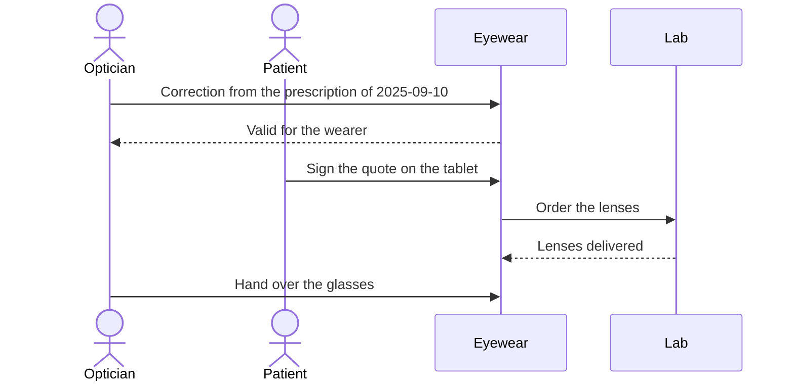

🏠 [Specs](../../../../README.md) › 🏷️ [Sectors](../../../README.md) › 🩺 [SC09 Health practices](../../README.md) ›
📝 [Use cases](../README.md) › 📝 [Use cases: FL-SC09-07 Pharmacy, eyewear, vets, dental and health centres](README.md) ›
📝 UC-SC09-22 Sell eyewear to a prescription

# 📝 UC-SC09-22 Sell eyewear to a prescription

**Status:** ✅ specified

## Summary

An optician sells glasses and lenses to a prescription. The optician reads the correction, checks the prescription is
still valid for the wearer, shows a quote with the frames and lenses, and orders the lenses from the lab. The patient
signs the quote on the tablet and the order follows until the glasses are handed over.

## Personas

- [U36 Professional](../../../../01-users/personas/u36-professional.md)
- [U17 Cashier](../../../../01-users/personas/u17-cashier.md)

## Goal

Every pair of glasses is made to a valid prescription, sold on a signed quote, and followed from the lab order to the
delivery to the patient.

## Trigger

A patient brings a prescription, asks for a quote, or the lab returns the lenses.

## Frequency

Ten to forty orders a week in one shop.

## Preconditions

- The patient exists with their insurance and complementary cover
  ([E-SC09-02 Patient](../../data/e-sc09-02-patient.md)).
- Frames and lenses are stock items
  ([E-F7-06 Item](../../../../02-functional/f07-purchasing-and-stock/data/e-f07-06-item.md)).
- The ophthalmic prescription is recorded ([E-SC09-04 Prescription](../../data/e-sc09-04-prescription.md)).

## Postconditions

- **Succeeded:** the order is saved ([E-SC09-15 Eyewear order](../../data/e-sc09-15-eyewear-order.md)) with its
  correction, quote and lab order; the glasses are handed over and invoiced
  ([E-SC09-07 Patient invoice](../../data/e-sc09-07-patient-invoice.md)).
- **Failed:** no lens is ordered; the prescription problem or the missing signature is shown.

## Main flow

1. The optician opens the eyewear screen
   ([S-SC09-22 Eyewear](../../screens/07-pharmacy-vets-dental-and-centres/s-sc09-22-eyewear.md)) and records the
   correction of each eye from the prescription, with its date.
2. SimpleERP checks that the prescription is valid for the wearer on that day
   ([BR-SC09-17](../../business-rules/br-sc09-17-lenses-follow-the-prescription-and-its-validity.md)).
3. The optician chooses the frame and the lenses; the quote shows the price, the share of the health insurance, the
   complementary cover and what the patient pays.
4. The patient signs the quote on the tablet; the lenses are ordered from the lab with the correction.
5. When the lab delivers, the optician fits the glasses, the patient confirms on the tablet and the order is Delivered
   and invoiced.
6. A reminder for the next prescription is set from its validity.

## Alternative flows

- 2a. The prescription is too old but the optician may adapt it within the rules: the adaptation is recorded with the
  optician's name and the order may go on.
- 3a. The patient chooses a package with no remaining cost: the quote shows it with its frame and lens conditions.
- 5a. The glasses do not suit the patient: a remake is ordered and the first order is linked to it.

## Error flows

- 2e. The prescription is past its validity and cannot be adapted: no lens is ordered and the patient is told to see the
  prescriber.
- 4e. The quote is not signed: the lab order is not sent.
- 5e. The lab returns lenses that differ from the order: the optician refuses them and a new order is made.
- Any step: a service does not answer; the call is retried first
  ([BR-F3-32](../../../../02-functional/f03-assistant/business-rules/br-f03-32-retry-before-an-error.md)), then the
  message follows the error pattern ([D122](../../../../06-decisions/ux/d122-error-message-standard.md)) and what the
  user typed stays on the screen.

## Business rules

- [BR-SC09-17](../../business-rules/br-sc09-17-lenses-follow-the-prescription-and-its-validity.md)
- [BR-SC09-04](../../business-rules/br-sc09-04-fees-shown-before-the-act.md)
- [BR-SC09-06](../../business-rules/br-sc09-06-third-party-payment-when-due.md)

## Entities

- [E-SC09-15 Eyewear order](../../data/e-sc09-15-eyewear-order.md): created, changed
- [E-SC09-04 Prescription](../../data/e-sc09-04-prescription.md): read, the correction and its date
- [E-SC09-07 Patient invoice](../../data/e-sc09-07-patient-invoice.md): created, the invoice of the order
- [E-F7-06 Item](../../../../02-functional/f07-purchasing-and-stock/data/e-f07-06-item.md): read, the frames and lenses

## Permissions

Optician records corrections, quotes and orders; cashier hands over and takes payment. The patient sees only
their own orders in the portal.

## Notifications

The patient, with their consent: the glasses are ready; a reminder for the next prescription. The optician: a lab order
is late.

## Audit events

Each correction, quote, signature, lab order, delivery and remake, with who and when; each use of an adapted
prescription.

## AI involvement

No AI step of its own. The AI assistant may open the screen and prefill it from the user's words; the user checks and
confirms
[BR-F3-07](../../../../02-functional/f03-assistant/business-rules/br-f03-07-no-deletes-no-irreversible-acts.md).

## API, MCP and A2A exposure

T5 operations of the capability for the personas above: create, read, update and list. The MCP tool of the
capability may read and propose, never confirm alone. No A2A skill.

## Screens

- [S-SC09-22 Eyewear](../../screens/07-pharmacy-vets-dental-and-centres/s-sc09-22-eyewear.md)

## Flowchart

See
[FL-SC09-07 Pharmacy, eyewear, vets, dental and health centres](../../flows/fl-sc09-07-pharmacy-vets-dental-and-centres.md#flowchart).

## Sequence diagram

## Acceptance criteria

1. **Given** a prescription within its validity for an adult wearer **when** the optician records it **then** the order
   may go on.
2. **Given** a prescription past its validity that the optician may not adapt **when** the optician records it **then**
   no lens is ordered and the patient is told to see the prescriber.
3. **Given** a quote not yet signed **when** the optician sends the order to the lab **then** it is refused until the
   patient signs.
4. **Given** lenses that differ from the order **when** the lab delivers them **then** the optician refuses them and a
   new order is proposed.

## Non-functional notes

The screen answers within 2 seconds for 10,000 records; every change is audited.

## Regulatory references

Lenses are made to the correction of a valid ophthalmic prescription; how long a prescription stays valid
depends on the wearer's age, and the optician may in some cases adapt it. A quote is given before the sale and, where
the patient chooses a package with no remaining cost, it states the frame and lens conditions. The France-pack rule is
written later. Related:
[CR-FR-133](../../../../10-country-packs/france/health-practice/cr-fr-133-third-party-payment.md),
[CR-FR-130](../../../../10-country-packs/france/health-practice/cr-fr-130-fee-display.md).

## Related use cases

- [UC-SC09-21 Dispense in a pharmacy](uc-sc09-21-dispense-in-a-pharmacy.md)
- [UC-SC09-23 Run a veterinary practice](uc-sc09-23-run-a-veterinary-practice.md)
- [UC-SC09-08](../03-insurance-billing/uc-sc09-08-bill-patients-and-show-fees.md)
- [UC-SC09-05](../02-patient-file-and-care/uc-sc09-05-write-prescriptions-and-e-prescriptions.md)

## Open questions

None.

---

⬅️ [UC-SC09-21 Dispense in a pharmacy](uc-sc09-21-dispense-in-a-pharmacy.md) · ⬆️ [Up](README.md) ·
➡️ [UC-SC09-23 Run a veterinary practice](uc-sc09-23-run-a-veterinary-practice.md)
