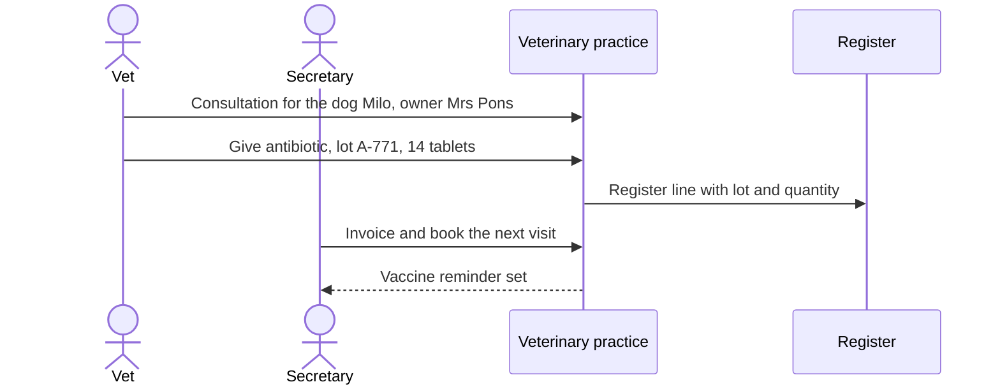

🏠 [Specs](../../../../README.md) › 🏷️ [Sectors](../../../README.md) › 🩺 [SC09 Health practices](../../README.md) ›
📝 [Use cases](../README.md) › 📝 [Use cases: FL-SC09-07 Pharmacy, eyewear, vets, dental and health centres](README.md) ›
📝 UC-SC09-23 Run a veterinary practice

# 📝 UC-SC09-23 Run a veterinary practice

**Status:** ✅ specified

## Summary

A veterinary practice cares for animals owned by clients. The vet keeps a record per animal (species, identification,
vaccines, treatments), prescribes and gives medicines, and writes each medicine that leaves the practice in the register
the law requires. The secretary books the visits and the owner receives reminders for vaccines.

## Personas

- [U36 Professional](../../../../01-users/personas/u36-professional.md)
- [U33 Medical secretary](../../../../01-users/personas/u33-medical-secretary.md)

## Goal

Every animal has its record, every medicine given or sold is written in the register with its lot, and the owner is
reminded of what is due.

## Trigger

An owner brings an animal, a medicine is given or sold, or a vaccine falls due.

## Frequency

Twenty to sixty consultations a day in a practice.

## Preconditions

- The owner is a customer record
  ([E-F6-01](../../../../02-functional/f06-customers-and-sales/data/e-f06-01-customer-record.md)).
- The medicines are stock items with their lots
  ([E-F7-06 Item](../../../../02-functional/f07-purchasing-and-stock/data/e-f07-06-item.md)).
- The practice's vets and their order numbers are recorded
  ([E-F9-01](../../../../02-functional/f09-hr-and-projects/data/e-f09-01-employee-record.md)).

## Postconditions

- **Succeeded:** the animal is saved ([E-SC09-16 Animal](../../data/e-sc09-16-animal.md)) with its acts and treatments;
  each medicine given is in the register with its lot and quantity.
- **Failed:** no medicine leaves the practice without its register line; the missing identification or prescription is
  shown.

## Main flow

1. The vet opens the veterinary screen
   ([S-SC09-23](../../screens/07-pharmacy-vets-dental-and-centres/s-sc09-23-veterinary.md)) and finds or creates the
   animal under its owner, with species, breed, birth date and identification number.
2. The vet records the consultation: findings, acts and treatment, in the animal's record
   ([UC-SC09-04](../02-patient-file-and-care/uc-sc09-04-keep-the-clinical-record.md)).
3. The vet gives or sells a medicine: the screen asks for the lot and the quantity and writes the register line
   ([BR-SC09-18](../../business-rules/br-sc09-18-dispensed-medicines-enter-the-register.md)).
4. The secretary invoices the owner
   [UC-F6-06](../../../../02-functional/f06-customers-and-sales/use-cases/03-invoice-and-get-paid/uc-f06-06-invoice-deposits-progress-and-final.md)
   and books the next visit ([UC-SC09-01](../01-appointments/uc-sc09-01-book-appointments-online-and-at-the-desk.md)).
5. When a vaccine falls due, the owner receives a reminder and the secretary books the visit.
6. When the animal dies or leaves, it is closed with its date and the record is kept.

## Alternative flows

- 2a. The animal belongs to a farm: the record is kept per herd or batch, with the farmer as the owner.
- 3a. The medicine is only prescribed: the prescription is given to the owner, the register is not written and the
  prescription is kept in the record.
- 1a. The owner changes: the animal is moved to the new owner and the old link is kept in the history.

## Error flows

- 1e. The animal has no identification where the law asks for one: the vet is told, and the act may go on after the
  reason is recorded.
- 3e. The lot is not given: the medicine cannot be given in the system and the register line is not written.
- 3e. The medicine is not allowed for the species: a warning is shown and the vet confirms or changes it.
- Any step: a service does not answer; the call is retried first
  ([BR-F3-32](../../../../02-functional/f03-assistant/business-rules/br-f03-32-retry-before-an-error.md)), then the
  message follows the error pattern ([D122](../../../../06-decisions/ux/d122-error-message-standard.md)) and what the
  user typed stays on the screen.

## Business rules

- [BR-SC09-18](../../business-rules/br-sc09-18-dispensed-medicines-enter-the-register.md)
- [BR-SC09-03 Secrecy by default](../../business-rules/br-sc09-03-secrecy-by-default.md)
- [BR-SC09-13 Sterilisation traced](../../business-rules/br-sc09-13-sterilisation-traced.md)
- [BR-SC09-04](../../business-rules/br-sc09-04-fees-shown-before-the-act.md)

## Entities

- [E-SC09-16 Animal](../../data/e-sc09-16-animal.md): created, changed, closed
- [E-SC09-03 Clinical record entry](../../data/e-sc09-03-clinical-record-entry.md): created, the consultation entry in
  the animal's record
- [E-F6-01](../../../../02-functional/f06-customers-and-sales/data/e-f06-01-customer-record.md): read, the owner
- [E-F7-06 Item](../../../../02-functional/f07-purchasing-and-stock/data/e-f07-06-item.md): changed, the medicine and
  its lot

## Permissions

Vet records acts, treatments and the register; secretary books and invoices. The owner sees their animals'
vaccine dates and invoices in the portal.

## Notifications

The owner, with their consent: a vaccine falls due, a visit is booked. The vet: a lot is recalled.

## Audit events

Each animal created, each act and treatment, each register line with lot, quantity and vet; each change of owner; who
and when.

## AI involvement

No AI step of its own. The AI assistant may open the screen and prefill it from the user's words; the user checks and
confirms
[BR-F3-07](../../../../02-functional/f03-assistant/business-rules/br-f03-07-no-deletes-no-irreversible-acts.md).

## API, MCP and A2A exposure

T5 operations of the capability for the personas above: create, read, update and list. The MCP tool of the
capability may read and propose, never confirm alone. No A2A skill.

## Screens

- [S-SC09-23](../../screens/07-pharmacy-vets-dental-and-centres/s-sc09-23-veterinary.md)

## Flowchart

See
[FL-SC09-07 Pharmacy, eyewear, vets, dental and health centres](../../flows/fl-sc09-07-pharmacy-vets-dental-and-centres.md#flowchart).

## Sequence diagram

## Acceptance criteria

1. **Given** a medicine given with its lot and quantity **when** the vet records it **then** a register line is written
   with the lot, quantity, animal and vet.
2. **Given** a medicine given without a lot **when** the vet saves it **then** it is refused and no register line
   exists.
3. **Given** a vaccine due in 14 days **when** the day comes **then** the owner receives a reminder.
4. **Given** an animal moved to a new owner **when** the secretary changes the owner **then** the history keeps the old
   owner.

## Non-functional notes

The screen answers within 2 seconds for 10,000 records; every change is audited.

## Regulatory references

A veterinary practice keeps a register of the medicines it gives or sells to animals, with the animal, the
medicine, the lot, the quantity, the date and the vet, kept for a set number of years; some animals must carry an
identification. Vets are registered with their professional order. The France-pack rule is written later. Related:
[CR-FR-137](../../../../10-country-packs/france/health-practice/cr-fr-137-medical-secrecy.md),
[CR-FR-055](../../../../10-country-packs/france/data-protection/cr-fr-055-health-data-hosting.md).

## Related use cases

- [UC-SC09-22 Sell eyewear to a prescription](uc-sc09-22-sell-eyewear-to-a-prescription.md)
- [UC-SC09-24](uc-sc09-24-quote-dental-work-with-the-regulated-quote.md)
- [UC-SC09-04](../02-patient-file-and-care/uc-sc09-04-keep-the-clinical-record.md)
- [UC-SC09-14](../05-practice-organisation/uc-sc09-14-trace-consumables-and-sterilisation.md)

## Open questions

None.

---

⬅️ [UC-SC09-22 Sell eyewear to a prescription](uc-sc09-22-sell-eyewear-to-a-prescription.md) · ⬆️ [Up](README.md) ·
➡️ [UC-SC09-24 Quote dental work with the regulated quote](uc-sc09-24-quote-dental-work-with-the-regulated-quote.md)
