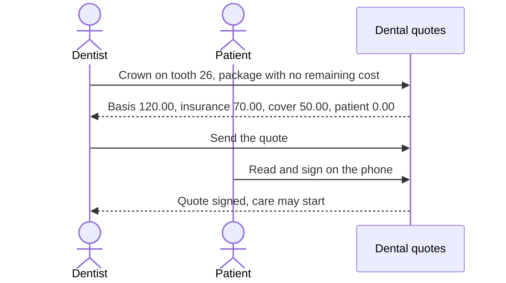

🏠 [Specs](../../../../README.md) › 🏷️ [Sectors](../../../README.md) › 🩺 [SC09 Health practices](../../README.md) ›
📝 [Use cases](../README.md) › 📝 [Use cases: FL-SC09-07 Pharmacy, eyewear, vets, dental and health centres](README.md) ›
📝 UC-SC09-24 Quote dental work with the regulated quote

# 📝 UC-SC09-24 Quote dental work with the regulated quote

**Status:** 🔄 waiting for the owner

## Summary

A dentist quotes prosthetic work (crowns, bridges, dentures) with the regulated quote. The quote lists each act with its
price, the basis of the health insurance, the complementary cover and the patient's remaining cost, and shows whether
the work belongs to the package with no remaining cost. The patient reads and signs it before any prosthetic care
starts.

## Personas

- [U36 Professional](../../../../01-users/personas/u36-professional.md)
- [U09 Customer](../../../../01-users/personas/u09-customer.md)

## Goal

No prosthetic care starts before the patient has the regulated quote, with the right shares and the signed agreement,
and the patient pays what the quote said.

## Trigger

The dentist plans prosthetic work, the patient asks for a quote, or the patient signs.

## Frequency

A few quotes a week in a dental practice.

## Preconditions

- The patient exists with their insurance and cover ([E-SC09-02 Patient](../../data/e-sc09-02-patient.md)).
- The practice's price list and the acts of the national scale are loaded.
- The clinical plan is recorded ([E-SC09-03 Clinical record entry](../../data/e-sc09-03-clinical-record-entry.md)).

## Postconditions

- **Succeeded:** the quote is saved ([E-SC09-17 Dental quote](../../data/e-sc09-17-dental-quote.md)) with each act, its
  price and shares; the patient has signed and the care may start.
- **Failed:** the care is not planned as prosthetic; the missing signature or the missing quote is shown.

## Main flow

1. The dentist opens the dental quotes screen
   ([S-SC09-24](../../screens/07-pharmacy-vets-dental-and-centres/s-sc09-24-dental-quotes.md)) and chooses the patient
   and the teeth concerned.
2. The dentist adds each act from the national scale or the practice's list; the screen shows the basis, the health
   insurance's share, the cover's share and the patient's remaining cost.
3. The screen shows, per act, whether it belongs to the package with no remaining cost, with its price cap.
4. The quote is sent to the patient on the phone
   ([UC-SC09-08](../03-insurance-billing/uc-sc09-08-bill-patients-and-show-fees.md)); the patient reads it and signs
   ([BR-SC09-19](../../business-rules/br-sc09-19-prosthetics-need-the-regulated-quote-before-care.md)).
5. The care starts and each act done is linked to its line of the quote.
6. When all acts are done, the quote is Completed and the invoice is prepared.

## Alternative flows

- 2a. Two options are offered (one in the package with no remaining cost, one outside it): the quote shows both and the
  patient chooses one.
- 4a. The patient wants to think: the quote stays Sent and the dentist is reminded after the delay set.
- 5a. The plan changes during the care: a new version of the quote is made and signed again.

## Error flows

- 4e. The patient has not signed: the prosthetic acts cannot be marked as planned and the screen explains why.
- 2e. An act has no price on the practice's list: the quote cannot be sent until the price is set.
- 5e. An act is done outside its quote line: it is flagged and the dentist must correct the quote.
- Any step: a service does not answer; the call is retried first
  ([BR-F3-32](../../../../02-functional/f03-assistant/business-rules/br-f03-32-retry-before-an-error.md)), then the
  message follows the error pattern ([D122](../../../../06-decisions/ux/d122-error-message-standard.md)) and what the
  user typed stays on the screen.

## Business rules

- [BR-SC09-19](../../business-rules/br-sc09-19-prosthetics-need-the-regulated-quote-before-care.md)
- [BR-SC09-04](../../business-rules/br-sc09-04-fees-shown-before-the-act.md)
- [BR-SC09-06](../../business-rules/br-sc09-06-third-party-payment-when-due.md)

## Entities

- [E-SC09-17 Dental quote](../../data/e-sc09-17-dental-quote.md): created, changed
- [E-SC09-03 Clinical record entry](../../data/e-sc09-03-clinical-record-entry.md): read, the clinical plan
- [E-SC09-07 Patient invoice](../../data/e-sc09-07-patient-invoice.md): created, the invoice of the quote
- [E-SC09-02 Patient](../../data/e-sc09-02-patient.md): read, the patient and their cover

## Permissions

Dentist writes and changes quotes; secretary sends them and prepares the invoice. The patient reads and signs
their own quote only.

## Notifications

The patient, by the portal or phone: the quote to read and sign; a reminder if unsigned. The dentist: a quote waiting
for signature after 14 days.

## Audit events

Each quote created, sent, signed, changed or completed, with the acts, the prices, the shares and who and when; each
signature with its time.

## AI involvement

No AI step of its own. The AI assistant may open the screen and prefill it from the user's words; the user checks and
confirms
[BR-F3-07](../../../../02-functional/f03-assistant/business-rules/br-f03-07-no-deletes-no-irreversible-acts.md).

## API, MCP and A2A exposure

T5 operations of the capability for the personas above: create, read, update and list. The MCP tool of the
capability may read and propose, never confirm alone. No A2A skill.

## Screens

- [S-SC09-24](../../screens/07-pharmacy-vets-dental-and-centres/s-sc09-24-dental-quotes.md)

## Flowchart

See
[FL-SC09-07 Pharmacy, eyewear, vets, dental and health centres](../../flows/fl-sc09-07-pharmacy-vets-dental-and-centres.md#flowchart).

## Sequence diagram

## Acceptance criteria

1. **Given** a crown in the package with no remaining cost, with a capped price **when** the dentist prepares the quote
   **then** the patient's remaining cost shows 0.00 EUR.
2. **Given** a quote that the patient has not signed **when** the dentist plans the prosthetic care **then** it is
   refused until the signature.
3. **Given** two options on one quote **when** the patient signs one **then** only the signed option may be done.
4. **Given** an act done outside its quote line **when** the dentist records it **then** it is flagged for correction.

## Non-functional notes

The screen answers within 2 seconds for 10,000 records; every change is audited.

## Regulatory references

Before prosthetic care the dentist gives the patient a written quote that states each act, its price, the
amount the health insurance and the complementary cover cover, and the remaining cost, and the patient accepts it before
the care. Some prosthetic acts belong to a package with no remaining cost, with price caps. The France-pack rule is
listed below. Related: [CR-FR-130](../../../../10-country-packs/france/health-practice/cr-fr-130-fee-display.md),
[CR-FR-133](../../../../10-country-packs/france/health-practice/cr-fr-133-third-party-payment.md).

- France-pack rule, (Proposed) until its law is read:
  [CR-FR-238 Regulated dental quote](../../../../10-country-packs/france/health-practice/cr-fr-238-dental-regulated-quote.md)

## Related use cases

- [UC-SC09-23 Run a veterinary practice](uc-sc09-23-run-a-veterinary-practice.md)
- [UC-SC09-25 Run a health centre](uc-sc09-25-run-a-health-centre.md)
- [UC-SC09-08](../03-insurance-billing/uc-sc09-08-bill-patients-and-show-fees.md)
- [UC-SC09-06](../03-insurance-billing/uc-sc09-06-bill-health-insurance-with-the-carte-vitale.md)

## Open questions

None.

---

⬅️ [UC-SC09-23 Run a veterinary practice](uc-sc09-23-run-a-veterinary-practice.md) · ⬆️ [Up](README.md) ·
➡️ [UC-SC09-25 Run a health centre](uc-sc09-25-run-a-health-centre.md)
