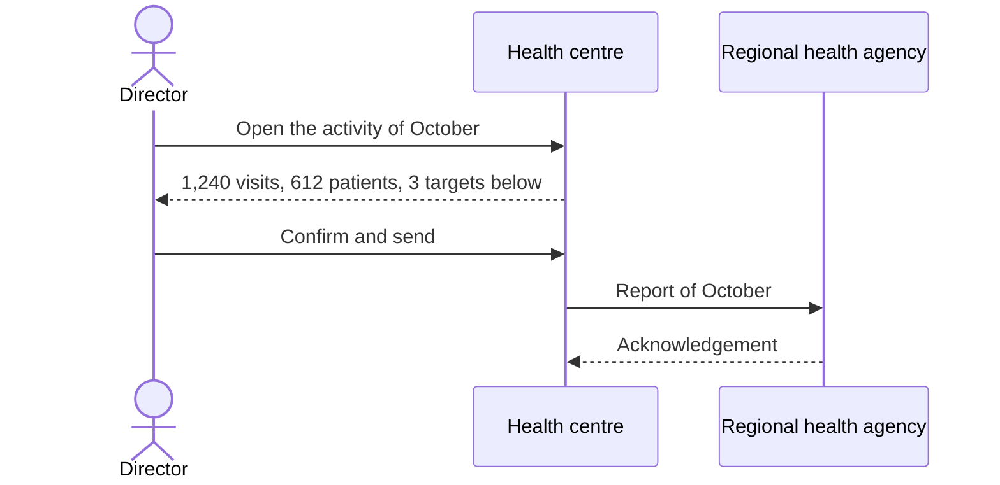

🏠 [Specs](../../../../README.md) › 🏷️ [Sectors](../../../README.md) › 🩺 [SC09 Health practices](../../README.md) ›
📝 [Use cases](../README.md) › 📝 [Use cases: FL-SC09-07 Pharmacy, eyewear, vets, dental and health centres](README.md) ›
📝 UC-SC09-25 Run a health centre

# 📝 UC-SC09-25 Run a health centre

**Status:** ✅ specified

## Summary

A health centre employs salaried doctors, nurses and dentists and runs under a health project approved by the regional
health agency. The secretary books the visits, the director follows the activity (visits, patients, hours) and the
centre reports it to the agency on the dates it asks.

## Personas

- [U33 Medical secretary](../../../../01-users/personas/u33-medical-secretary.md)
- [U13 Owner](../../../../01-users/personas/u13-owner.md)

## Goal

The centre's activity is counted from the records and reported to the regional health agency on time, and the director
sees it against the health project.

## Trigger

A month or a year ends, the agency asks for a report, or the director opens the activity view.

## Frequency

A monthly count, a yearly report.

## Preconditions

- The centre's practitioners are employees with their qualifications
  ([E-F9-01](../../../../02-functional/f09-hr-and-projects/data/e-f09-01-employee-record.md)).
- Appointments and patients are recorded ([E-SC09-01 Appointment](../../data/e-sc09-01-appointment.md),
  [E-SC09-02 Patient](../../data/e-sc09-02-patient.md)).

## Postconditions

- **Succeeded:** the activity of the period is saved
  ([E-SC09-18 Centre activity](../../data/e-sc09-18-centre-activity.md)), checked and sent to the agency, with the proof
  of the sending.
- **Failed:** nothing is sent; the missing figure or the practitioner without a qualification is listed.

## Main flow

1. The director opens the health centre screen
   ([S-SC09-25](../../screens/07-pharmacy-vets-dental-and-centres/s-sc09-25-health-centre.md)) and chooses the period.
2. SimpleERP counts the visits, patients and practitioner hours per profession from the appointments and the care
   sheets ([UC-SC09-18](../06-compliance-and-certification/uc-sc09-18-report-activity-and-quality-indicators.md)).
3. The screen compares the count with the health project's targets and shows the gaps.
4. The director checks and confirms the activity; the report is prepared in the agency's format
   ([BR-SC09-20](../../business-rules/br-sc09-20-activity-is-reported-to-the-regional-health-agency.md)).
5. The report is sent and the agency's acknowledgement is stored with it.
6. The period is Reported and its figures are locked.

## Alternative flows

- 3a. A target is not reached: the director adds a comment to explain, which goes with the report.
- 4a. The agency asks for a correction: the report is reopened, corrected and sent again with the reason.
- 2a. A practitioner works in two places: only the hours in the centre are counted.

## Error flows

- 2e. A visit has no practitioner or profession: it cannot be counted and is listed to correct.
- 5e. The agency's channel does not answer: the report stays Confirmed and is retried; the director is told.
- 4e. The period is not complete (missing care sheets): the director is warned before sending.
- Any step: a service does not answer; the call is retried first
  ([BR-F3-32](../../../../02-functional/f03-assistant/business-rules/br-f03-32-retry-before-an-error.md)), then the
  message follows the error pattern ([D122](../../../../06-decisions/ux/d122-error-message-standard.md)) and what the
  user typed stays on the screen.

## Business rules

- [BR-SC09-20](../../business-rules/br-sc09-20-activity-is-reported-to-the-regional-health-agency.md)
- [BR-SC09-03 Secrecy by default](../../business-rules/br-sc09-03-secrecy-by-default.md)
- [BR-SC09-02](../../business-rules/br-sc09-02-health-data-only-on-certified-hosting.md)

## Entities

- [E-SC09-18 Centre activity](../../data/e-sc09-18-centre-activity.md): created, changed
- [E-SC09-01 Appointment](../../data/e-sc09-01-appointment.md): read, the visits of the period
- [E-SC09-05 Care sheet](../../data/e-sc09-05-care-sheet.md): read, the care sheets
- [E-F9-01](../../../../02-functional/f09-hr-and-projects/data/e-f09-01-employee-record.md): read, the practitioners and
  their hours

## Permissions

Director confirms and sends reports; secretary prepares counts. Only aggregated figures leave the centre,
never a patient's identity.

## Notifications

The director, in the app: a report is due in 14 days, the agency has acknowledged or asked for a correction.

## Audit events

Each count, confirmation, sending and correction, with the figures, the period, who and when; each acknowledgement.

## AI involvement

No AI step of its own. The AI assistant may open the screen and prefill it from the user's words; the user checks and
confirms
[BR-F3-07](../../../../02-functional/f03-assistant/business-rules/br-f03-07-no-deletes-no-irreversible-acts.md).

## API, MCP and A2A exposure

T5 operations of the capability for the personas above: create, read, update and list. The MCP tool of the
capability may read and propose, never confirm alone. No A2A skill.

## Screens

- [S-SC09-25](../../screens/07-pharmacy-vets-dental-and-centres/s-sc09-25-health-centre.md)

## Flowchart

See
[FL-SC09-07 Pharmacy, eyewear, vets, dental and health centres](../../flows/fl-sc09-07-pharmacy-vets-dental-and-centres.md#flowchart).

## Sequence diagram

## Acceptance criteria

1. **Given** a month with 1,240 visits in the appointments **when** the director opens the activity **then** the count
   shows 1,240 visits.
2. **Given** a visit with no practitioner **when** the count is prepared **then** the visit is listed to correct.
3. **Given** a report sent and acknowledged **when** the period is closed **then** the figures are locked.
4. **Given** the agency asks for a correction **when** the director reopens the period **then** a corrected report is
   sent with the reason.

## Non-functional notes

The screen answers within 2 seconds for 10,000 records; every change is audited.

## Regulatory references

A health centre works under a health project approved by the regional health agency, employs salaried health
professionals, applies the third-party payment and sends the agency its activity report on the dates the agency sets.
The France-pack rule is [CR-FR-287 Health centres (centres de santé)](../../../../10-country-packs/france/health-practice/cr-fr-287-health-centres.md). Related:
[CR-FR-133](../../../../10-country-packs/france/health-practice/cr-fr-133-third-party-payment.md),
[CR-FR-137](../../../../10-country-packs/france/health-practice/cr-fr-137-medical-secrecy.md).

## Related use cases

- [UC-SC09-24](uc-sc09-24-quote-dental-work-with-the-regulated-quote.md)
- [UC-SC09-26 Run a multi-professional practice](uc-sc09-26-run-a-multi-professional-practice.md)
- [UC-SC09-18](../06-compliance-and-certification/uc-sc09-18-report-activity-and-quality-indicators.md)
- [UC-SC09-15](../05-practice-organisation/uc-sc09-15-keep-practice-accounts.md)

## Open questions

None.

---

⬅️ [UC-SC09-24 Quote dental work with the regulated quote](uc-sc09-24-quote-dental-work-with-the-regulated-quote.md) ·
⬆️ [Up](README.md) ·
➡️ [UC-SC09-26 Run a multi-professional practice](uc-sc09-26-run-a-multi-professional-practice.md)
