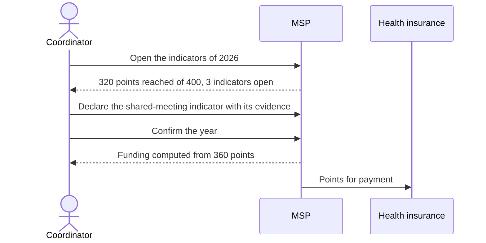

🏠 [Specs](../../../../README.md) › 🏷️ [Sectors](../../../README.md) › 🩺 [SC09 Health practices](../../README.md) ›
📝 [Use cases](../README.md) › 📝 [Use cases: FL-SC09-07 Pharmacy, eyewear, vets, dental and health centres](README.md) ›
📝 UC-SC09-26 Run a multi-professional practice

# 📝 UC-SC09-26 Run a multi-professional practice

**Status:** ✅ specified

## Summary

A multi-professional practice (MSP) groups doctors, nurses and other professionals under one health project. The
coordinator follows the indicators the health insurance sets for the team's funding, the patients served by the team,
and the yearly points reached; the practice receives its funding according to those points.

## Personas

- [U33 Medical secretary](../../../../01-users/personas/u33-medical-secretary.md)
- [U36 Professional](../../../../01-users/personas/u36-professional.md)

## Goal

The team sees each indicator of its funding contract against its target during the year, and the yearly funding is
computed from the points reached.

## Trigger

A new year starts, an indicator changes, or the year ends and the funding is computed.

## Frequency

Indicators refreshed monthly; one funding computation a year.

## Preconditions

- The practice has signed its funding contract with the health insurance.
- The patients, appointments and care are recorded ([E-SC09-02 Patient](../../data/e-sc09-02-patient.md),
  [E-SC09-01 Appointment](../../data/e-sc09-01-appointment.md)).

## Postconditions

- **Succeeded:** the indicators are saved ([E-SC09-19 ACI indicator](../../data/e-sc09-19-aci-indicator.md)) with their
  value and points; the funding of the year is computed and kept.
- **Failed:** no funding amount is shown; the indicator without a source is listed.

## Main flow

1. The coordinator opens the MSP screen
   ([S-SC09-26](../../screens/07-pharmacy-vets-dental-and-centres/s-sc09-26-msp.md)) and sees the indicators of the
   contract: access to care, team work, information system and others.
2. simple-ERP computes each indicator from the practice's records (patients served, opening hours, shared meetings,
   certified software) and shows the points
   ([BR-SC09-21](../../business-rules/br-sc09-21-aci-funding-follows-the-indicators-reached.md)).
3. The coordinator enters the indicators the system cannot count, with their evidence.
4. The screen shows the points reached, the points still possible and the estimated funding.
5. At the end of the year the coordinator confirms the points; the funding is computed and sent for payment to the
   practice.
6. The partners share the funding as the practice's rules say
   ([UC-SC09-13](../05-practice-organisation/uc-sc09-13-share-costs-between-partners.md)).

## Alternative flows

- 3a. An indicator is declared by the practice: its evidence is attached and it is marked as declared.
- 2a. A professional leaves the team: the indicators that depend on the team are recomputed.
- 5a. The health insurance corrects the points: the funding is recomputed and the difference is shown.

## Error flows

- 2e. An indicator has no source in the records: it is shown with no value and the missing source is named.
- 5e. The points are confirmed before the year ends: the coordinator is warned and the confirmation is kept as
  provisional.
- 4e. The estimated funding differs from the contract's rule by more than the margin: the screen flags it.
- Any step: a service does not answer; the call is retried first
  ([BR-F3-32](../../../../02-functional/f03-assistant/business-rules/br-f03-32-retry-before-an-error.md)), then the
  message follows the error pattern ([D122](../../../../06-decisions/ux/d122-error-message-standard.md)) and what the
  user typed stays on the screen.

## Business rules

- [BR-SC09-21](../../business-rules/br-sc09-21-aci-funding-follows-the-indicators-reached.md)
- [BR-SC09-12 Costs shared by the key](../../business-rules/br-sc09-12-costs-shared-by-the-key.md)
- [BR-SC09-15](../../business-rules/br-sc09-15-certifications-kept-current.md)

## Entities

- [E-SC09-19 ACI indicator](../../data/e-sc09-19-aci-indicator.md): created, changed
- [E-SC09-10 Shared cost](../../data/e-sc09-10-shared-cost.md): read, the shared costs the funding helps pay
- [E-SC09-13 Certified module](../../data/e-sc09-13-certified-module.md): read, the certified software indicator
- [E-SC09-02 Patient](../../data/e-sc09-02-patient.md): read, the patients served

## Permissions

Coordinator enters and confirms indicators; the practitioners read them. Only totals leave the practice,
never a patient's identity.

## Notifications

The coordinator and the partners, in the app: an indicator falls below its target, the year ends in 60 days.

## Audit events

Each indicator computed, entered, evidenced or confirmed, and each funding computation, with who, when and the values.

## AI involvement

No AI step of its own. The AI assistant may open the screen and prefill it from the user's words; the user checks and
confirms
[BR-F3-07](../../../../02-functional/f03-assistant/business-rules/br-f03-07-no-deletes-no-irreversible-acts.md).

## API, MCP and A2A exposure

T5 operations of the capability for the personas above: create, read, update and list. The MCP tool of the
capability may read and propose, never confirm alone. No A2A skill.

## Screens

- [S-SC09-26](../../screens/07-pharmacy-vets-dental-and-centres/s-sc09-26-msp.md)

## Flowchart

See
[FL-SC09-07 Pharmacy, eyewear, vets, dental and health centres](../../flows/fl-sc09-07-pharmacy-vets-dental-and-centres.md#flowchart).

## Sequence diagram

## Acceptance criteria

1. **Given** an indicator counted from the practice's records **when** the coordinator opens the screen **then** its
   value and points are shown with their source.
2. **Given** an indicator the system cannot count **when** the coordinator declares it with evidence **then** it is
   marked as declared.
3. **Given** 360 points of 400 and a funding rule per point **when** the year is confirmed **then** the funding is
   computed from 360 points.
4. **Given** the year not yet ended **when** the coordinator confirms the points **then** the confirmation is kept as
   provisional.

## Non-functional notes

The screen answers within 2 seconds for 10,000 records; every change is audited.

## Regulatory references

A multi-professional practice may sign a funding contract with the health insurance. The yearly funding
follows a set of indicators (access to care, team work, information system) that earn points, and the amount follows the
points reached. The indicators, their points and the amounts are data of the France pack, written later. Related:
[CR-FR-136](../../../../10-country-packs/france/health-practice/cr-fr-136-segur-labels.md),
[CR-FR-133](../../../../10-country-packs/france/health-practice/cr-fr-133-third-party-payment.md).

## Related use cases

- [UC-SC09-25 Run a health centre](uc-sc09-25-run-a-health-centre.md)
- [UC-SC09-13](../05-practice-organisation/uc-sc09-13-share-costs-between-partners.md)
- [UC-SC09-18](../06-compliance-and-certification/uc-sc09-18-report-activity-and-quality-indicators.md)

## Open questions

None.

---

⬅️ [UC-SC09-25 Run a health centre](uc-sc09-25-run-a-health-centre.md) · ⬆️ [Up](README.md)
