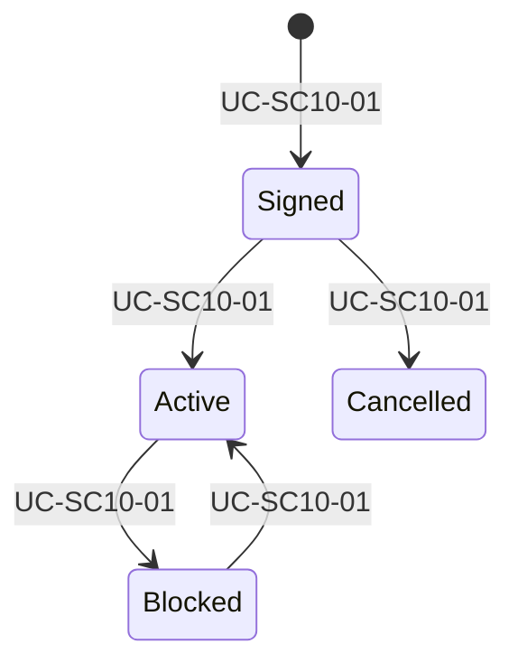

🏠 [Specs](../../../README.md) › 🏷️ [Sectors](../../README.md) › 🏘️ [SC10 Real estate](../README.md) ›
🗃️ [Data](README.md) › 🗃️ E-SC10-01 Mandate

# 🗃️ E-SC10-01 Mandate

**Status:** ✅ specified

## Purpose

A sale or letting mandate.

## Fields

| Name | Type | Required | Validation | Default | Example | Personal data | Custom fields |
|---|---|---|---|---|---|---|---|
| number, kind | register number, sale or letting | yes | BR-SC10-02 | auto | 2026-118, sale | no | no |
| owner, property, price | records | yes | - | - | J. Petit, flat Lyon 3, 320 000 | yes | no |
| exclusive, end | yes or no, date | yes | - | no | 2027-02 | no | no |

## Relations

As its use cases.

## Lifecycle

## Indexes and search

By number, date, partner.

## Retention

Kept for the period of its kind of record in the country pack (D293), or else its kind's default in the
[retention schedule](../../../05-non-functional/data-retention.md).

## Audit

Every change.

## Import and export

CSV, FEC where relevant.

## Used by

- [UC-SC10-01](../use-cases/01-mandates-and-listings/uc-sc10-01-take-a-mandate-and-record-it-in-the-register.md)

## Open questions

None.

---

⬆️ [Up](README.md) · ➡️ [E-SC10-02 Property listing](e-sc10-02-property-listing.md)
