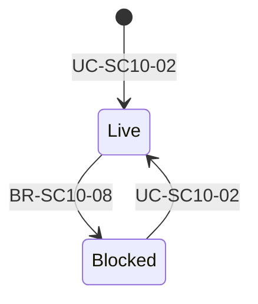

🏠 [Specs](../../../README.md) › 🏷️ [Sectors](../../README.md) › 🏘️ [SC10 Real estate](../README.md) ›
🗃️ [Data](README.md) › 🗃️ E-SC10-02 Property listing

# 🗃️ E-SC10-02 Property listing

**Status:** ✅ specified

## Purpose

A property advertised.

## Fields

| Name | Type | Required | Validation | Default | Example | Personal data | Custom fields |
|---|---|---|---|---|---|---|---|
| mandate, portals | records | yes | BR-SC10-08 | - | 2026-118, 3 portals | no | no |
| text, photos, energy rating | records | yes | - | - | C | no | no |

## Relations

As its use cases.

## Lifecycle

## Indexes and search

By number, date, partner.

## Retention

Kept for the period of its kind of record in the country pack (D293), or else its kind's default in the
[retention schedule](../../../05-non-functional/data-retention.md).

## Audit

Every change.

## Import and export

CSV, FEC where relevant.

## Used by

- [UC-SC10-02](../use-cases/01-mandates-and-listings/uc-sc10-02-publish-listings-on-portals.md)

## Open questions

None.

---

⬅️ [E-SC10-01 Mandate](e-sc10-01-mandate.md) · ⬆️ [Up](README.md) · ➡️ [E-SC10-03 Viewing](e-sc10-03-viewing.md)
