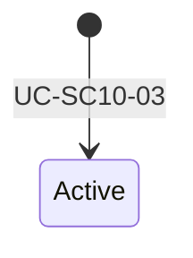

🏠 [Specs](../../../README.md) › 🏷️ [Sectors](../../README.md) › 🏘️ [SC10 Real estate](../README.md) ›
🗃️ [Data](README.md) › 🗃️ E-SC10-03 Viewing

# 🗃️ E-SC10-03 Viewing

**Status:** ✅ specified

## Purpose

A visit with a prospect.

## Fields

| Name | Type | Required | Validation | Default | Example | Personal data | Custom fields |
|---|---|---|---|---|---|---|---|
| listing, prospect, slot | records | yes | - | - | 2026-118, A. Bauer, Sat 10:00 | yes | no |
| feedback | text | no | - | - | likes the light | no | no |

## Relations

As its use cases.

## Lifecycle

## Indexes and search

By number, date, partner.

## Retention

Kept for the period of its kind of record in the country pack (D293), or else its kind's default in the
[retention schedule](../../../05-non-functional/data-retention.md).

## Audit

Every change.

## Import and export

CSV, FEC where relevant.

## Used by

- [UC-SC10-03](../use-cases/02-sales/uc-sc10-03-organise-viewings.md)

## Open questions

None.

---

⬅️ [E-SC10-02 Property listing](e-sc10-02-property-listing.md) · ⬆️ [Up](README.md) ·
➡️ [E-SC10-04 Offer](e-sc10-04-offer.md)
