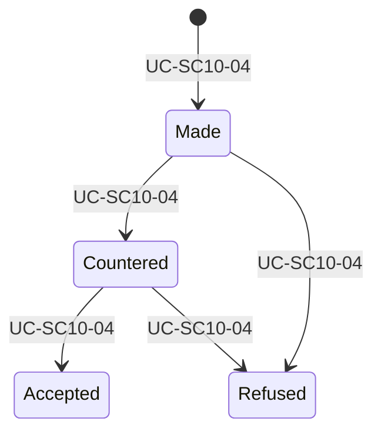

🏠 [Specs](../../../README.md) › 🏷️ [Sectors](../../README.md) › 🏘️ [SC10 Real estate](../README.md) ›
🗃️ [Data](README.md) › 🗃️ E-SC10-04 Offer

# 🗃️ E-SC10-04 Offer

**Status:** 🔄 waiting for the owner

## Purpose

A purchase offer.

## Fields

| Name | Type | Required | Validation | Default | Example | Personal data | Custom fields |
|---|---|---|---|---|---|---|---|
| listing, buyer, amount | records | yes | - | - | 2026-118, A. Bauer, 310 000 | yes | no |
| state | made, countered, accepted, refused | yes | - | made | accepted | no | no |

## Relations

(Proposed) As its use cases.

## Lifecycle

## Indexes and search

(Proposed) By number, date, partner.

## Retention

Kept for the period of its kind of record in the country pack (D293), or else its kind's default in the
[retention schedule](../../../05-non-functional/data-retention.md).

## Audit

Every change.

## Import and export

(Proposed) CSV, FEC where relevant.

## Used by

- [UC-SC10-04](../use-cases/02-sales/uc-sc10-04-receive-offers-and-prepare-the-sale-agreement.md)

## Open questions

None.

---

⬅️ [E-SC10-03 Viewing](e-sc10-03-viewing.md) · ⬆️ [Up](README.md) ·
➡️ [E-SC10-05 Client fund](e-sc10-05-client-fund.md)
