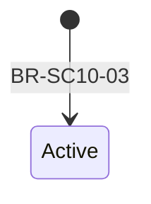

🏠 [Specs](../../../README.md) › 🏷️ [Sectors](../../README.md) › 🏘️ [SC10 Real estate](../README.md) ›
🗃️ [Data](README.md) › 🗃️ E-SC10-05 Client fund

# 🗃️ E-SC10-05 Client fund

**Status:** 🔄 waiting for the owner

## Purpose

Money held for a client and its purpose (a sale deposit, rents to pass on); the ledger itself is the shared
[E-F8-17 Client money ledger](../../../02-functional/f08-accounting/data/e-f08-17-client-money-ledger.md),
[UC-F8-21](../../../02-functional/f08-accounting/use-cases/07-client-money-grants-and-non-profits/uc-f08-21-keep-third-party-client-money.md).

## Fields

| Name | Type | Required | Validation | Default | Example | Personal data | Custom fields |
|---|---|---|---|---|---|---|---|
| client, amount, purpose | records | yes | BR-SC10-03 | - | A. Bauer, 15 500, sale deposit | yes | no |
| account | client account | yes | - | - | escrow 1 | no | no |

## Relations

(Proposed) As its use cases.

## Lifecycle

## Indexes and search

(Proposed) By number, date, partner.

## Retention

As an accounting record:
[CR-FR-002 Accounting records kept 10 years](../../../10-country-packs/france/accounting/cr-fr-002-accounting-records-kept-ten-years.md).

## Audit

Every change.

## Import and export

(Proposed) CSV, FEC where relevant.

## Used by

- [UC-SC10-05](../use-cases/02-sales/uc-sc10-05-hold-client-funds-under-the-guarantee.md)

## Open questions

None.

---

⬅️ [E-SC10-04 Offer](e-sc10-04-offer.md) · ⬆️ [Up](README.md) · ➡️ [E-SC10-06 Fee scale](e-sc10-06-fee-scale.md)
