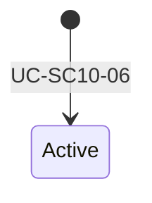

🏠 [Specs](../../../README.md) › 🏷️ [Sectors](../../README.md) › 🏘️ [SC10 Real estate](../README.md) ›
🗃️ [Data](README.md) › 🗃️ E-SC10-06 Fee scale

# 🗃️ E-SC10-06 Fee scale

**Status:** ✅ specified

## Purpose

The agency's fees.

## Fields

| Name | Type | Required | Validation | Default | Example | Personal data | Custom fields |
|---|---|---|---|---|---|---|---|
| activity, bracket, rate | records | yes | - | - | sale, 200-400 k, 4 % | no | no |

## Relations

As its use cases.

## Lifecycle

## Indexes and search

By number, date, partner.

## Retention

Kept for the period of its kind of record in the country pack (D293), or else its kind's default in the
[retention schedule](../../../05-non-functional/data-retention.md).

## Audit

Every change.

## Import and export

CSV, FEC where relevant.

## Used by

- [UC-SC10-06](../use-cases/02-sales/uc-sc10-06-bill-and-display-agency-fees.md)

## Open questions

None.

---

⬅️ [E-SC10-05 Client fund](e-sc10-05-client-fund.md) · ⬆️ [Up](README.md) · ➡️ [E-SC10-07 Lease](e-sc10-07-lease.md)
