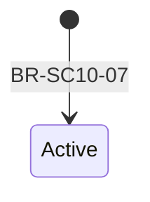

🏠 [Specs](../../../README.md) › 🏷️ [Sectors](../../README.md) › 🏘️ [SC10 Real estate](../README.md) ›
🗃️ [Data](README.md) › 🗃️ E-SC10-07 Lease

# 🗃️ E-SC10-07 Lease

**Status:** 🔄 waiting for the owner

## Purpose

A residential lease.

## Fields

| Name | Type | Required | Validation | Default | Example | Personal data | Custom fields |
|---|---|---|---|---|---|---|---|
| property, tenant, start | records | yes | BR-SC10-07 | - | flat Lyon 3, S. Roux, 1 Dec | yes | no |
| rent, charges, index clause | amounts, yes or no | yes | BR-SC10-06 | - | 800, 90, yes | no | no |
| energy rating | A to G | yes | - | - | D | no | no |

## Relations

(Proposed) As its use cases.

## Lifecycle

## Indexes and search

(Proposed) By number, date, partner.

## Retention

For the lease and its limitation periods, then deleted:
[CR-FR-052 Personal data kept no longer than needed](../../../10-country-packs/france/data-protection/cr-fr-052-storage-limitation.md).

## Audit

Every change.

## Import and export

(Proposed) CSV, FEC where relevant.

## Used by

- [UC-SC10-07](../use-cases/03-lettings/uc-sc10-07-let-a-property.md)
- [UC-SC10-09](../use-cases/04-rents-and-landlords/uc-sc10-09-index-rents-within-the-caps.md)
- [UC-SC10-20](../use-cases/06-portal-and-assistant/uc-sc10-20-ask-the-assistant-about-the-portfolio.md)

## Open questions

None.

---

⬅️ [E-SC10-06 Fee scale](e-sc10-06-fee-scale.md) · ⬆️ [Up](README.md) · ➡️ [E-SC10-08 Deposit](e-sc10-08-deposit.md)
