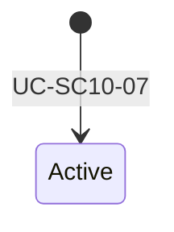

🏠 [Specs](../../../README.md) › 🏷️ [Sectors](../../README.md) › 🏘️ [SC10 Real estate](../README.md) ›
🗃️ [Data](README.md) › 🗃️ E-SC10-08 Deposit

# 🗃️ E-SC10-08 Deposit

**Status:** 🔄 waiting for the owner

## Purpose

A lease's deposit.

## Fields

| Name | Type | Required | Validation | Default | Example | Personal data | Custom fields |
|---|---|---|---|---|---|---|---|
| lease, amount | records | yes | BR-SC10-04 | - | S. Roux, 800 | yes | no |
| deductions, returned | amounts, date | no | - | - | 120, 2027-01-05 | no | no |

## Relations

(Proposed) As its use cases.

## Lifecycle

## Indexes and search

(Proposed) By number, date, partner.

## Retention

Kept for the period of its kind of record in the country pack (D293), or else its kind's default in the
[retention schedule](../../../05-non-functional/data-retention.md).

## Audit

Every change.

## Import and export

(Proposed) CSV, FEC where relevant.

## Used by

- [UC-SC10-07](../use-cases/03-lettings/uc-sc10-07-let-a-property.md)
- [UC-SC10-10](../use-cases/03-lettings/uc-sc10-10-manage-deposits-and-their-return.md)

## Open questions

None.

---

⬅️ [E-SC10-07 Lease](e-sc10-07-lease.md) · ⬆️ [Up](README.md) · ➡️ [E-SC10-09 Rent call](e-sc10-09-rent-call.md)
