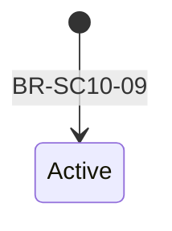

🏠 [Specs](../../../README.md) › 🏷️ [Sectors](../../README.md) › 🏘️ [SC10 Real estate](../README.md) ›
🗃️ [Data](README.md) › 🗃️ E-SC10-10 Charge settlement

# 🗃️ E-SC10-10 Charge settlement

**Status:** 🔄 waiting for the owner

## Purpose

The yearly charges settlement.

## Fields

| Name | Type | Required | Validation | Default | Example | Personal data | Custom fields |
|---|---|---|---|---|---|---|---|
| lease, year | records | yes | BR-SC10-09 | - | S. Roux, 2026 | no | no |
| provisions, actual, balance | amounts | yes | - | - | 1 080, 960, -120 | no | no |

## Relations

(Proposed) As its use cases.

## Lifecycle

## Indexes and search

(Proposed) By number, date, partner.

## Retention

As an accounting record:
[CR-FR-002 Accounting records kept 10 years](../../../10-country-packs/france/accounting/cr-fr-002-accounting-records-kept-ten-years.md).

## Audit

Every change.

## Import and export

(Proposed) CSV, FEC where relevant.

## Used by

- [UC-SC10-11](../use-cases/04-rents-and-landlords/uc-sc10-11-settle-service-charges-yearly.md)

## Open questions

None.

---

⬅️ [E-SC10-09 Rent call](e-sc10-09-rent-call.md) · ⬆️ [Up](README.md) ·
➡️ [E-SC10-11 Landlord statement](e-sc10-11-landlord-statement.md)
