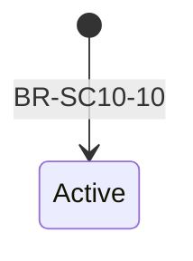

🏠 [Specs](../../../README.md) › 🏷️ [Sectors](../../README.md) › 🏘️ [SC10 Real estate](../README.md) ›
🗃️ [Data](README.md) › 🗃️ E-SC10-11 Landlord statement

# 🗃️ E-SC10-11 Landlord statement

**Status:** ✅ specified

## Purpose

What is paid to a landlord.

## Fields

| Name | Type | Required | Validation | Default | Example | Personal data | Custom fields |
|---|---|---|---|---|---|---|---|
| landlord, period | records | yes | BR-SC10-10 | - | J. Petit, Nov | yes | no |
| rents, fees, expenses, paid | amounts | yes | - | - | 890, 71.20, 0, 818.80 | no | no |

## Relations

As its use cases.

## Lifecycle

## Indexes and search

By number, date, partner.

## Retention

As an accounting record:
[CR-FR-002 Accounting records kept 10 years](../../../10-country-packs/france/accounting/cr-fr-002-accounting-records-kept-ten-years.md).

## Audit

Every change.

## Import and export

CSV, FEC where relevant.

## Used by

- [UC-SC10-12](../use-cases/04-rents-and-landlords/uc-sc10-12-pay-landlords-and-send-statements.md)
- [UC-SC10-19](../use-cases/06-portal-and-assistant/uc-sc10-19-give-landlords-tenants-and-co-owners-their-portal.md)

## Open questions

None.

---

⬅️ [E-SC10-10 Charge settlement](e-sc10-10-charge-settlement.md) · ⬆️ [Up](README.md) ·
➡️ [E-SC10-12 Diagnostic](e-sc10-12-diagnostic.md)
