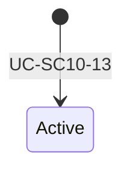

🏠 [Specs](../../../README.md) › 🏷️ [Sectors](../../README.md) › 🏘️ [SC10 Real estate](../README.md) ›
🗃️ [Data](README.md) › 🗃️ E-SC10-12 Diagnostic

# 🗃️ E-SC10-12 Diagnostic

**Status:** 🔄 waiting for the owner

## Purpose

A property diagnostic.

## Fields

| Name | Type | Required | Validation | Default | Example | Personal data | Custom fields |
|---|---|---|---|---|---|---|---|
| property, kind | records | yes | BR-SC10-08 | - | flat Lyon 3, energy | no | no |
| result, valid to | text, date | yes | - | - | D, 2034 | no | no |

## Relations

(Proposed) As its use cases.

## Lifecycle

## Indexes and search

(Proposed) By number, date, partner.

## Retention

Kept for the period of its kind of record in the country pack (D293), or else its kind's default in the
[retention schedule](../../../05-non-functional/data-retention.md).

## Audit

Every change.

## Import and export

(Proposed) CSV, FEC where relevant.

## Used by

- [UC-SC10-13](../use-cases/03-lettings/uc-sc10-13-track-diagnostics-and-works.md)

## Open questions

None.

---

⬅️ [E-SC10-11 Landlord statement](e-sc10-11-landlord-statement.md) · ⬆️ [Up](README.md) ·
➡️ [E-SC10-13 Co-owners' assembly](e-sc10-13-co-owners-assembly.md)
