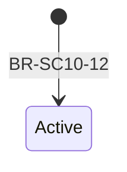

🏠 [Specs](../../../README.md) › 🏷️ [Sectors](../../README.md) › 🏘️ [SC10 Real estate](../README.md) ›
🗃️ [Data](README.md) › 🗃️ E-SC10-13 Co-owners' assembly

# 🗃️ E-SC10-13 Co-owners' assembly

**Status:** ✅ specified

## Purpose

An assembly of a co-ownership.

## Fields

| Name | Type | Required | Validation | Default | Example | Personal data | Custom fields |
|---|---|---|---|---|---|---|---|
| co-ownership, date | records | yes | BR-SC10-12 | - | Les Tilleuls, 30 Nov | no | no |
| notice sent, minutes sent | dates | no | - | - | 6 Nov | no | no |
| resolutions | list | yes | - | - | budget, works | no | no |

## Relations

As its use cases.

## Lifecycle

## Indexes and search

By number, date, partner.

## Retention

Kept for the period of its kind of record in the country pack (D293), or else its kind's default in the
[retention schedule](../../../05-non-functional/data-retention.md).

## Audit

Every change.

## Import and export

CSV, FEC where relevant.

## Used by

- [UC-SC10-15](../use-cases/05-co-ownership/uc-sc10-15-run-co-owners-general-assemblies.md)
- [UC-SC10-20](../use-cases/06-portal-and-assistant/uc-sc10-20-ask-the-assistant-about-the-portfolio.md)

## Open questions

None.

---

⬅️ [E-SC10-12 Diagnostic](e-sc10-12-diagnostic.md) · ⬆️ [Up](README.md) ·
➡️ [E-SC10-14 Call for funds](e-sc10-14-call-for-funds.md)
