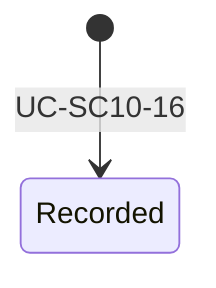

🏠 [Specs](../../../README.md) › 🏷️ [Sectors](../../README.md) › 🏘️ [SC10 Real estate](../README.md) ›
🗃️ [Data](README.md) › 🗃️ E-SC10-14 Call for funds

# 🗃️ E-SC10-14 Call for funds

**Status:** 🔄 waiting for the owner

## Purpose

A co-ownership call.

## Fields

| Name | Type | Required | Validation | Default | Example | Personal data | Custom fields |
|---|---|---|---|---|---|---|---|
| co-ownership, period, kind | records | yes | BR-SC10-14 | - | Les Tilleuls, Q1, budget | no | no |
| lot, share, amount | records | yes | - | - | lot 12, 120/10 000, 120 | yes | no |

## Relations

(Proposed) As its use cases.

## Lifecycle

## Indexes and search

(Proposed) By number, date, partner.

## Retention

As an accounting record:
[CR-FR-002 Accounting records kept 10 years](../../../10-country-packs/france/accounting/cr-fr-002-accounting-records-kept-ten-years.md).

## Audit

Every change.

## Import and export

(Proposed) CSV, FEC where relevant.

## Used by

- [UC-SC10-16](../use-cases/05-co-ownership/uc-sc10-16-vote-the-co-ownership-budget-and-call-funds.md)

## Open questions

None.

---

⬅️ [E-SC10-13 Co-owners' assembly](e-sc10-13-co-owners-assembly.md) · ⬆️ [Up](README.md) ·
➡️ [E-SC10-15 Works fund](e-sc10-15-works-fund.md)
