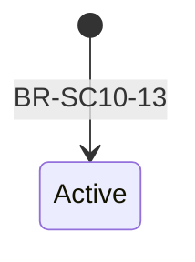

🏠 [Specs](../../../README.md) › 🏷️ [Sectors](../../README.md) › 🏘️ [SC10 Real estate](../README.md) ›
🗃️ [Data](README.md) › 🗃️ E-SC10-15 Works fund

# 🗃️ E-SC10-15 Works fund

**Status:** 🔄 waiting for the owner

## Purpose

A co-ownership's works fund.

## Fields

| Name | Type | Required | Validation | Default | Example | Personal data | Custom fields |
|---|---|---|---|---|---|---|---|
| co-ownership, year | records | yes | BR-SC10-13 | - | Les Tilleuls, 2027 | no | no |
| contribution, balance | amounts | yes | - | - | 2 000, 14 600 | no | no |

## Relations

(Proposed) As its use cases.

## Lifecycle

## Indexes and search

(Proposed) By number, date, partner.

## Retention

Kept for the period of its kind of record in the country pack (D293), or else its kind's default in the
[retention schedule](../../../05-non-functional/data-retention.md).

## Audit

Every change.

## Import and export

(Proposed) CSV, FEC where relevant.

## Used by

- [UC-SC10-17](../use-cases/05-co-ownership/uc-sc10-17-manage-the-works-fund-and-works.md)

## Open questions

None.

---

⬅️ [E-SC10-14 Call for funds](e-sc10-14-call-for-funds.md) · ⬆️ [Up](README.md) ·
➡️ [E-SC10-16 Co-ownership](e-sc10-16-co-ownership.md)
