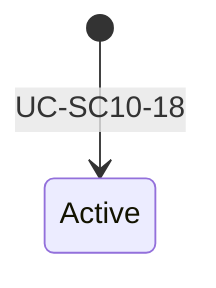

🏠 [Specs](../../../README.md) › 🏷️ [Sectors](../../README.md) › 🏘️ [SC10 Real estate](../README.md) ›
🗃️ [Data](README.md) › 🗃️ E-SC10-16 Co-ownership

# 🗃️ E-SC10-16 Co-ownership

**Status:** 🔄 waiting for the owner

## Purpose

A building in co-ownership.

## Fields

| Name | Type | Required | Validation | Default | Example | Personal data | Custom fields |
|---|---|---|---|---|---|---|---|
| name, address | text | yes | - | - | Les Tilleuls, Lyon | no | no |
| lots, shares | list | yes | total 10 000 | - | 24 lots | no | no |
| register number | text | no | BR-SC10-15 | - | AB1-234-567 | no | no |

## Relations

(Proposed) As its use cases.

## Lifecycle

## Indexes and search

(Proposed) By number, date, partner.

## Retention

Kept for the period of its kind of record in the country pack (D293), or else its kind's default in the
[retention schedule](../../../05-non-functional/data-retention.md).

## Audit

Every change.

## Import and export

(Proposed) CSV, FEC where relevant.

## Used by

- [UC-SC10-18](../use-cases/05-co-ownership/uc-sc10-18-keep-co-owners-accounts-and-the-register.md)
- [UC-SC10-19](../use-cases/06-portal-and-assistant/uc-sc10-19-give-landlords-tenants-and-co-owners-their-portal.md)

## Open questions

None.

---

⬅️ [E-SC10-15 Works fund](e-sc10-15-works-fund.md) · ⬆️ [Up](README.md) · ➡️ [E-SC10-17 Stay](e-sc10-17-stay.md)
