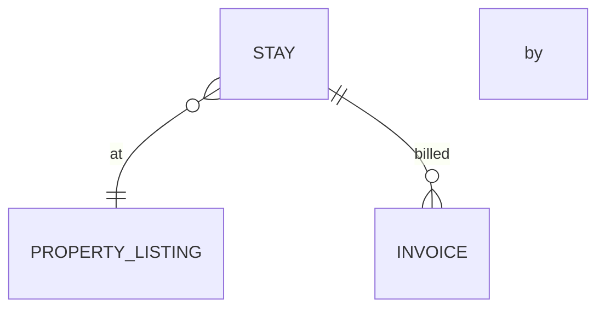
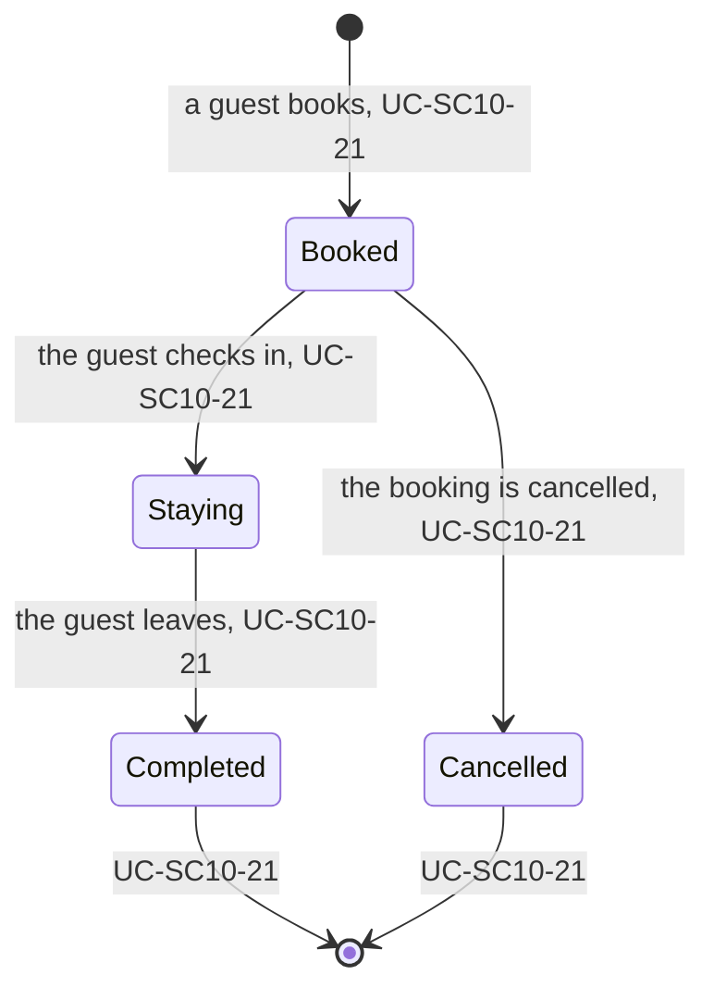

🏠 [Specs](../../../README.md) › 🏷️ [Sectors](../../README.md) › 🏘️ [SC10 Real estate](../README.md) ›
🗃️ [Data](README.md) › 🗃️ E-SC10-17 Stay

# 🗃️ E-SC10-17 Stay

**Status:** ✅ specified

## Purpose

A short stay of guests in a furnished property: dates, guests, price and the tourist tax
([D554](../../../06-decisions/sectors/d554-benchmark-gaps-sc10-real-estate.md)). It is not a lease
([E-SC10-07 Lease](e-sc10-07-lease.md)), which is a long-term letting of a home; a stay has no deposit return and no
rent index.

## Fields

| Name | Type | Required | Validation | Default | Example | Personal data | Custom fields |
|---|---|---|---|---|---|---|---|
| property | listing (E-SC10-02) | yes | a property of the portfolio | - | Studio Le Port | no | no |
| guest | customer (E-F6-01) | yes | a customer of the company | - | Marie D. | yes | no |
| arrival | date | yes | not overlapping another stay | - | 2026-12-20 | no | no |
| departure | date | yes | after the arrival | - | 2026-12-24 | no | no |
| guests | adults, minors, exempt | yes | at least 1 adult, within the capacity | - | 2 adults, 1 child | no | no |
| rent | amount | yes | 0 or more | nights times price | 480.00 EUR | no | no |
| cleaning fee | amount | no | 0 or more | from the property | 60.00 EUR | no | no |
| tax collector | manager, platform | yes | one of the two | manager | manager | no | no |
| tourist tax | amount | yes | computed per night and guest | from the rate | 8.40 EUR | no | no |
| channel | text | no | direct or a platform name | direct | direct | no | no |
| state | Booked, Staying, Completed, Cancelled | yes | the lifecycle below | Booked | Staying | no | no |
| owner | user | yes | a user of the company | the creator | Claire P. | yes | no |

## Relations

- [E-SC10-02 Property listing](e-sc10-02-property-listing.md)
- [E-F6-01](../../../02-functional/f06-customers-and-sales/data/e-f06-01-customer-record.md)
- [E-F6-05 Invoice](../../../02-functional/f06-customers-and-sales/data/e-f06-05-invoice.md)

## Lifecycle

## Indexes and search

By property, guest, arrival date and state.

## Retention

Kept with the invoices and the tax declarations for ten years
([CR-FR-002](../../../10-country-packs/france/accounting/cr-fr-002-accounting-records-kept-ten-years.md)).

## Audit

Every booking, change, check-in, completion and cancellation, and each tax computed, with who, when and the values.

## Import and export

Import of bookings from a calendar file; export of the tax declaration as a CSV.

## Used by

- [UC-SC10-21](../use-cases/07-short-stays-commercial-and-coworking/uc-sc10-21-manage-short-term-rentals.md)
- [UC-SC10-07 Let a property](../use-cases/03-lettings/uc-sc10-07-let-a-property.md)

## Open questions

None.

---

⬅️ [E-SC10-16 Co-ownership](e-sc10-16-co-ownership.md) · ⬆️ [Up](README.md) ·
➡️ [E-SC10-18 Commercial lease](e-sc10-18-commercial-lease.md)
