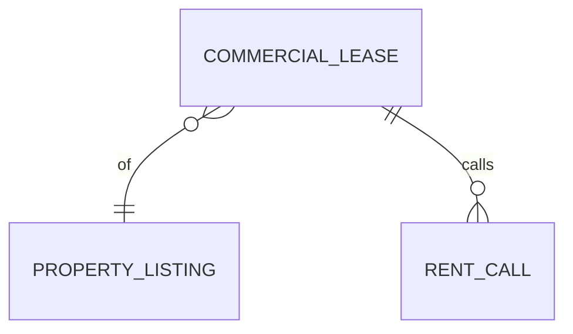
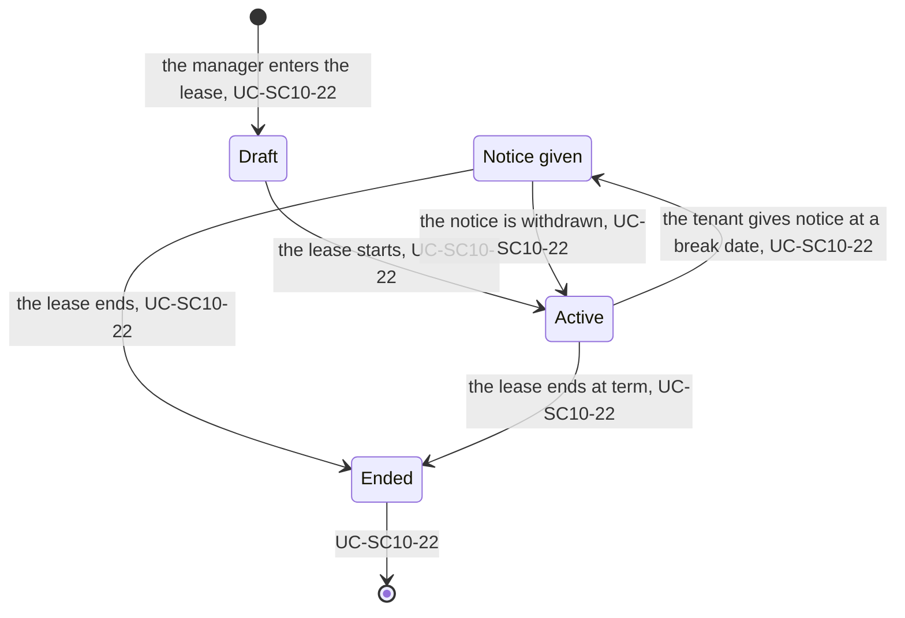

🏠 [Specs](../../../README.md) › 🏷️ [Sectors](../../README.md) › 🏘️ [SC10 Real estate](../README.md) ›
🗃️ [Data](README.md) › 🗃️ E-SC10-18 Commercial lease

# 🗃️ E-SC10-18 Commercial lease

**Status:** ✅ specified

## Purpose

A lease of premises for a trade or an office: its periods, break dates, rent, index and revisions
([D554](../../../06-decisions/sectors/d554-benchmark-gaps-sc10-real-estate.md)). It differs from the home lease
([E-SC10-07 Lease](e-sc10-07-lease.md)), which follows the home rent rules and its own index; the commercial lease has
three-year periods, the tenant's break dates and an index chosen by the activity.

## Fields

| Name | Type | Required | Validation | Default | Example | Personal data | Custom fields |
|---|---|---|---|---|---|---|---|
| tenant | customer (E-F6-01) | yes | a company or a person | - | Boulangerie Dupin | yes | no |
| premises | listing (E-SC10-02) | yes | premises of the portfolio | - | 4 Rue Haute | no | no |
| activity | text | yes | the activity the lease allows | - | bakery | no | no |
| start date | date | yes | - | - | 2023-03-01 | no | no |
| index | ILC, ILAT | yes | named in the lease | from the activity | ILC | no | no |
| base index | number | yes | above 0 | from the series | 126.05 | no | no |
| rent | amount | yes | above 0 | - | 18,000.00 EUR | no | no |
| charges | amount | no | 0 or more | 0 | 1,200.00 EUR | no | no |
| next revision | date | yes | after the last one | start date plus one year | 2027-03-01 | no | no |
| next break | date | yes | end of a three-year period | from the start | 2029-02-28 | no | no |
| end date | date | no | set when ended | - | - | no | no |
| state | Draft, Active, Notice given, Ended | yes | the lifecycle below | Draft | Active | no | no |
| owner | user | yes | a user of the company | the creator | Claire P. | yes | no |

## Relations

- [E-SC10-02 Property listing](e-sc10-02-property-listing.md)
- [E-SC10-07 Lease](e-sc10-07-lease.md)
- [E-SC10-08 Deposit](e-sc10-08-deposit.md)
- [E-SC10-09 Rent call](e-sc10-09-rent-call.md)

## Lifecycle

## Indexes and search

By tenant, premises, index, next revision, next break and state.

## Retention

Kept ten years after the end of the lease
([CR-FR-002](../../../10-country-packs/france/accounting/cr-fr-002-accounting-records-kept-ten-years.md)).

## Audit

Every change of rent, index or dates, each revision with its index and caps, each notice; who, when and the old and new
value.

## Import and export

Import of leases from a CSV; export of the revisions of a period.

## Used by

- [UC-SC10-22](../use-cases/07-short-stays-commercial-and-coworking/uc-sc10-22-manage-commercial-leases.md)
- [UC-SC10-09](../use-cases/04-rents-and-landlords/uc-sc10-09-index-rents-within-the-caps.md)

## Open questions

None.

---

⬅️ [E-SC10-17 Stay](e-sc10-17-stay.md) · ⬆️ [Up](README.md) ·
➡️ [E-SC10-19 Furnished property](e-sc10-19-furnished-property.md)
