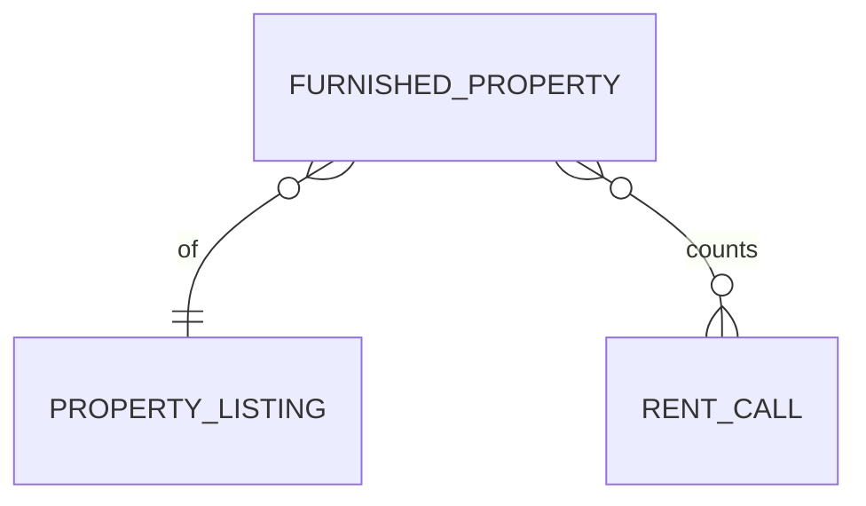
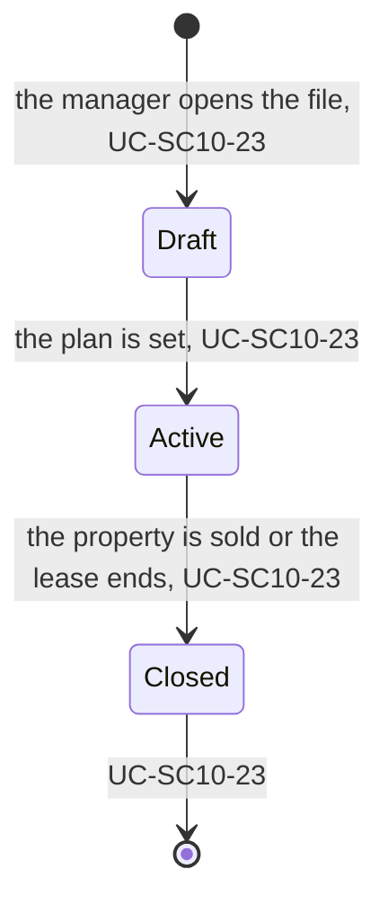

🏠 [Specs](../../../README.md) › 🏷️ [Sectors](../../README.md) › 🏘️ [SC10 Real estate](../README.md) ›
🗃️ [Data](README.md) › 🗃️ E-SC10-19 Furnished property

# 🗃️ E-SC10-19 Furnished property

**Status:** ✅ specified

## Purpose

The tax file of a furnished rental property: its acquisition values, depreciation plan and the yearly figures
([D554](../../../06-decisions/sectors/d554-benchmark-gaps-sc10-real-estate.md)). It is the landlord's tax view of the
property; the lease ([E-SC10-07 Lease](e-sc10-07-lease.md)) and the rent calls
([E-SC10-09 Rent call](e-sc10-09-rent-call.md)) remain the property manager's records.

## Fields

| Name | Type | Required | Validation | Default | Example | Personal data | Custom fields |
|---|---|---|---|---|---|---|---|
| property | listing (E-SC10-02) | yes | a property of the portfolio | - | Studio Le Port | no | no |
| landlord | customer (E-F6-01) | yes | a customer of the company | - | Ahmed K. | yes | no |
| regime | real, simplified | yes | one of the two | real | real | no | no |
| acquisition price | amount | yes | above 0 | - | 140,000.00 EUR | no | no |
| land share | percentage | yes | 0 to 100 | - | 20 % | no | no |
| furniture value | amount | no | 0 or more | 0 | 8,000.00 EUR | no | no |
| depreciation plan | years per component | yes | above 0 | from the pack | 30 and 7 years | no | no |
| rents of the year | amount | yes | 0 or more | from the calls | 9,600.00 EUR | no | no |
| charges of the year | amount | yes | 0 or more | from the accounts | 6,500.00 EUR | no | no |
| depreciation deducted | amount | yes | not above the result | 0 | 3,100.00 EUR | no | no |
| carried forward | amount | yes | 0 or more | 0 | 1,300.00 EUR | no | no |
| state | Draft, Active, Closed | yes | the lifecycle below | Draft | Active | no | no |
| owner | user | yes | a user of the company | the creator | Claire P. | yes | no |

## Relations

- [E-SC10-02 Property listing](e-sc10-02-property-listing.md)
- [E-SC10-07 Lease](e-sc10-07-lease.md)
- [E-SC10-09 Rent call](e-sc10-09-rent-call.md)
- [E-SC10-11 Landlord statement](e-sc10-11-landlord-statement.md)

## Lifecycle

## Indexes and search

By landlord, property, year and state.

## Retention

Kept ten years after the file is closed
([CR-FR-002](../../../10-country-packs/france/accounting/cr-fr-002-accounting-records-kept-ten-years.md)).

## Audit

Every value, plan change, year closing and carry-forward, with who, when and the old and new value.

## Import and export

Export of the yearly figures as a CSV for the return; no import.

## Used by

- [UC-SC10-23](../use-cases/07-short-stays-commercial-and-coworking/uc-sc10-23-keep-furnished-rental-figures.md)
- [UC-SC10-12](../use-cases/04-rents-and-landlords/uc-sc10-12-pay-landlords-and-send-statements.md)

## Open questions

None.

---

⬅️ [E-SC10-18 Commercial lease](e-sc10-18-commercial-lease.md) · ⬆️ [Up](README.md) ·
➡️ [E-SC10-20 Membership](e-sc10-20-membership.md)
