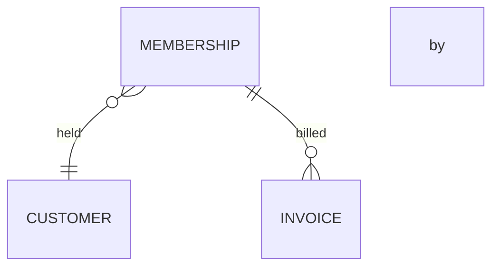
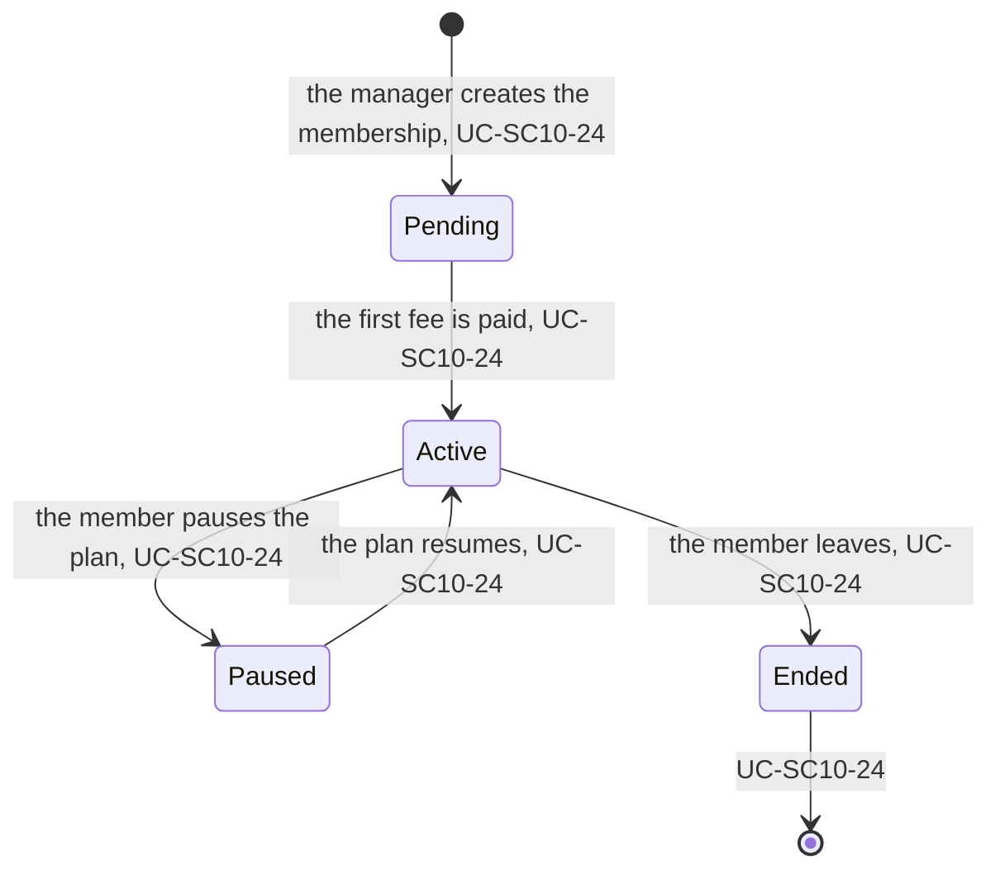

🏠 [Specs](../../../README.md) › 🏷️ [Sectors](../../README.md) › 🏘️ [SC10 Real estate](../README.md) ›
🗃️ [Data](README.md) › 🗃️ E-SC10-20 Membership

# 🗃️ E-SC10-20 Membership

**Status:** ✅ specified

## Purpose

A member's subscription to the coworking space: plan, monthly fee, room-hour credits and the hours used
([D554](../../../06-decisions/sectors/d554-benchmark-gaps-sc10-real-estate.md)). It is not a lease
([E-SC10-07 Lease](e-sc10-07-lease.md)): it has no rent index, no deposit return and no notice period beyond the plan's.

## Fields

| Name | Type | Required | Validation | Default | Example | Personal data | Custom fields |
|---|---|---|---|---|---|---|---|
| member | customer (E-F6-01) | yes | a customer of the company | - | Studio Nova | yes | no |
| plan | choice | yes | a plan of the space | - | Flexible | no | no |
| monthly fee | amount | yes | 0 or more | from the plan | 120.00 EUR | no | no |
| credit hours | number | yes | 0 or more | from the plan | 6 | no | no |
| used hours | number | yes | 0 or more | 0 | 2 | no | no |
| extra hours | number | yes | 0 or more | 0 | 1 | no | no |
| start date | date | yes | - | today | 2026-11-01 | no | no |
| end date | date | no | after the start | - | - | no | no |
| state | Pending, Active, Paused, Ended | yes | the lifecycle below | Pending | Active | no | no |
| owner | user | yes | a user of the company | the creator | Claire P. | yes | no |

## Relations

- [E-SC10-02 Property listing](e-sc10-02-property-listing.md)
- [E-F6-01](../../../02-functional/f06-customers-and-sales/data/e-f06-01-customer-record.md)
- [E-F6-05 Invoice](../../../02-functional/f06-customers-and-sales/data/e-f06-05-invoice.md)

## Lifecycle

## Indexes and search

By member, plan, state and start date.

## Retention

Kept with the invoices for ten years
([CR-FR-002](../../../10-country-packs/france/accounting/cr-fr-002-accounting-records-kept-ten-years.md)).

## Audit

Every membership change, booking, cancellation and credit movement, with who, when and the hours.

## Import and export

Export of the bookings of a month as a CSV; no import.

## Used by

- [UC-SC10-24](../use-cases/07-short-stays-commercial-and-coworking/uc-sc10-24-run-a-coworking-space.md)
- [UC-SC10-03 Organise viewings](../use-cases/02-sales/uc-sc10-03-organise-viewings.md)

## Open questions

None.

---

⬅️ [E-SC10-19 Furnished property](e-sc10-19-furnished-property.md) · ⬆️ [Up](README.md)
