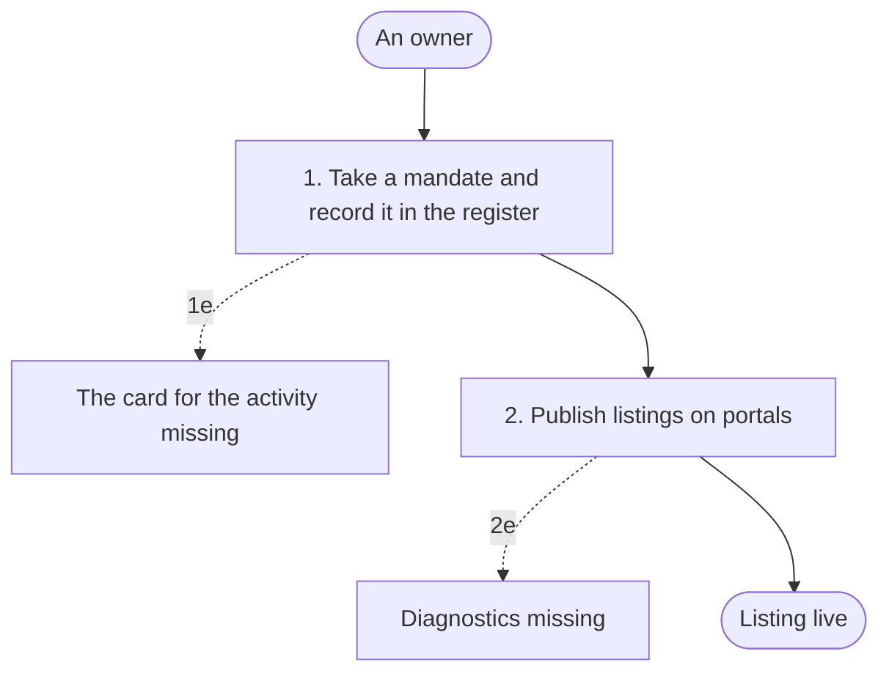

🏠 [Specs](../../../README.md) › 🏷️ [Sectors](../../README.md) › 🏘️ [SC10 Real estate](../README.md) ›
🔀 [Flows](README.md) › 🔀 FL-SC10-01 Mandates and listings

# 🔀 FL-SC10-01 Mandates and listings

**Status:** ✅ specified

## Summary

Mandates in the register and listings on portals. It covers
[UC-SC10-01 Take a mandate and record it in the register](../use-cases/01-mandates-and-listings/uc-sc10-01-take-a-mandate-and-record-it-in-the-register.md),
[UC-SC10-02 Publish listings on portals](../use-cases/01-mandates-and-listings/uc-sc10-02-publish-listings-on-portals.md).

## Personas

- [U35 Real-estate agent](../../../01-users/personas/u35-real-estate-agent.md)

## Flowchart

## Sequence diagram

See each use case.

## Steps

| Step | Persona | Screen | Use case | What happens |
|---|---|---|---|---|
| 1 | U35 | [S-SC10-01](../screens/01-mandates-and-listings/s-sc10-01-mandates.md) | [UC-SC10-01](../use-cases/01-mandates-and-listings/uc-sc10-01-take-a-mandate-and-record-it-in-the-register.md) | The real-estate agent agrees a sale or letting mandate with the owner, numbers it in the agency's mandates register before any action, and has it signed |
| 2 | U35 | [S-SC10-02](../screens/01-mandates-and-listings/s-sc10-02-listings.md) | [UC-SC10-02](../use-cases/01-mandates-and-listings/uc-sc10-02-publish-listings-on-portals.md) | The agent writes the listing, checks the diagnostics are valid, and publishes it on portals through their connectors |

### Entities and screens

| Entity | States in this flow | Shown at step and screen | Aggregated view |
|---|---|---|---|
| [E-SC10-01 Mandate](../data/e-sc10-01-mandate.md) | Signed, Active, Cancelled, Blocked | 1 [S-SC10-01](../screens/01-mandates-and-listings/s-sc10-01-mandates.md) | Mandates |
| [E-F15-04 Standard register entry](../../../02-functional/f15-legal-assistant/data/e-f15-04-standard-register-entry.md) | Open | Shown elsewhere: [S-F15-06 Standards register](../../../02-functional/f15-legal-assistant/screens/04-set-up-the-legal-assistant/s-f15-06-standards-register.md) | Standard register entries |
| [E-SC10-02 Property listing](../data/e-sc10-02-property-listing.md) | Live, Blocked | 2 [S-SC10-02](../screens/01-mandates-and-listings/s-sc10-02-listings.md) | Property listings |
| [E-SC10-12 Diagnostic](../data/e-sc10-12-diagnostic.md) | Active | 2 [S-SC10-02](../screens/01-mandates-and-listings/s-sc10-02-listings.md) | Diagnostics |

## Errors

- [UC-SC10-01](../use-cases/01-mandates-and-listings/uc-sc10-01-take-a-mandate-and-record-it-in-the-register.md) 1e. The
  card for the activity missing: the mandate is blocked.
- [UC-SC10-01](../use-cases/01-mandates-and-listings/uc-sc10-01-take-a-mandate-and-record-it-in-the-register.md) 3e. The
  owner does not sign: the number stays reserved and the mandate cancelled with reason.
- [UC-SC10-02](../use-cases/01-mandates-and-listings/uc-sc10-02-publish-listings-on-portals.md) 2e. Diagnostics missing:
  publication is blocked.
- [UC-SC10-02](../use-cases/01-mandates-and-listings/uc-sc10-02-publish-listings-on-portals.md) 4e. A portal refuses:
  the reason is shown and retried.

## Images

Every step and error, for each persona taking part, in light and dark mode (D120). Steps are numbered as in the Steps
table; E rows are the error cases.

| Step | Persona | Device | Light | Dark |
|---|---|---|---|---|
| 1 | U35 | desktop | [light](../images/01-mandates-and-listings/u35-real-estate-agent/1-mandate-desktop-light.png) | [dark](../images/01-mandates-and-listings/u35-real-estate-agent/1-mandate-desktop-dark.png) |
| 1 | U35 | phone | [light](../images/01-mandates-and-listings/u35-real-estate-agent/1-mandate-phone-light.png) | [dark](../images/01-mandates-and-listings/u35-real-estate-agent/1-mandate-phone-dark.png) |
| 1 | U35 | tablet | [light](../images/01-mandates-and-listings/u35-real-estate-agent/1-mandate-tablet-light.png) | [dark](../images/01-mandates-and-listings/u35-real-estate-agent/1-mandate-tablet-dark.png) |
| 2 | U35 | desktop | [light](../images/01-mandates-and-listings/u35-real-estate-agent/2-listing-desktop-light.png) | [dark](../images/01-mandates-and-listings/u35-real-estate-agent/2-listing-desktop-dark.png) |
| 2 | U35 | phone | [light](../images/01-mandates-and-listings/u35-real-estate-agent/2-listing-phone-light.png) | [dark](../images/01-mandates-and-listings/u35-real-estate-agent/2-listing-phone-dark.png) |
| 2 | U35 | tablet | [light](../images/01-mandates-and-listings/u35-real-estate-agent/2-listing-tablet-light.png) | [dark](../images/01-mandates-and-listings/u35-real-estate-agent/2-listing-tablet-dark.png) |
| E1 | U35 | desktop | [light](../images/01-mandates-and-listings/u35-real-estate-agent/e1-diagnostics-missing-desktop-light.png) | [dark](../images/01-mandates-and-listings/u35-real-estate-agent/e1-diagnostics-missing-desktop-dark.png) |
| E1 | U35 | phone | [light](../images/01-mandates-and-listings/u35-real-estate-agent/e1-diagnostics-missing-phone-light.png) | [dark](../images/01-mandates-and-listings/u35-real-estate-agent/e1-diagnostics-missing-phone-dark.png) |
| E1 | U35 | tablet | [light](../images/01-mandates-and-listings/u35-real-estate-agent/e1-diagnostics-missing-tablet-light.png) | [dark](../images/01-mandates-and-listings/u35-real-estate-agent/e1-diagnostics-missing-tablet-dark.png) |

## Open questions

None.

---

⬆️ [Up](README.md) · ➡️ [FL-SC10-02 Sales](fl-sc10-02-sales.md)
