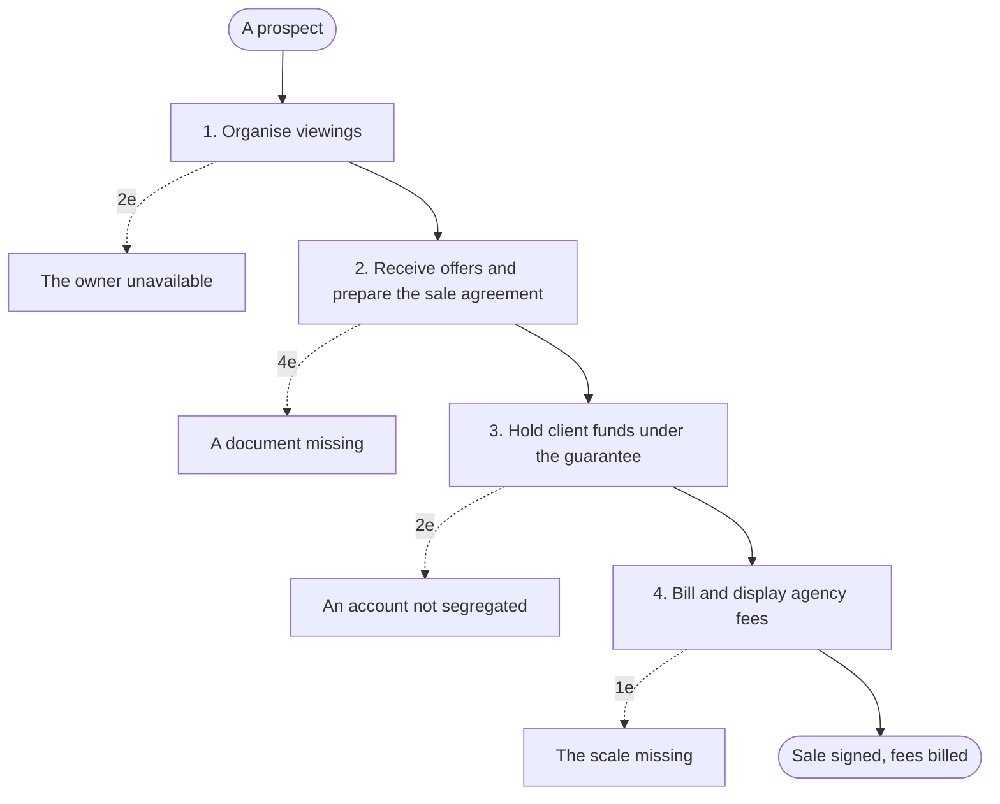

🏠 [Specs](../../../README.md) › 🏷️ [Sectors](../../README.md) › 🏘️ [SC10 Real estate](../README.md) ›
🔀 [Flows](README.md) › 🔀 FL-SC10-02 Sales

# 🔀 FL-SC10-02 Sales

**Status:** ✅ specified

## Summary

Sales: viewings, offers, client funds on the shared client money, fees. It covers
[UC-SC10-03 Organise viewings](../use-cases/02-sales/uc-sc10-03-organise-viewings.md),
[UC-SC10-04 Receive offers and prepare the sale agreement](../use-cases/02-sales/uc-sc10-04-receive-offers-and-prepare-the-sale-agreement.md),
[UC-SC10-05 Hold client funds under the guarantee](../use-cases/02-sales/uc-sc10-05-hold-client-funds-under-the-guarantee.md),
[UC-SC10-06 Bill and display agency fees](../use-cases/02-sales/uc-sc10-06-bill-and-display-agency-fees.md).

## Personas

- [U05 Accounting](../../../01-users/personas/u05-accounting.md)
- [U09 Customer](../../../01-users/personas/u09-customer.md)
- [U35 Real-estate agent](../../../01-users/personas/u35-real-estate-agent.md)

## Flowchart

## Sequence diagram

See each use case.

## Steps

| Step | Persona | Screen | Use case | What happens |
|---|---|---|---|---|
| 1 | U35, U09 | [S-SC10-03](../screens/02-sales/s-sc10-03-viewings.md) | [UC-SC10-03](../use-cases/02-sales/uc-sc10-03-organise-viewings.md) | The agent books viewings with buyers or tenants, visits, and records their feedback for the owner |
| 2 | U35, U09 | [S-SC10-04](../screens/02-sales/s-sc10-04-offers.md) | [UC-SC10-04](../use-cases/02-sales/uc-sc10-04-receive-offers-and-prepare-the-sale-agreement.md) | The agent records offers, the owner accepts one, and the agent prepares the agreement file for the notary |
| 3 | U05, U35 | [S-SC10-05](../screens/02-sales/s-sc10-05-client-funds.md) | [UC-SC10-05](../use-cases/02-sales/uc-sc10-05-hold-client-funds-under-the-guarantee.md) | Accounting receives deposits and funds held for clients on segregated accounts with the shared third-party client money capability, and pays them out when due |
| 4 | U35, U05 | [S-SC10-06](../screens/02-sales/s-sc10-06-agency-fees.md) | [UC-SC10-06](../use-cases/02-sales/uc-sc10-06-bill-and-display-agency-fees.md) | The agent applies the fee scale, shows the fees on the listing, and accounting bills them at the sale |

### Entities and screens

| Entity | States in this flow | Shown at step and screen | Aggregated view |
|---|---|---|---|
| [E-SC10-03 Viewing](../data/e-sc10-03-viewing.md) | Active | 1 [S-SC10-03](../screens/02-sales/s-sc10-03-viewings.md) | Viewings |
| [E-SC10-04 Offer](../data/e-sc10-04-offer.md) | Made, Countered, Refused | 2 [S-SC10-04](../screens/02-sales/s-sc10-04-offers.md) | Offers |
| [E-SC10-05 Client fund](../data/e-sc10-05-client-fund.md) | Active | 3 [S-SC10-05](../screens/02-sales/s-sc10-05-client-funds.md) | Client funds |
| [E-SC10-06 Fee scale](../data/e-sc10-06-fee-scale.md) | Active | 4 [S-SC10-06](../screens/02-sales/s-sc10-06-agency-fees.md) | Fee scales |

## Errors

- [UC-SC10-03](../use-cases/02-sales/uc-sc10-03-organise-viewings.md) 2e. The owner unavailable: the viewing is
  rescheduled.
- [UC-SC10-03](../use-cases/02-sales/uc-sc10-03-organise-viewings.md) 3e. The prospect does not come: the slot is freed
  and recorded.
- [UC-SC10-04](../use-cases/02-sales/uc-sc10-04-receive-offers-and-prepare-the-sale-agreement.md) 4e. A document
  missing: it is listed.
- [UC-SC10-04](../use-cases/02-sales/uc-sc10-04-receive-offers-and-prepare-the-sale-agreement.md) 3e. Two offers at the
  price: the owner chooses and both are recorded.
- [UC-SC10-05](../use-cases/02-sales/uc-sc10-05-hold-client-funds-under-the-guarantee.md) 2e. An account not segregated:
  the receipt is refused ([BR-SC10-03](../business-rules/br-sc10-03-client-funds-kept-apart.md)).
- [UC-SC10-05](../use-cases/02-sales/uc-sc10-05-hold-client-funds-under-the-guarantee.md) 4e. A payout over the client's
  balance: it is refused,
  [BR-F8-13](../../../02-functional/f08-accounting/business-rules/br-f08-13-client-money-is-segregated-and-never-negative-per-client.md).
- [UC-SC10-06](../use-cases/02-sales/uc-sc10-06-bill-and-display-agency-fees.md) 1e. The scale missing: it is asked.
- [UC-SC10-06](../use-cases/02-sales/uc-sc10-06-bill-and-display-agency-fees.md) 3e. The sale not signed: no fee is
  billed.

## Images

Every step and error, for each persona taking part, in light and dark mode (D120). Steps are numbered as in the Steps
table; E rows are the error cases.

| Step | Persona | Device | Light | Dark |
|---|---|---|---|---|
| 1 | U35 | phone | [light](../images/02-sales/u35-real-estate-agent/1-viewings-phone-light.png) | [dark](../images/02-sales/u35-real-estate-agent/1-viewings-phone-dark.png) |
| 1 | U35 | desktop | [light](../images/02-sales/u35-real-estate-agent/1-viewings-desktop-light.png) | [dark](../images/02-sales/u35-real-estate-agent/1-viewings-desktop-dark.png) |
| 1 | U35 | tablet | [light](../images/02-sales/u35-real-estate-agent/1-viewings-tablet-light.png) | [dark](../images/02-sales/u35-real-estate-agent/1-viewings-tablet-dark.png) |
| 1 | U09 | phone | [light](../images/02-sales/u09-customer/1-viewings-phone-light.png) | [dark](../images/02-sales/u09-customer/1-viewings-phone-dark.png) |
| 2 | U35 | desktop | [light](../images/02-sales/u35-real-estate-agent/2-offer-desktop-light.png) | [dark](../images/02-sales/u35-real-estate-agent/2-offer-desktop-dark.png) |
| 2 | U35 | phone | [light](../images/02-sales/u35-real-estate-agent/2-offer-phone-light.png) | [dark](../images/02-sales/u35-real-estate-agent/2-offer-phone-dark.png) |
| 2 | U35 | tablet | [light](../images/02-sales/u35-real-estate-agent/2-offer-tablet-light.png) | [dark](../images/02-sales/u35-real-estate-agent/2-offer-tablet-dark.png) |
| 2 | U09 | phone | [light](../images/02-sales/u09-customer/2-offer-phone-light.png) | [dark](../images/02-sales/u09-customer/2-offer-phone-dark.png) |
| 3 | U05 | desktop | [light](../images/02-sales/u05-accounting/3-client-funds-desktop-light.png) | [dark](../images/02-sales/u05-accounting/3-client-funds-desktop-dark.png) |
| 3 | U35 | desktop | [light](../images/02-sales/u35-real-estate-agent/3-client-funds-desktop-light.png) | [dark](../images/02-sales/u35-real-estate-agent/3-client-funds-desktop-dark.png) |
| 3 | U35 | phone | [light](../images/02-sales/u35-real-estate-agent/3-client-funds-phone-light.png) | [dark](../images/02-sales/u35-real-estate-agent/3-client-funds-phone-dark.png) |
| 3 | U35 | tablet | [light](../images/02-sales/u35-real-estate-agent/3-client-funds-tablet-light.png) | [dark](../images/02-sales/u35-real-estate-agent/3-client-funds-tablet-dark.png) |
| 4 | U35 | desktop | [light](../images/02-sales/u35-real-estate-agent/4-fees-desktop-light.png) | [dark](../images/02-sales/u35-real-estate-agent/4-fees-desktop-dark.png) |
| 4 | U35 | phone | [light](../images/02-sales/u35-real-estate-agent/4-fees-phone-light.png) | [dark](../images/02-sales/u35-real-estate-agent/4-fees-phone-dark.png) |
| 4 | U35 | tablet | [light](../images/02-sales/u35-real-estate-agent/4-fees-tablet-light.png) | [dark](../images/02-sales/u35-real-estate-agent/4-fees-tablet-dark.png) |
| 4 | U05 | desktop | [light](../images/02-sales/u05-accounting/4-fees-desktop-light.png) | [dark](../images/02-sales/u05-accounting/4-fees-desktop-dark.png) |
| E1 | U05 | desktop | [light](../images/02-sales/u05-accounting/e1-funds-not-segregated-desktop-light.png) | [dark](../images/02-sales/u05-accounting/e1-funds-not-segregated-desktop-dark.png) |

## Open questions

None.

---

⬅️ [FL-SC10-01 Mandates and listings](fl-sc10-01-mandates-and-listings.md) · ⬆️ [Up](README.md) ·
➡️ [FL-SC10-03 Lettings](fl-sc10-03-lettings.md)
