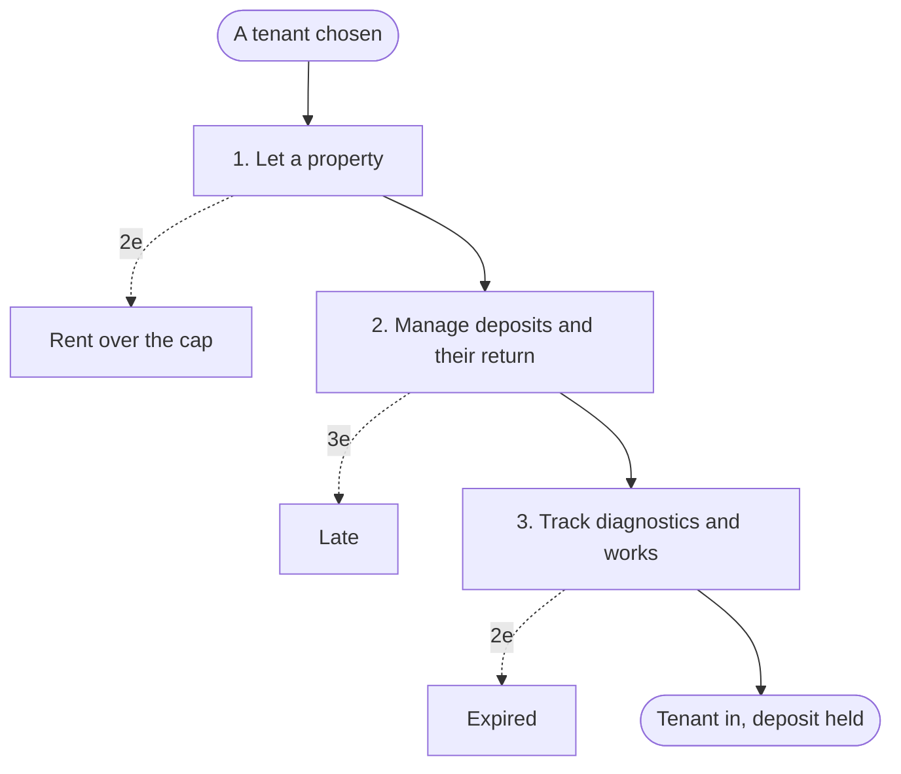

🏠 [Specs](../../../README.md) › 🏷️ [Sectors](../../README.md) › 🏘️ [SC10 Real estate](../README.md) ›
🔀 [Flows](README.md) › 🔀 FL-SC10-03 Lettings

# 🔀 FL-SC10-03 Lettings

**Status:** ✅ specified

## Summary

Lettings: leases, deposits and diagnostics. It covers
[UC-SC10-07 Let a property](../use-cases/03-lettings/uc-sc10-07-let-a-property.md),
[UC-SC10-10 Manage deposits and their return](../use-cases/03-lettings/uc-sc10-10-manage-deposits-and-their-return.md),
[UC-SC10-13 Track diagnostics and works](../use-cases/03-lettings/uc-sc10-13-track-diagnostics-and-works.md).

## Personas

- [U09 Customer](../../../01-users/personas/u09-customer.md)
- [U34 Property manager](../../../01-users/personas/u34-property-manager.md)

## Flowchart

## Sequence diagram

See each use case.

## Steps

| Step | Persona | Screen | Use case | What happens |
|---|---|---|---|---|
| 1 | U34, U09 | [S-SC10-07](../screens/03-lettings/s-sc10-07-letting.md) | [UC-SC10-07](../use-cases/03-lettings/uc-sc10-07-let-a-property.md) | The property manager checks the tenant's file, signs the lease within the rent caps, does the entry inventory and takes the deposit |
| 2 | U34, U09 | [S-SC10-10](../screens/03-lettings/s-sc10-10-deposits.md) | [UC-SC10-10](../use-cases/03-lettings/uc-sc10-10-manage-deposits-and-their-return.md) | The property manager does the exit inventory, computes deductions, and returns the deposit by the deadline from the client money ledger |
| 3 | U34 | [S-SC10-13](../screens/03-lettings/s-sc10-13-diagnostics.md) | [UC-SC10-13](../use-cases/03-lettings/uc-sc10-13-track-diagnostics-and-works.md) | The property manager records diagnostics and repairs per property, follows expiries and orders works |

### Entities and screens

| Entity | States in this flow | Shown at step and screen | Aggregated view |
|---|---|---|---|
| [E-F6-05 Invoice](../../../02-functional/f06-customers-and-sales/data/e-f06-05-invoice.md) | Refused | Shown elsewhere: [S-F6-06 Invoice](../../../02-functional/f06-customers-and-sales/screens/03-invoice-and-get-paid/s-f06-06-invoice.md) | Invoices |
| [E-SC10-12 Diagnostic](../data/e-sc10-12-diagnostic.md) | Active | 3 [S-SC10-13](../screens/03-lettings/s-sc10-13-diagnostics.md) | Diagnostics |
| [E-F8-17 Client money ledger](../../../02-functional/f08-accounting/data/e-f08-17-client-money-ledger.md) | Open, Closed | Shown elsewhere: [S-F8-21 Client money](../../../02-functional/f08-accounting/screens/07-client-money-grants-and-non-profits/s-f08-21-client-money.md) | Client money ledgers |

## Errors

- [UC-SC10-07](../use-cases/03-lettings/uc-sc10-07-let-a-property.md) 2e. Rent over the cap: the rent is refused.
- [UC-SC10-07](../use-cases/03-lettings/uc-sc10-07-let-a-property.md) 4e. No network at the property: the inventory is
  kept on the tablet and synced.
- [UC-SC10-10](../use-cases/03-lettings/uc-sc10-10-manage-deposits-and-their-return.md) 3e. Late: the penalty is
  computed ([BR-SC10-04](../business-rules/br-sc10-04-deposit-within-the-cap.md)).
- [UC-SC10-10](../use-cases/03-lettings/uc-sc10-10-manage-deposits-and-their-return.md) 2e. A deduction without proof:
  it is refused.
- [UC-SC10-13](../use-cases/03-lettings/uc-sc10-13-track-diagnostics-and-works.md) 2e. Expired: the listing is blocked.
- [UC-SC10-13](../use-cases/03-lettings/uc-sc10-13-track-diagnostics-and-works.md) 3e. Works over the landlord's limit:
  the landlord's approval is asked.

## Images

Every step and error, for each persona taking part, in light and dark mode (D120). Steps are numbered as in the Steps
table; E rows are the error cases.

| Step | Persona | Device | Light | Dark |
|---|---|---|---|---|
| 1 | U34 | desktop | [light](../images/03-lettings/u34-property-manager/1-lease-desktop-light.png) | [dark](../images/03-lettings/u34-property-manager/1-lease-desktop-dark.png) |
| 1 | U34 | tablet | [light](../images/03-lettings/u34-property-manager/1-lease-tablet-light.png) | [dark](../images/03-lettings/u34-property-manager/1-lease-tablet-dark.png) |
| 1 | U09 | phone | [light](../images/03-lettings/u09-customer/1-lease-phone-light.png) | [dark](../images/03-lettings/u09-customer/1-lease-phone-dark.png) |
| 2 | U34 | desktop | [light](../images/03-lettings/u34-property-manager/2-deposit-desktop-light.png) | [dark](../images/03-lettings/u34-property-manager/2-deposit-desktop-dark.png) |
| 2 | U34 | tablet | [light](../images/03-lettings/u34-property-manager/2-deposit-tablet-light.png) | [dark](../images/03-lettings/u34-property-manager/2-deposit-tablet-dark.png) |
| 2 | U09 | phone | [light](../images/03-lettings/u09-customer/2-deposit-phone-light.png) | [dark](../images/03-lettings/u09-customer/2-deposit-phone-dark.png) |
| 3 | U34 | desktop | [light](../images/03-lettings/u34-property-manager/3-diagnostics-desktop-light.png) | [dark](../images/03-lettings/u34-property-manager/3-diagnostics-desktop-dark.png) |
| 3 | U34 | tablet | [light](../images/03-lettings/u34-property-manager/3-diagnostics-tablet-light.png) | [dark](../images/03-lettings/u34-property-manager/3-diagnostics-tablet-dark.png) |
| E1 | U34 | desktop | [light](../images/03-lettings/u34-property-manager/e1-over-cap-desktop-light.png) | [dark](../images/03-lettings/u34-property-manager/e1-over-cap-desktop-dark.png) |
| E1 | U34 | tablet | [light](../images/03-lettings/u34-property-manager/e1-over-cap-tablet-light.png) | [dark](../images/03-lettings/u34-property-manager/e1-over-cap-tablet-dark.png) |

## Open questions

None.

---

⬅️ [FL-SC10-02 Sales](fl-sc10-02-sales.md) · ⬆️ [Up](README.md) ·
➡️ [FL-SC10-04 Rents and landlords](fl-sc10-04-rents-and-landlords.md)
