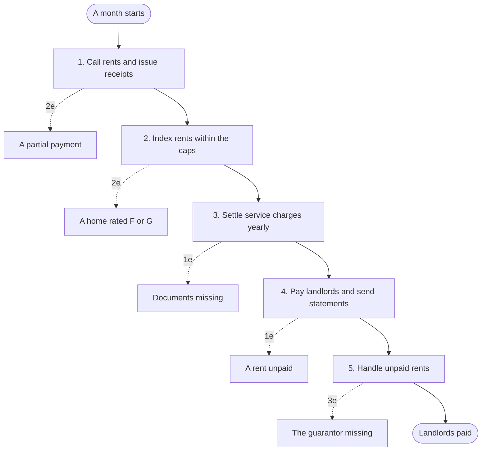

🏠 [Specs](../../../README.md) › 🏷️ [Sectors](../../README.md) › 🏘️ [SC10 Real estate](../README.md) ›
🔀 [Flows](README.md) › 🔀 FL-SC10-04 Rents and landlords

# 🔀 FL-SC10-04 Rents and landlords

**Status:** ✅ specified

## Summary

Rents and landlords: calls, indexation, charges, statements, unpaid rents. It covers
[UC-SC10-08 Call rents and issue receipts](../use-cases/04-rents-and-landlords/uc-sc10-08-call-rents-and-issue-receipts.md),
[UC-SC10-09 Index rents within the caps](../use-cases/04-rents-and-landlords/uc-sc10-09-index-rents-within-the-caps.md),
[UC-SC10-11 Settle service charges yearly](../use-cases/04-rents-and-landlords/uc-sc10-11-settle-service-charges-yearly.md),
[UC-SC10-12 Pay landlords and send statements](../use-cases/04-rents-and-landlords/uc-sc10-12-pay-landlords-and-send-statements.md),
[UC-SC10-14 Handle unpaid rents](../use-cases/04-rents-and-landlords/uc-sc10-14-handle-unpaid-rents.md).

## Personas

- [U05 Accounting](../../../01-users/personas/u05-accounting.md)
- [U09 Customer](../../../01-users/personas/u09-customer.md)
- [U34 Property manager](../../../01-users/personas/u34-property-manager.md)

## Flowchart

## Sequence diagram

See each use case.

## Steps

| Step | Persona | Screen | Use case | What happens |
|---|---|---|---|---|
| 1 | U34, U09 | [S-SC10-08](../screens/04-rents-and-landlords/s-sc10-08-rents.md) | [UC-SC10-08](../use-cases/04-rents-and-landlords/uc-sc10-08-call-rents-and-issue-receipts.md) | The property manager calls rents monthly, collects them onto the client money account, and issues receipts on request |
| 2 | U34 | [S-SC10-09](../screens/04-rents-and-landlords/s-sc10-09-indexation.md) | [UC-SC10-09](../use-cases/04-rents-and-landlords/uc-sc10-09-index-rents-within-the-caps.md) | The property manager computes yearly revisions by the reference index, checks the rules and notifies tenants |
| 3 | U34, U09 | [S-SC10-11](../screens/04-rents-and-landlords/s-sc10-11-charges.md) | [UC-SC10-11](../use-cases/04-rents-and-landlords/uc-sc10-11-settle-service-charges-yearly.md) | The property manager gathers the year's costs, settles them against the provisions and sends the statement |
| 4 | U34, U05 | [S-SC10-12](../screens/04-rents-and-landlords/s-sc10-12-landlord-statements.md) | [UC-SC10-12](../use-cases/04-rents-and-landlords/uc-sc10-12-pay-landlords-and-send-statements.md) | The property manager closes the period, deducts fees and expenses, pays each landlord from the client money ledger and sends the statement |
| 5 | U34 | [S-SC10-14](../screens/04-rents-and-landlords/s-sc10-14-unpaid-rents.md) | [UC-SC10-14](../use-cases/04-rents-and-landlords/uc-sc10-14-handle-unpaid-rents.md) | The property manager follows the steps for an unpaid rent |

### Entities and screens

| Entity | States in this flow | Shown at step and screen | Aggregated view |
|---|---|---|---|
| [E-SC10-09 Rent call](../data/e-sc10-09-rent-call.md) | Recorded | 1 [S-SC10-08](../screens/04-rents-and-landlords/s-sc10-08-rents.md); 5 [S-SC10-14](../screens/04-rents-and-landlords/s-sc10-14-unpaid-rents.md) | Rent calls |
| [E-F6-06 Customer payment](../../../02-functional/f06-customers-and-sales/data/e-f06-06-customer-payment.md) | Refused | Shown elsewhere: [S-F6-07 Payments and reconciliation](../../../02-functional/f06-customers-and-sales/screens/03-invoice-and-get-paid/s-f06-07-payments-and-reconciliation.md) | Customer payments |
| [E-SC10-10 Charge settlement](../data/e-sc10-10-charge-settlement.md) | Active | 3 [S-SC10-11](../screens/04-rents-and-landlords/s-sc10-11-charges.md) | Charge settlements |
| [E-SC10-11 Landlord statement](../data/e-sc10-11-landlord-statement.md) | Active | 4 [S-SC10-12](../screens/04-rents-and-landlords/s-sc10-12-landlord-statements.md) | Landlord statements |
| [E-F8-17 Client money ledger](../../../02-functional/f08-accounting/data/e-f08-17-client-money-ledger.md) | Open, Closed | 4 [S-SC10-12](../screens/04-rents-and-landlords/s-sc10-12-landlord-statements.md) | Client money ledgers |

## Errors

- [UC-SC10-08](../use-cases/04-rents-and-landlords/uc-sc10-08-call-rents-and-issue-receipts.md) 2e. A partial payment:
  the balance is kept.
- [UC-SC10-08](../use-cases/04-rents-and-landlords/uc-sc10-08-call-rents-and-issue-receipts.md) 2f. No payment: the
  unpaid steps start ([UC-SC10-14](../use-cases/04-rents-and-landlords/uc-sc10-14-handle-unpaid-rents.md)).
- [UC-SC10-09](../use-cases/04-rents-and-landlords/uc-sc10-09-index-rents-within-the-caps.md) 2e. A home rated F or G:
  the revision is blocked.
- [UC-SC10-09](../use-cases/04-rents-and-landlords/uc-sc10-09-index-rents-within-the-caps.md) 4e. A revision forgotten:
  it is not applied backwards.
- [UC-SC10-11](../use-cases/04-rents-and-landlords/uc-sc10-11-settle-service-charges-yearly.md) 1e. Documents missing:
  the settlement is held.
- [UC-SC10-11](../use-cases/04-rents-and-landlords/uc-sc10-11-settle-service-charges-yearly.md) 4e. A balance disputed:
  the documents are shown on the portal.
- [UC-SC10-12](../use-cases/04-rents-and-landlords/uc-sc10-12-pay-landlords-and-send-statements.md) 1e. A rent unpaid:
  it shows on the statement.
- [UC-SC10-12](../use-cases/04-rents-and-landlords/uc-sc10-12-pay-landlords-and-send-statements.md) 3e. A payout over
  the ledger's balance: it is refused,
  [BR-F8-13](../../../02-functional/f08-accounting/business-rules/br-f08-13-client-money-is-segregated-and-never-negative-per-client.md).
- [UC-SC10-14](../use-cases/04-rents-and-landlords/uc-sc10-14-handle-unpaid-rents.md) 3e. The guarantor missing: the
  next step follows.
- [UC-SC10-14](../use-cases/04-rents-and-landlords/uc-sc10-14-handle-unpaid-rents.md) 1e. A payment during the steps:
  the steps stop.

## Images

Every step and error, for each persona taking part, in light and dark mode (D120). Steps are numbered as in the Steps
table; E rows are the error cases.

| Step | Persona | Device | Light | Dark |
|---|---|---|---|---|
| 1 | U34 | desktop | [light](../images/04-rents-and-landlords/u34-property-manager/1-rents-desktop-light.png) | [dark](../images/04-rents-and-landlords/u34-property-manager/1-rents-desktop-dark.png) |
| 1 | U34 | tablet | [light](../images/04-rents-and-landlords/u34-property-manager/1-rents-tablet-light.png) | [dark](../images/04-rents-and-landlords/u34-property-manager/1-rents-tablet-dark.png) |
| 1 | U09 | phone | [light](../images/04-rents-and-landlords/u09-customer/1-rents-phone-light.png) | [dark](../images/04-rents-and-landlords/u09-customer/1-rents-phone-dark.png) |
| 2 | U34 | desktop | [light](../images/04-rents-and-landlords/u34-property-manager/2-indexation-desktop-light.png) | [dark](../images/04-rents-and-landlords/u34-property-manager/2-indexation-desktop-dark.png) |
| 2 | U34 | tablet | [light](../images/04-rents-and-landlords/u34-property-manager/2-indexation-tablet-light.png) | [dark](../images/04-rents-and-landlords/u34-property-manager/2-indexation-tablet-dark.png) |
| 3 | U34 | desktop | [light](../images/04-rents-and-landlords/u34-property-manager/3-charges-desktop-light.png) | [dark](../images/04-rents-and-landlords/u34-property-manager/3-charges-desktop-dark.png) |
| 3 | U34 | tablet | [light](../images/04-rents-and-landlords/u34-property-manager/3-charges-tablet-light.png) | [dark](../images/04-rents-and-landlords/u34-property-manager/3-charges-tablet-dark.png) |
| 3 | U09 | phone | [light](../images/04-rents-and-landlords/u09-customer/3-charges-phone-light.png) | [dark](../images/04-rents-and-landlords/u09-customer/3-charges-phone-dark.png) |
| 4 | U05 | desktop | [light](../images/04-rents-and-landlords/u05-accounting/4-landlord-desktop-light.png) | [dark](../images/04-rents-and-landlords/u05-accounting/4-landlord-desktop-dark.png) |
| 4 | U34 | desktop | [light](../images/04-rents-and-landlords/u34-property-manager/4-landlord-desktop-light.png) | [dark](../images/04-rents-and-landlords/u34-property-manager/4-landlord-desktop-dark.png) |
| 4 | U34 | tablet | [light](../images/04-rents-and-landlords/u34-property-manager/4-landlord-tablet-light.png) | [dark](../images/04-rents-and-landlords/u34-property-manager/4-landlord-tablet-dark.png) |
| 5 | U34 | desktop | [light](../images/04-rents-and-landlords/u34-property-manager/5-unpaid-desktop-light.png) | [dark](../images/04-rents-and-landlords/u34-property-manager/5-unpaid-desktop-dark.png) |
| 5 | U34 | tablet | [light](../images/04-rents-and-landlords/u34-property-manager/5-unpaid-tablet-light.png) | [dark](../images/04-rents-and-landlords/u34-property-manager/5-unpaid-tablet-dark.png) |
| E1 | U34 | desktop | [light](../images/04-rents-and-landlords/u34-property-manager/e1-revision-blocked-desktop-light.png) | [dark](../images/04-rents-and-landlords/u34-property-manager/e1-revision-blocked-desktop-dark.png) |
| E1 | U34 | tablet | [light](../images/04-rents-and-landlords/u34-property-manager/e1-revision-blocked-tablet-light.png) | [dark](../images/04-rents-and-landlords/u34-property-manager/e1-revision-blocked-tablet-dark.png) |

## Open questions

None.

---

⬅️ [FL-SC10-03 Lettings](fl-sc10-03-lettings.md) · ⬆️ [Up](README.md) ·
➡️ [FL-SC10-05 Co-ownership](fl-sc10-05-co-ownership.md)
