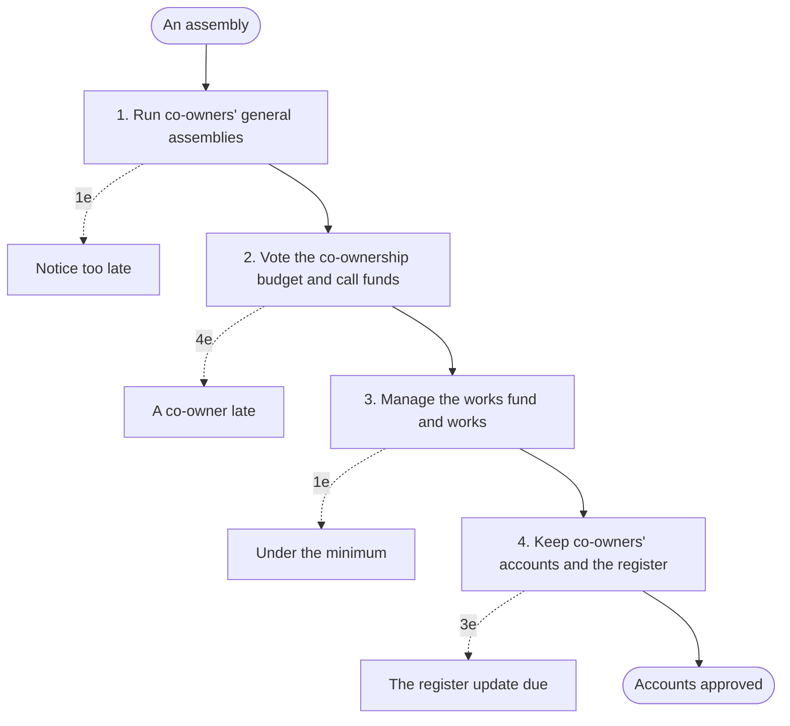

🏠 [Specs](../../../README.md) › 🏷️ [Sectors](../../README.md) › 🏘️ [SC10 Real estate](../README.md) ›
🔀 [Flows](README.md) › 🔀 FL-SC10-05 Co-ownership

# 🔀 FL-SC10-05 Co-ownership

**Status:** ✅ specified

## Summary

Co-ownership: assemblies, calls, the works fund and the register. It covers
[UC-SC10-15 Run co-owners' general assemblies](../use-cases/05-co-ownership/uc-sc10-15-run-co-owners-general-assemblies.md),
[UC-SC10-16 Vote the co-ownership budget and call funds](../use-cases/05-co-ownership/uc-sc10-16-vote-the-co-ownership-budget-and-call-funds.md),
[UC-SC10-17 Manage the works fund and works](../use-cases/05-co-ownership/uc-sc10-17-manage-the-works-fund-and-works.md),
[UC-SC10-18 Keep co-owners' accounts and the register](../use-cases/05-co-ownership/uc-sc10-18-keep-co-owners-accounts-and-the-register.md).

## Personas

- [U05 Accounting](../../../01-users/personas/u05-accounting.md)
- [U09 Customer](../../../01-users/personas/u09-customer.md)
- [U34 Property manager](../../../01-users/personas/u34-property-manager.md)

## Flowchart

## Sequence diagram

See each use case.

## Steps

| Step | Persona | Screen | Use case | What happens |
|---|---|---|---|---|
| 1 | U34, U09 | [S-SC10-15](../screens/05-co-ownership/s-sc10-15-assemblies.md) | [UC-SC10-15](../use-cases/05-co-ownership/uc-sc10-15-run-co-owners-general-assemblies.md) | The co-ownership manager convenes the assembly within the legal notice, holds it and sends the minutes in time |
| 2 | U34, U09 | [S-SC10-16](../screens/05-co-ownership/s-sc10-16-budget-and-calls.md) | [UC-SC10-16](../use-cases/05-co-ownership/uc-sc10-16-vote-the-co-ownership-budget-and-call-funds.md) | The co-owners vote the budget, the co-ownership manager calls funds by each lot's shares and follows payments |
| 3 | U34 | [S-SC10-17](../screens/05-co-ownership/s-sc10-17-works-fund.md) | [UC-SC10-17](../use-cases/05-co-ownership/uc-sc10-17-manage-the-works-fund-and-works.md) | The co-ownership manager sets the works fund contribution at least at the minimum, has works voted and pays them from the fund |
| 4 | U34, U05 | [S-SC10-18](../screens/05-co-ownership/s-sc10-18-co-ownership-accounts.md) | [UC-SC10-18](../use-cases/05-co-ownership/uc-sc10-18-keep-co-owners-accounts-and-the-register.md) | The co-ownership manager and accounting keep the co-owners' accounts, have them approved, and update the national register yearly |

### Entities and screens

| Entity | States in this flow | Shown at step and screen | Aggregated view |
|---|---|---|---|
| [E-SC10-13 Co-owners' assembly](../data/e-sc10-13-co-owners-assembly.md) | Active | 1 [S-SC10-15](../screens/05-co-ownership/s-sc10-15-assemblies.md) | Co-owners' assemblies |
| [E-F25-14 Vote](../../../02-functional/f25-devops-agents/data/e-f25-14-vote.md) | Counted, Withdrawn | Shown elsewhere: [S-F25-24 Public requests](../../../02-functional/f25-devops-agents/screens/05-tell-the-customer/s-f25-24-public-requests.md) | Votes |
| [E-SC10-16 Co-ownership](../data/e-sc10-16-co-ownership.md) | Active | 4 [S-SC10-18](../screens/05-co-ownership/s-sc10-18-co-ownership-accounts.md) | Co-ownerships |
| [E-F8-08 Accounting budget](../../../02-functional/f08-accounting/data/e-f08-08-accounting-budget.md) | Active | Shown elsewhere: [S-F8-09 Analytics and budgets](../../../02-functional/f08-accounting/screens/04-tax-assets-and-analytics/s-f08-09-analytics-and-budgets.md) | Accounting budgets |
| [E-SC10-14 Call for funds](../data/e-sc10-14-call-for-funds.md) | Recorded | 2 [S-SC10-16](../screens/05-co-ownership/s-sc10-16-budget-and-calls.md) | Call for funds |
| [E-SC10-15 Works fund](../data/e-sc10-15-works-fund.md) | Active | 3 [S-SC10-17](../screens/05-co-ownership/s-sc10-17-works-fund.md) | Works funds |
| [E-F8-13 Book](../../../02-functional/f08-accounting/data/e-f08-13-book.md) | Refused | Shown elsewhere: [S-F8-15 Books](../../../02-functional/f08-accounting/screens/06-benchmark-additions/s-f08-15-books.md) | Books |

## Errors

- [UC-SC10-15](../use-cases/05-co-ownership/uc-sc10-15-run-co-owners-general-assemblies.md) 1e. Notice too late: it is
  refused.
- [UC-SC10-15](../use-cases/05-co-ownership/uc-sc10-15-run-co-owners-general-assemblies.md) 4e. Minutes late: the
  manager is reminded.
- [UC-SC10-16](../use-cases/05-co-ownership/uc-sc10-16-vote-the-co-ownership-budget-and-call-funds.md) 4e. A co-owner
  late: a reminder goes out.
- [UC-SC10-16](../use-cases/05-co-ownership/uc-sc10-16-vote-the-co-ownership-budget-and-call-funds.md) 2e. Shares not
  adding up: the call is blocked.
- [UC-SC10-17](../use-cases/05-co-ownership/uc-sc10-17-manage-the-works-fund-and-works.md) 1e. Under the minimum: it is
  refused.
- [UC-SC10-17](../use-cases/05-co-ownership/uc-sc10-17-manage-the-works-fund-and-works.md) 4e. The fund short: a special
  call is proposed.
- [UC-SC10-18](../use-cases/05-co-ownership/uc-sc10-18-keep-co-owners-accounts-and-the-register.md) 3e. The register
  update due: the manager is reminded.
- [UC-SC10-18](../use-cases/05-co-ownership/uc-sc10-18-keep-co-owners-accounts-and-the-register.md) 2e. Accounts not
  approved: they are presented again.

## Images

Every step and error, for each persona taking part, in light and dark mode (D120). Steps are numbered as in the Steps
table; E rows are the error cases.

| Step | Persona | Device | Light | Dark |
|---|---|---|---|---|
| 1 | U34 | desktop | [light](../images/05-co-ownership/u34-property-manager/1-assembly-desktop-light.png) | [dark](../images/05-co-ownership/u34-property-manager/1-assembly-desktop-dark.png) |
| 1 | U34 | tablet | [light](../images/05-co-ownership/u34-property-manager/1-assembly-tablet-light.png) | [dark](../images/05-co-ownership/u34-property-manager/1-assembly-tablet-dark.png) |
| 1 | U09 | phone | [light](../images/05-co-ownership/u09-customer/1-assembly-phone-light.png) | [dark](../images/05-co-ownership/u09-customer/1-assembly-phone-dark.png) |
| 2 | U34 | desktop | [light](../images/05-co-ownership/u34-property-manager/2-calls-desktop-light.png) | [dark](../images/05-co-ownership/u34-property-manager/2-calls-desktop-dark.png) |
| 2 | U34 | tablet | [light](../images/05-co-ownership/u34-property-manager/2-calls-tablet-light.png) | [dark](../images/05-co-ownership/u34-property-manager/2-calls-tablet-dark.png) |
| 2 | U09 | phone | [light](../images/05-co-ownership/u09-customer/2-calls-phone-light.png) | [dark](../images/05-co-ownership/u09-customer/2-calls-phone-dark.png) |
| 3 | U34 | desktop | [light](../images/05-co-ownership/u34-property-manager/3-works-fund-desktop-light.png) | [dark](../images/05-co-ownership/u34-property-manager/3-works-fund-desktop-dark.png) |
| 3 | U34 | tablet | [light](../images/05-co-ownership/u34-property-manager/3-works-fund-tablet-light.png) | [dark](../images/05-co-ownership/u34-property-manager/3-works-fund-tablet-dark.png) |
| 4 | U34 | desktop | [light](../images/05-co-ownership/u34-property-manager/4-register-desktop-light.png) | [dark](../images/05-co-ownership/u34-property-manager/4-register-desktop-dark.png) |
| 4 | U34 | tablet | [light](../images/05-co-ownership/u34-property-manager/4-register-tablet-light.png) | [dark](../images/05-co-ownership/u34-property-manager/4-register-tablet-dark.png) |
| 4 | U05 | desktop | [light](../images/05-co-ownership/u05-accounting/4-register-desktop-light.png) | [dark](../images/05-co-ownership/u05-accounting/4-register-desktop-dark.png) |
| E1 | U34 | desktop | [light](../images/05-co-ownership/u34-property-manager/e1-notice-late-desktop-light.png) | [dark](../images/05-co-ownership/u34-property-manager/e1-notice-late-desktop-dark.png) |
| E1 | U34 | tablet | [light](../images/05-co-ownership/u34-property-manager/e1-notice-late-tablet-light.png) | [dark](../images/05-co-ownership/u34-property-manager/e1-notice-late-tablet-dark.png) |

## Open questions

None.

---

⬅️ [FL-SC10-04 Rents and landlords](fl-sc10-04-rents-and-landlords.md) · ⬆️ [Up](README.md) ·
➡️ [FL-SC10-06 Portal and assistant](fl-sc10-06-portal-and-assistant.md)
