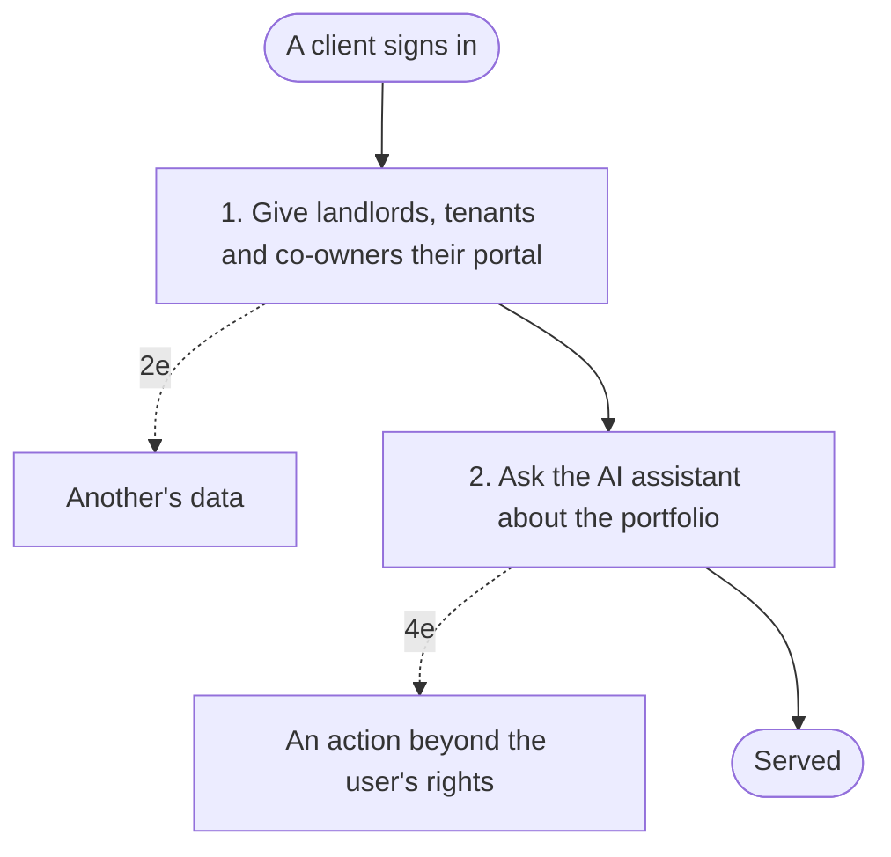

🏠 [Specs](../../../README.md) › 🏷️ [Sectors](../../README.md) › 🏘️ [SC10 Real estate](../README.md) ›
🔀 [Flows](README.md) › 🔀 FL-SC10-06 Portal and assistant

# 🔀 FL-SC10-06 Portal and assistant

**Status:** ✅ specified

## Summary

The shared portal for clients, and the AI assistant. It covers
[UC-SC10-19 Give landlords, tenants and co-owners their portal](../use-cases/06-portal-and-assistant/uc-sc10-19-give-landlords-tenants-and-co-owners-their-portal.md),
[UC-SC10-20 Ask the AI assistant about the portfolio](../use-cases/06-portal-and-assistant/uc-sc10-20-ask-the-assistant-about-the-portfolio.md).

## Personas

- [U09 Customer](../../../01-users/personas/u09-customer.md)
- [U34 Property manager](../../../01-users/personas/u34-property-manager.md)
- [U35 Real-estate agent](../../../01-users/personas/u35-real-estate-agent.md)

## Flowchart

## Sequence diagram

See each use case.

## Steps

| Step | Persona | Screen | Use case | What happens |
|---|---|---|---|---|
| 1 | U09 | [S-SC10-19](../screens/06-portal-and-assistant/s-sc10-19-portal.md) | [UC-SC10-19](../use-cases/06-portal-and-assistant/uc-sc10-19-give-landlords-tenants-and-co-owners-their-portal.md) | Landlords, tenants and co-owners sign in to the portal built on the shared portal capability, see documents and balances, pay, and send requests |
| 2 | U34, U35 | [S-SC10-20](../screens/06-portal-and-assistant/s-sc10-20-portfolio-assistant.md) | [UC-SC10-20](../use-cases/06-portal-and-assistant/uc-sc10-20-ask-the-assistant-about-the-portfolio.md) | The property manager or agent asks the AI assistant about unpaid rents, leases to index or a building's works, within their role's rights |

### Entities and screens

| Entity | States in this flow | Shown at step and screen | Aggregated view |
|---|---|---|---|
| [E-F1-17 Portal account](../../../02-functional/f01-administration/data/e-f01-17-portal-account.md) | Invited, Active, Blocked, Deactivated | Shown elsewhere: [S-F1-19 Portal accounts](../../../02-functional/f01-administration/screens/12-portal-accounts-and-integrations/s-f01-19-portal-accounts.md) | Portal accounts |
| [E-F3-04 Assistant change batch](../../../02-functional/f03-assistant/data/e-f03-04-assistant-change-batch.md) | Proposed, Cancelled, Done, Partly done, Undone | Shown elsewhere: [S-F3-01 Assistant panel](../../../02-functional/f03-assistant/screens/01-ask-the-assistant/s-f03-01-assistant-panel.md) | Assistant change batches |
| [E-F1-03 User](../../../02-functional/f01-administration/data/e-f01-03-user.md) | Invited, Active, Deactivated | Shown elsewhere: [S-F1-03 Users](../../../02-functional/f01-administration/screens/03-user-lifecycle/s-f01-03-users.md) | Users |
| [E-F1-06 Role](../../../02-functional/f01-administration/data/e-f01-06-role.md) | Active | Shown elsewhere: [S-F1-06 Role editor](../../../02-functional/f01-administration/screens/04-edit-a-role/s-f01-06-role-editor.md) | Roles |

## Errors

- [UC-SC10-19](../use-cases/06-portal-and-assistant/uc-sc10-19-give-landlords-tenants-and-co-owners-their-portal.md) 2e.
  Another's data: it is never shown.
- [UC-SC10-19](../use-cases/06-portal-and-assistant/uc-sc10-19-give-landlords-tenants-and-co-owners-their-portal.md) 3e.
  Payment refused: the balance stays.
- [UC-SC10-20](../use-cases/06-portal-and-assistant/uc-sc10-20-ask-the-assistant-about-the-portfolio.md) 4e. An action
  beyond the user's rights: the AI assistant refuses and says which role can do it.
- [UC-SC10-20](../use-cases/06-portal-and-assistant/uc-sc10-20-ask-the-assistant-about-the-portfolio.md) 2e. No data to
  answer: the AI assistant says so and does not guess.

## Images

Every step and error, for each persona taking part, in light and dark mode (D120). Steps are numbered as in the Steps
table; E rows are the error cases.

| Step | Persona | Device | Light | Dark |
|---|---|---|---|---|
| 1 | U09 | phone | [light](../images/06-portal-and-assistant/u09-customer/1-portal-phone-light.png) | [dark](../images/06-portal-and-assistant/u09-customer/1-portal-phone-dark.png) |
| 2 | U34 | desktop | [light](../images/06-portal-and-assistant/u34-property-manager/2-assistant-desktop-light.png) | [dark](../images/06-portal-and-assistant/u34-property-manager/2-assistant-desktop-dark.png) |
| 2 | U34 | tablet | [light](../images/06-portal-and-assistant/u34-property-manager/2-assistant-tablet-light.png) | [dark](../images/06-portal-and-assistant/u34-property-manager/2-assistant-tablet-dark.png) |
| 2 | U35 | desktop | [light](../images/06-portal-and-assistant/u35-real-estate-agent/2-assistant-desktop-light.png) | [dark](../images/06-portal-and-assistant/u35-real-estate-agent/2-assistant-desktop-dark.png) |
| 2 | U35 | phone | [light](../images/06-portal-and-assistant/u35-real-estate-agent/2-assistant-phone-light.png) | [dark](../images/06-portal-and-assistant/u35-real-estate-agent/2-assistant-phone-dark.png) |
| 2 | U35 | tablet | [light](../images/06-portal-and-assistant/u35-real-estate-agent/2-assistant-tablet-light.png) | [dark](../images/06-portal-and-assistant/u35-real-estate-agent/2-assistant-tablet-dark.png) |
| E1 | U09 | phone | [light](../images/06-portal-and-assistant/u09-customer/e1-other-data-phone-light.png) | [dark](../images/06-portal-and-assistant/u09-customer/e1-other-data-phone-dark.png) |

## Open questions

None.

---

⬅️ [FL-SC10-05 Co-ownership](fl-sc10-05-co-ownership.md) · ⬆️ [Up](README.md) ·
➡️ [FL-SC10-07 Short stays, commercial leases, LMNP and coworking](fl-sc10-07-short-stays-commercial-and-coworking.md)
