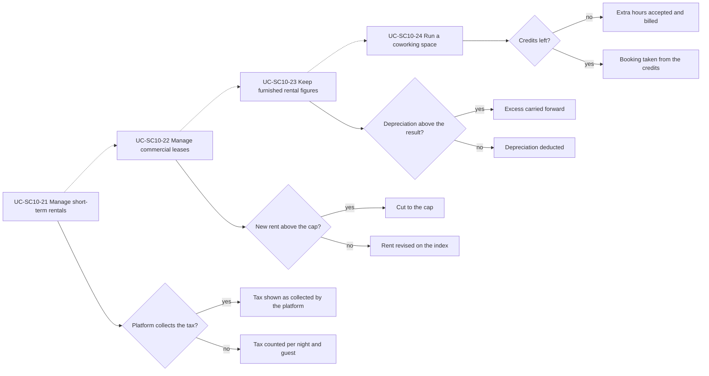
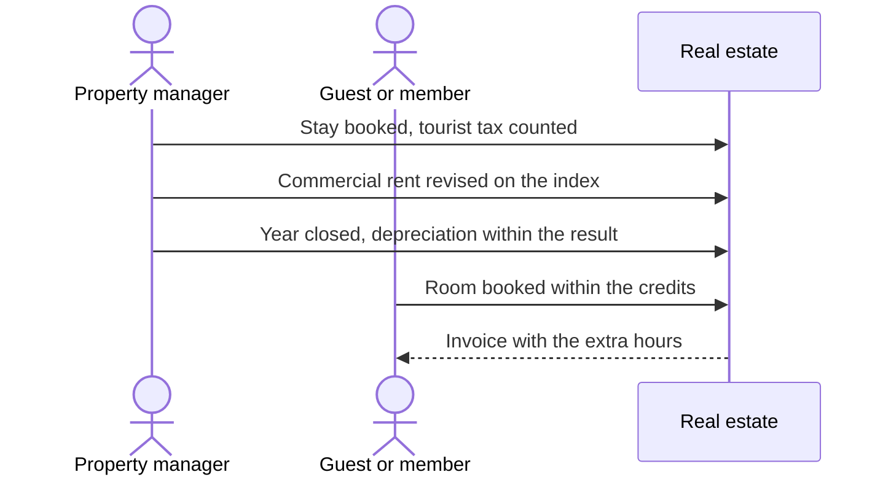

🏠 [Specs](../../../README.md) › 🏷️ [Sectors](../../README.md) › 🏘️ [SC10 Real estate](../README.md) ›
🔀 [Flows](README.md) › 🔀 FL-SC10-07 Short stays, commercial leases, LMNP and coworking

# 🔀 FL-SC10-07 Short stays, commercial leases, LMNP and coworking

**Status:** ✅ specified

## Summary

Four situations of property managers that real estate suites handle: short-term rentals with the tourist tax counted per
night and guest, commercial leases revised on the ILC or ILAT within the caps, the yearly figures of furnished rentals
with their depreciation, and a coworking space with membership credits
([D554](../../../06-decisions/sectors/d554-benchmark-gaps-sc10-real-estate.md)).

## Personas

- [U34 Property manager](../../../01-users/personas/u34-property-manager.md), who books, revises, computes and runs the
  space
- [U09 Customer](../../../01-users/personas/u09-customer.md), who books, reads their figures and pays on the phone

## Flowchart

## Sequence diagram

## Steps

| Step | Persona | Screen | Use case | What happens |
|---|---|---|---|---|
| 1 | [U34](../../../01-users/personas/u34-property-manager.md) | [S-SC10-21](../screens/07-short-stays-commercial-and-coworking/s-sc10-21-short-term-rentals.md) | [UC-SC10-21](../use-cases/07-short-stays-commercial-and-coworking/uc-sc10-21-manage-short-term-rentals.md) | The property manager books the stay, the guest pays a deposit on the phone and the tourist tax is counted per night and guest |
| 2 | [U34](../../../01-users/personas/u34-property-manager.md) | [S-SC10-22](../screens/07-short-stays-commercial-and-coworking/s-sc10-22-commercial-leases.md) | [UC-SC10-22](../use-cases/07-short-stays-commercial-and-coworking/uc-sc10-22-manage-commercial-leases.md) | The property manager revises the rent of a commercial lease on its index within the caps |
| 3 | [U34](../../../01-users/personas/u34-property-manager.md) | [S-SC10-23](../screens/07-short-stays-commercial-and-coworking/s-sc10-23-furnished-rentals.md) | [UC-SC10-23](../use-cases/07-short-stays-commercial-and-coworking/uc-sc10-23-keep-furnished-rental-figures.md) | The property manager closes the year of a furnished property and the landlord reads the figures on the phone |
| 4 | [U34](../../../01-users/personas/u34-property-manager.md) | [S-SC10-24](../screens/07-short-stays-commercial-and-coworking/s-sc10-24-coworking.md) | [UC-SC10-24](../use-cases/07-short-stays-commercial-and-coworking/uc-sc10-24-run-a-coworking-space.md) | The member books a room within the credits on the phone and the manager follows the occupancy |

### Entities and screens

| Entity | States in this flow | Shown at step and screen | Aggregated view |
|---|---|---|---|
| [E-SC10-17 Stay](../data/e-sc10-17-stay.md) | Booked, Staying, Completed, Cancelled | 1 [S-SC10-21](../screens/07-short-stays-commercial-and-coworking/s-sc10-21-short-term-rentals.md) | Stays |
| [E-SC10-18 Commercial lease](../data/e-sc10-18-commercial-lease.md) | Draft, Active, Notice given, Ended | 2 [S-SC10-22](../screens/07-short-stays-commercial-and-coworking/s-sc10-22-commercial-leases.md) | Commercial leases |
| [E-SC10-19 Furnished property](../data/e-sc10-19-furnished-property.md) | Draft, Active, Closed | 3 [S-SC10-23](../screens/07-short-stays-commercial-and-coworking/s-sc10-23-furnished-rentals.md) | Furnished properties |
| [E-SC10-20 Membership](../data/e-sc10-20-membership.md) | Pending, Active, Paused, Ended | 4 [S-SC10-24](../screens/07-short-stays-commercial-and-coworking/s-sc10-24-coworking.md) | Memberships |

## Errors

- **E1 The index cap is exceeded.** The revision would raise the rent above the cap; the rent is cut to the cap and the
  difference is shown ([BR-SC10-17](../business-rules/br-sc10-17-rents-are-indexed-on-ilc-or-ilat-within-the-caps.md),
  step 2).

## Images

Every step and error, for each persona taking part, in light and dark mode (D120). Steps are numbered as in the Steps
table; E rows are the error cases.

| Step | Persona | Device | Light | Dark |
|---|---|---|---|---|
| 1 | U34 | desktop | [light](../images/07-short-stays-commercial-and-coworking/u34-property-manager/1-short-term-rentals-desktop-light.png) | [dark](../images/07-short-stays-commercial-and-coworking/u34-property-manager/1-short-term-rentals-desktop-dark.png) |
| 1 | U09 | phone | [light](../images/07-short-stays-commercial-and-coworking/u09-customer/1-short-term-rentals-phone-light.png) | [dark](../images/07-short-stays-commercial-and-coworking/u09-customer/1-short-term-rentals-phone-dark.png) |
| 1 | U34 | tablet | [light](../images/07-short-stays-commercial-and-coworking/u34-property-manager/1-short-term-rentals-tablet-light.png) | [dark](../images/07-short-stays-commercial-and-coworking/u34-property-manager/1-short-term-rentals-tablet-dark.png) |
| 2 | U34 | desktop | [light](../images/07-short-stays-commercial-and-coworking/u34-property-manager/2-commercial-leases-desktop-light.png) | [dark](../images/07-short-stays-commercial-and-coworking/u34-property-manager/2-commercial-leases-desktop-dark.png) |
| 2 | U34 | tablet | [light](../images/07-short-stays-commercial-and-coworking/u34-property-manager/2-commercial-leases-tablet-light.png) | [dark](../images/07-short-stays-commercial-and-coworking/u34-property-manager/2-commercial-leases-tablet-dark.png) |
| 3 | U34 | desktop | [light](../images/07-short-stays-commercial-and-coworking/u34-property-manager/3-furnished-rentals-desktop-light.png) | [dark](../images/07-short-stays-commercial-and-coworking/u34-property-manager/3-furnished-rentals-desktop-dark.png) |
| 3 | U09 | phone | [light](../images/07-short-stays-commercial-and-coworking/u09-customer/3-furnished-rentals-phone-light.png) | [dark](../images/07-short-stays-commercial-and-coworking/u09-customer/3-furnished-rentals-phone-dark.png) |
| 3 | U34 | tablet | [light](../images/07-short-stays-commercial-and-coworking/u34-property-manager/3-furnished-rentals-tablet-light.png) | [dark](../images/07-short-stays-commercial-and-coworking/u34-property-manager/3-furnished-rentals-tablet-dark.png) |
| 4 | U34 | desktop | [light](../images/07-short-stays-commercial-and-coworking/u34-property-manager/4-coworking-desktop-light.png) | [dark](../images/07-short-stays-commercial-and-coworking/u34-property-manager/4-coworking-desktop-dark.png) |
| 4 | U09 | phone | [light](../images/07-short-stays-commercial-and-coworking/u09-customer/4-coworking-phone-light.png) | [dark](../images/07-short-stays-commercial-and-coworking/u09-customer/4-coworking-phone-dark.png) |
| 4 | U34 | tablet | [light](../images/07-short-stays-commercial-and-coworking/u34-property-manager/4-coworking-tablet-light.png) | [dark](../images/07-short-stays-commercial-and-coworking/u34-property-manager/4-coworking-tablet-dark.png) |
| E1 | U34 | desktop | [light](../images/07-short-stays-commercial-and-coworking/u34-property-manager/e1-the-index-cap-is-exceeded-desktop-light.png) | [dark](../images/07-short-stays-commercial-and-coworking/u34-property-manager/e1-the-index-cap-is-exceeded-desktop-dark.png) |
| E1 | U34 | tablet | [light](../images/07-short-stays-commercial-and-coworking/u34-property-manager/e1-the-index-cap-is-exceeded-tablet-light.png) | [dark](../images/07-short-stays-commercial-and-coworking/u34-property-manager/e1-the-index-cap-is-exceeded-tablet-dark.png) |

## Open questions

None.

---

⬅️ [FL-SC10-06 Portal and assistant](fl-sc10-06-portal-and-assistant.md) · ⬆️ [Up](README.md)
