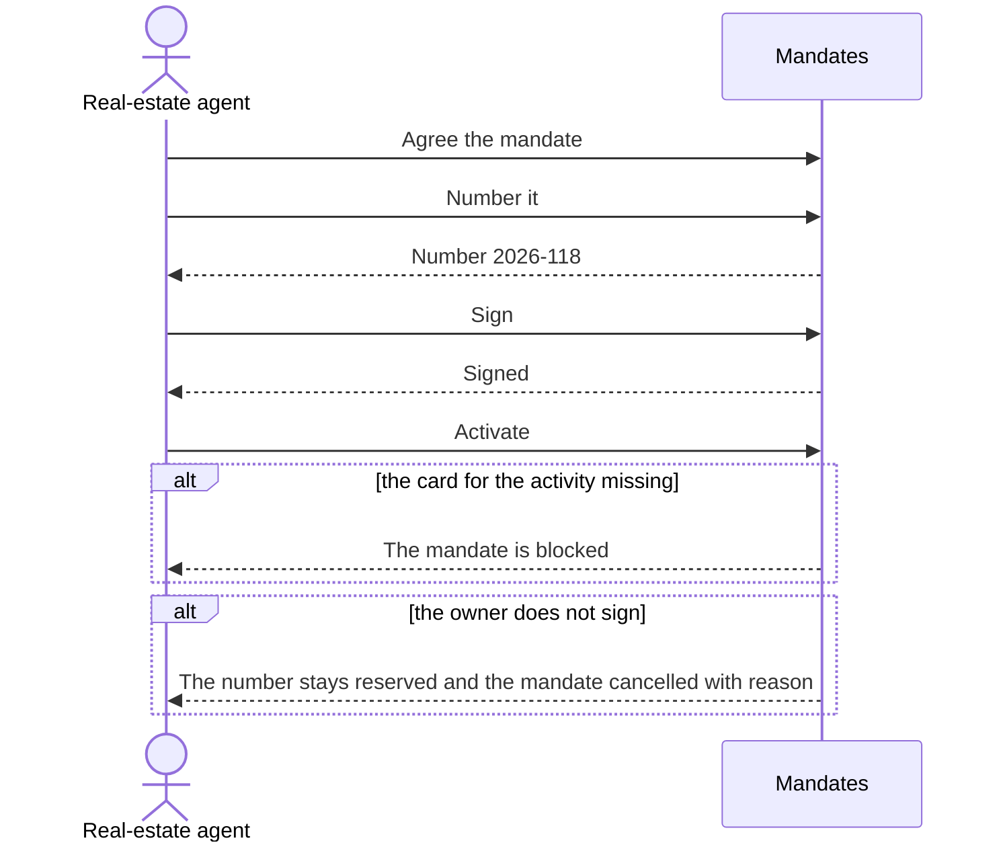

🏠 [Specs](../../../../README.md) › 🏷️ [Sectors](../../../README.md) › 🏘️ [SC10 Real estate](../../README.md) ›
📝 [Use cases](../README.md) › 📝 [Use cases: FL-SC10-01 Mandates and listings](README.md) ›
📝 UC-SC10-01 Take a mandate and record it in the register

# 📝 UC-SC10-01 Take a mandate and record it in the register

**Status:** ✅ specified

## Summary

The real-estate agent agrees a sale or letting mandate with the owner, numbers it in the agency's mandates register
before any action, and has it signed.

## Personas

- [U35 Real-estate agent](../../../../01-users/personas/u35-real-estate-agent.md)

## Goal

A numbered, signed mandate that allows the agent to act.

## Trigger

An owner wants to sell or let.

## Frequency

Several a week.

## Preconditions

- The SC10 sector pack is installed for the company,
  [UC-F14-02](../../../../02-functional/f14-plugin-store/use-cases/01-find-and-install/uc-f14-02-install-a-plugin-or-sector-pack.md),
  and its users have their roles,
  [UC-F1-06](../../../../02-functional/f01-administration/use-cases/04-edit-a-role/uc-f01-06-edit-a-role-and-its-record-rules.md).
- The agency's professional card covers the activity
  ([BR-SC10-01](../../business-rules/br-sc10-01-real-estate-follows-the-country-pack.md)).

## Postconditions

- **Success:** the mandate is numbered, signed and active.
- **Failed:** no mandate; the agent cannot list the property.

## Main flow

1. The agent records the owner, property, price and terms on
   [S-SC10-01 Mandates](../../screens/01-mandates-and-listings/s-sc10-01-mandates.md).
2. The mandate gets the register's next number
   ([BR-SC10-02](../../business-rules/br-sc10-02-mandates-numbered-in-the-register.md)).
3. The owner signs by e-signature,
   [UC-F2-14](../../../../02-functional/f02-no-code-configuration/use-cases/07-benchmark-additions/uc-f02-14-send-documents-for-e-signature.md).
4. The mandate is active until its end date.

## Alternative flows

- 1a. An exclusive mandate: its exclusivity and end date are recorded.

## Error flows

- 1e. The card for the activity missing: the mandate is blocked.
- 3e. The owner does not sign: the number stays reserved and the mandate cancelled with reason.
- Any step: a call to a service or an outside system fails: it is retried first
  ([BR-F3-32](../../../../02-functional/f03-assistant/business-rules/br-f03-32-retry-before-an-error.md)), then the
  error message pattern ([D122](../../../../06-decisions/ux/d122-error-message-standard.md)) says what failed; what was
  typed is kept.

## Business rules

- [BR-SC10-02 Mandates numbered in the register](../../business-rules/br-sc10-02-mandates-numbered-in-the-register.md)
- [BR-SC10-01 Real estate follows the country pack](../../business-rules/br-sc10-01-real-estate-follows-the-country-pack.md)

## Entities

- [E-SC10-01 Mandate](../../data/e-sc10-01-mandate.md)

## Permissions

The real-estate agent roles; the record rules of their role and site apply,
[UC-F1-06](../../../../02-functional/f01-administration/use-cases/04-edit-a-role/uc-f01-06-edit-a-role-and-its-record-rules.md).

## Notifications

None beyond the in-app updates of the records concerned.

## Audit events

Every creation, change and state change of mandate records, with who, when and the values before and after (T3).

## AI involvement

The AI assistant answers questions on the mandate records of this use case, with links, and prepares them as drafts the
user confirms. It works within the user's rights,
[BR-F3-34](../../../../02-functional/f03-assistant/business-rules/br-f03-34-every-capability-is-reachable-from-the-assistant.md),
and never deletes or does anything irreversible without the user's confirmation,
[BR-F3-07](../../../../02-functional/f03-assistant/business-rules/br-f03-07-no-deletes-no-irreversible-acts.md).

## API, MCP and A2A exposure

Through the API and webhooks (T5) and the MCP and A2A gateway (T6), with the caller's rights,
[BR-F3-34](../../../../02-functional/f03-assistant/business-rules/br-f03-34-every-capability-is-reachable-from-the-assistant.md),
reading, creating and changing the records of this use case; nothing irreversible without a person's confirmation.

## Screens

- [S-SC10-01 Mandates](../../screens/01-mandates-and-listings/s-sc10-01-mandates.md)

## Flowchart

See [FL-SC10-01 Mandates and listings](../../flows/fl-sc10-01-mandates-and-listings.md#flowchart).

## Sequence diagram

## Acceptance criteria

1. **Given** the example estate agency's sale mandate for J. Petit's flat in Lyon 3 at 320,000 EUR **when** it is
   created **then** it gets number 2026-118 in the register.
2. **Given** a letting mandate in an agency whose card covers sales only **when** it is created **then** the mandate is
   blocked.

## Non-functional notes

[D408](../../../../06-decisions/technical/d408-performance-and-profiles.md)'s targets
([performance](../../../../05-non-functional/performance.md)): 95 % of screens within 1 second; lists paged on the
server, the first page within 1 second; reports within 5 seconds or in the background. WCAG 2.2 AA and RGAA
([D46](../../../../06-decisions/ux/d46-accessibility-standard.md)).

## Regulatory references

Legal values from the France country pack:
[CR-FR-139 Agents' card, client-funds guarantee and mandates register](../../../../10-country-packs/france/real-estate/cr-fr-139-hoguet-card-and-guarantee.md).

## Related use cases

- [UC-SC10-02 Publish listings on portals](uc-sc10-02-publish-listings-on-portals.md)

## Open questions

None.

---

⬆️ [Up](README.md) · ➡️ [UC-SC10-02 Publish listings on portals](uc-sc10-02-publish-listings-on-portals.md)
