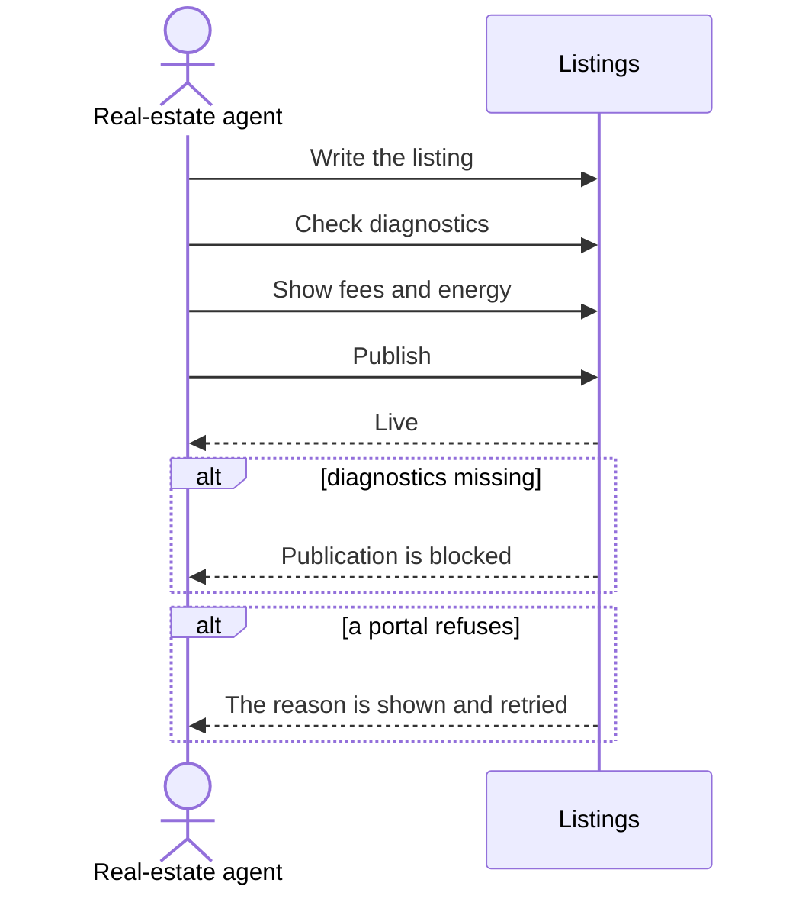

🏠 [Specs](../../../../README.md) › 🏷️ [Sectors](../../../README.md) › 🏘️ [SC10 Real estate](../../README.md) ›
📝 [Use cases](../README.md) › 📝 [Use cases: FL-SC10-01 Mandates and listings](README.md) ›
📝 UC-SC10-02 Publish listings on portals

# 📝 UC-SC10-02 Publish listings on portals

**Status:** ✅ specified

## Summary

The agent writes the listing, checks the diagnostics are valid, and publishes it on portals through their connectors.

## Personas

- [U35 Real-estate agent](../../../../01-users/personas/u35-real-estate-agent.md)

## Goal

Listings online with the legal mentions.

## Trigger

A mandate is signed.

## Frequency

Several a week.

## Preconditions

- The SC10 sector pack is installed for the company,
  [UC-F14-02](../../../../02-functional/f14-plugin-store/use-cases/01-find-and-install/uc-f14-02-install-a-plugin-or-sector-pack.md),
  and its users have their roles,
  [UC-F1-06](../../../../02-functional/f01-administration/use-cases/04-edit-a-role/uc-f01-06-edit-a-role-and-its-record-rules.md).

## Postconditions

- **Success:** the listing is live on the chosen portals.
- **Failed:** the listing stays a draft.

## Main flow

1. The agent writes text and photos on
   [S-SC10-02 Listings](../../screens/01-mandates-and-listings/s-sc10-02-listings.md).
2. SimpleERP checks diagnostics are valid
   ([BR-SC10-08](../../business-rules/br-sc10-08-diagnostics-valid-before-listing.md)).
3. The fees and energy rating show on the listing
   ([UC-SC10-06](../02-sales/uc-sc10-06-bill-and-display-agency-fees.md)).
4. The listing goes to the portals (T12).

## Alternative flows

- 4a. A price change: it updates every portal at once.

## Error flows

- 2e. Diagnostics missing: publication is blocked.
- 4e. A portal refuses: the reason is shown and retried.
- Any step: a call to a service or an outside system fails: it is retried first
  ([BR-F3-32](../../../../02-functional/f03-assistant/business-rules/br-f03-32-retry-before-an-error.md)), then the
  error message pattern ([D122](../../../../06-decisions/ux/d122-error-message-standard.md)) says what failed; what was
  typed is kept.

## Business rules

- [BR-SC10-08 Diagnostics valid before listing](../../business-rules/br-sc10-08-diagnostics-valid-before-listing.md)

## Entities

- [E-SC10-02 Property listing](../../data/e-sc10-02-property-listing.md)
- [E-SC10-12 Diagnostic](../../data/e-sc10-12-diagnostic.md)

## Permissions

The real-estate agent roles; the record rules of their role and site apply,
[UC-F1-06](../../../../02-functional/f01-administration/use-cases/04-edit-a-role/uc-f01-06-edit-a-role-and-its-record-rules.md).

## Notifications

None beyond the in-app updates of the records concerned.

## Audit events

Every creation, change and state change of listing, diagnostic records, with who, when and the values before and after
(T3).

## AI involvement

The AI assistant answers questions on the listing, diagnostic records of this use case, with links, and prepares them as
drafts the user confirms. It works within the user's rights,
[BR-F3-34](../../../../02-functional/f03-assistant/business-rules/br-f03-34-every-capability-is-reachable-from-the-assistant.md),
and never deletes or does anything irreversible without the user's confirmation,
[BR-F3-07](../../../../02-functional/f03-assistant/business-rules/br-f03-07-no-deletes-no-irreversible-acts.md).

## API, MCP and A2A exposure

Through the API and webhooks (T5) and the MCP and A2A gateway (T6), with the caller's rights,
[BR-F3-34](../../../../02-functional/f03-assistant/business-rules/br-f03-34-every-capability-is-reachable-from-the-assistant.md),
reading, creating and changing the records of this use case; nothing irreversible without a person's confirmation.

## Screens

- [S-SC10-02 Listings](../../screens/01-mandates-and-listings/s-sc10-02-listings.md)

## Flowchart

See [FL-SC10-01 Mandates and listings](../../flows/fl-sc10-01-mandates-and-listings.md#flowchart).

## Sequence diagram

## Acceptance criteria

1. **Given** the example estate agency's listing 2026-118 rated C **when** it is published on 3 portals **then** each
   shows rating C.
2. **Given** listing 2026-118 without its energy diagnostic **when** it is published **then** publication is blocked.

## Non-functional notes

[D408](../../../../06-decisions/technical/d408-performance-and-profiles.md)'s targets
([performance](../../../../05-non-functional/performance.md)): 95 % of screens within 1 second; lists paged on the
server, the first page within 1 second; reports within 5 seconds or in the background. WCAG 2.2 AA and RGAA
([D46](../../../../06-decisions/ux/d46-accessibility-standard.md)).

## Regulatory references

Legal values from the France country pack:
[CR-FR-144 Mandatory property diagnostics](../../../../10-country-packs/france/real-estate/cr-fr-144-property-diagnostics.md).

## Related use cases

- [UC-SC10-03 Organise viewings](../02-sales/uc-sc10-03-organise-viewings.md)

## Open questions

None.

---

⬅️ [UC-SC10-01](uc-sc10-01-take-a-mandate-and-record-it-in-the-register.md) · ⬆️ [Up](README.md) ·
➡️ [UC-SC10-03 Organise viewings](../02-sales/uc-sc10-03-organise-viewings.md)
