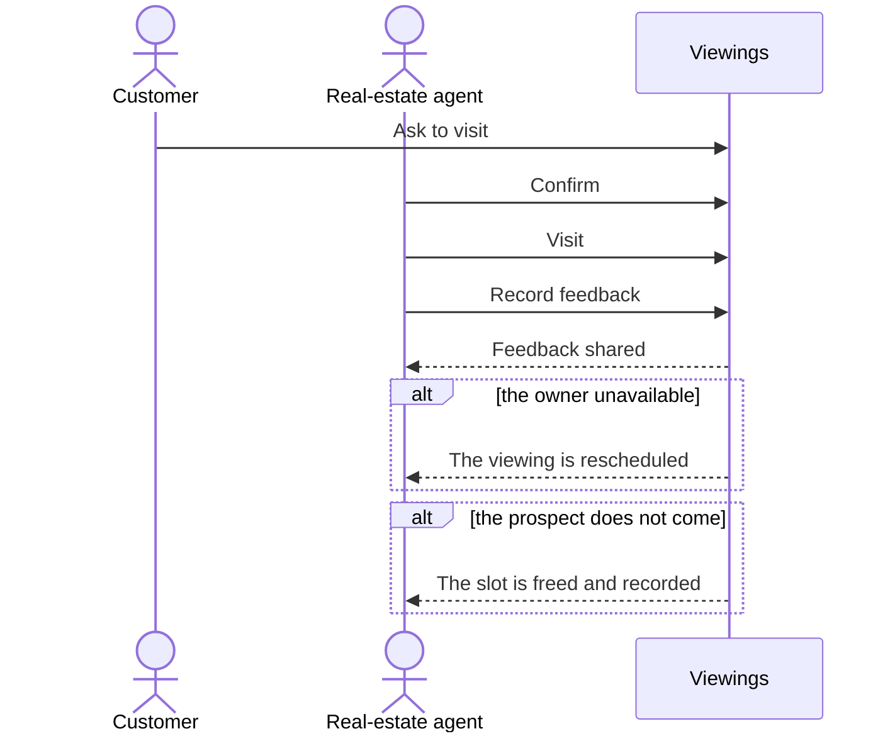

🏠 [Specs](../../../../README.md) › 🏷️ [Sectors](../../../README.md) › 🏘️ [SC10 Real estate](../../README.md) ›
📝 [Use cases](../README.md) › 📝 [Use cases: FL-SC10-02 Sales](README.md) › 📝 UC-SC10-03 Organise viewings

# 📝 UC-SC10-03 Organise viewings

**Status:** ✅ specified

## Summary

The agent books viewings with buyers or tenants, visits, and records their feedback for the owner.

## Personas

- [U35 Real-estate agent](../../../../01-users/personas/u35-real-estate-agent.md)
- [U09 Customer](../../../../01-users/personas/u09-customer.md)

## Goal

Viewings that lead to offers.

## Trigger

A prospect asks to visit.

## Frequency

Many a week.

## Preconditions

- The SC10 sector pack is installed for the company,
  [UC-F14-02](../../../../02-functional/f14-plugin-store/use-cases/01-find-and-install/uc-f14-02-install-a-plugin-or-sector-pack.md),
  and its users have their roles,
  [UC-F1-06](../../../../02-functional/f01-administration/use-cases/04-edit-a-role/uc-f01-06-edit-a-role-and-its-record-rules.md).

## Postconditions

- **Success:** the viewing is done and its feedback shared.
- **Failed:** the viewing is rescheduled.

## Main flow

1. The prospect asks from the listing; the agent books on
   [S-SC10-03 Viewings](../../screens/02-sales/s-sc10-03-viewings.md),
   [UC-F4-18](../../../../02-functional/f04-meetings/use-cases/10-benchmark-additions/uc-f04-18-let-customers-book-appointments.md).
2. The agent confirms with the owner or tenant.
3. The agent visits with the prospect.
4. The agent records feedback, shared with the owner.

## Alternative flows

- 1a. A group viewing: several prospects are booked on one slot.

## Error flows

- 2e. The owner unavailable: the viewing is rescheduled.
- 3e. The prospect does not come: the slot is freed and recorded.
- Any step: a call to a service or an outside system fails: it is retried first
  ([BR-F3-32](../../../../02-functional/f03-assistant/business-rules/br-f03-32-retry-before-an-error.md)), then the
  error message pattern ([D122](../../../../06-decisions/ux/d122-error-message-standard.md)) says what failed; what was
  typed is kept.

## Business rules

- [BR-SC10-01 Real estate follows the country pack](../../business-rules/br-sc10-01-real-estate-follows-the-country-pack.md)

## Entities

- [E-SC10-03 Viewing](../../data/e-sc10-03-viewing.md)

## Permissions

The real-estate agent and customer roles; the record rules of their role and site apply,
[UC-F1-06](../../../../02-functional/f01-administration/use-cases/04-edit-a-role/uc-f01-06-edit-a-role-and-its-record-rules.md).

## Notifications

None beyond the in-app updates of the records concerned.

## Audit events

Every creation, change and state change of viewing records, with who, when and the values before and after (T3).

## AI involvement

The AI assistant answers questions on the viewing records of this use case, with links, and prepares them as drafts the
user confirms. It works within the user's rights,
[BR-F3-34](../../../../02-functional/f03-assistant/business-rules/br-f03-34-every-capability-is-reachable-from-the-assistant.md),
and never deletes or does anything irreversible without the user's confirmation,
[BR-F3-07](../../../../02-functional/f03-assistant/business-rules/br-f03-07-no-deletes-no-irreversible-acts.md).

## API, MCP and A2A exposure

Through the API and webhooks (T5) and the MCP and A2A gateway (T6), with the caller's rights,
[BR-F3-34](../../../../02-functional/f03-assistant/business-rules/br-f03-34-every-capability-is-reachable-from-the-assistant.md),
reading, creating and changing the records of this use case; nothing irreversible without a person's confirmation.

## Screens

- [S-SC10-03 Viewings](../../screens/02-sales/s-sc10-03-viewings.md)

## Flowchart

See [FL-SC10-02 Sales](../../flows/fl-sc10-02-sales.md#flowchart).

## Sequence diagram

## Acceptance criteria

1. **Given** the example estate agency's viewing of 2026-118 by A. Bauer on Saturday at 10:00 **when** feedback is
   recorded **then** J. Petit sees "likes the light" on his portal.
2. **Given** A. Bauer on Saturday at 10:00 with the owner away **when** it is confirmed **then** the viewing is
   rescheduled.

## Non-functional notes

[D408](../../../../06-decisions/technical/d408-performance-and-profiles.md)'s targets
([performance](../../../../05-non-functional/performance.md)): 95 % of screens within 1 second; lists paged on the
server, the first page within 1 second; reports within 5 seconds or in the background. WCAG 2.2 AA and RGAA
([D46](../../../../06-decisions/ux/d46-accessibility-standard.md)).

## Regulatory references

None specific to this use case; the sector's legal rules are listed in [SC10 regulatory](../../regulatory.md).

## Related use cases

- [UC-SC10-04 Receive offers and prepare the sale agreement](uc-sc10-04-receive-offers-and-prepare-the-sale-agreement.md)

## Open questions

None.

---

⬅️ [UC-SC10-02 Publish listings on portals](../01-mandates-and-listings/uc-sc10-02-publish-listings-on-portals.md) ·
⬆️ [Up](README.md) · ➡️ [UC-SC10-04](uc-sc10-04-receive-offers-and-prepare-the-sale-agreement.md)
