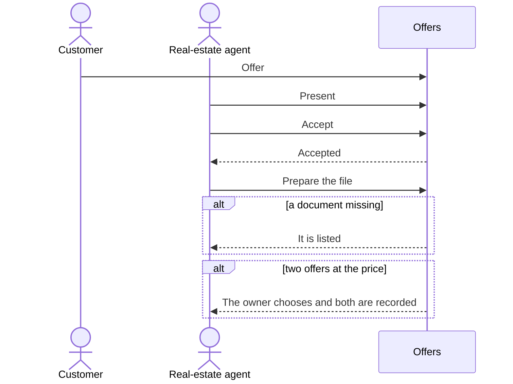

🏠 [Specs](../../../../README.md) › 🏷️ [Sectors](../../../README.md) › 🏘️ [SC10 Real estate](../../README.md) ›
📝 [Use cases](../README.md) › 📝 [Use cases: FL-SC10-02 Sales](README.md) ›
📝 UC-SC10-04 Receive offers and prepare the sale agreement

# 📝 UC-SC10-04 Receive offers and prepare the sale agreement

**Status:** ✅ specified

## Summary

The agent records offers, the owner accepts one, and the agent prepares the agreement file for the notary.

## Personas

- [U35 Real-estate agent](../../../../01-users/personas/u35-real-estate-agent.md)
- [U09 Customer](../../../../01-users/personas/u09-customer.md)

## Goal

An accepted offer and a complete file for the notary.

## Trigger

A buyer makes an offer.

## Frequency

Weekly.

## Preconditions

- The SC10 sector pack is installed for the company,
  [UC-F14-02](../../../../02-functional/f14-plugin-store/use-cases/01-find-and-install/uc-f14-02-install-a-plugin-or-sector-pack.md),
  and its users have their roles,
  [UC-F1-06](../../../../02-functional/f01-administration/use-cases/04-edit-a-role/uc-f01-06-edit-a-role-and-its-record-rules.md).

## Postconditions

- **Success:** the file goes to the notary.
- **Failed:** the offer is refused.

## Main flow

1. The buyer makes an offer, recorded on [S-SC10-04 Offers](../../screens/02-sales/s-sc10-04-offers.md).
2. The agent presents it to the owner.
3. The owner accepts.
4. The agent gathers diagnostics, title and co-ownership documents for the notary.

## Alternative flows

- 2a. A counter-offer: the owner's counter-offer is sent and recorded.

## Error flows

- 4e. A document missing: it is listed.
- 3e. Two offers at the price: the owner chooses and both are recorded.
- Any step: a call to a service or an outside system fails: it is retried first
  ([BR-F3-32](../../../../02-functional/f03-assistant/business-rules/br-f03-32-retry-before-an-error.md)), then the
  error message pattern ([D122](../../../../06-decisions/ux/d122-error-message-standard.md)) says what failed; what was
  typed is kept.

## Business rules

- [BR-SC10-01 Real estate follows the country pack](../../business-rules/br-sc10-01-real-estate-follows-the-country-pack.md)

## Entities

- [E-SC10-04 Offer](../../data/e-sc10-04-offer.md)

## Permissions

The real-estate agent and customer roles; the record rules of their role and site apply,
[UC-F1-06](../../../../02-functional/f01-administration/use-cases/04-edit-a-role/uc-f01-06-edit-a-role-and-its-record-rules.md).

## Notifications

None beyond the in-app updates of the records concerned.

## Audit events

Every creation, change and state change of offer records, with who, when and the values before and after (T3).

## AI involvement

The AI assistant answers questions on the offer records of this use case, with links, and prepares them as drafts the
user confirms. It works within the user's rights,
[BR-F3-34](../../../../02-functional/f03-assistant/business-rules/br-f03-34-every-capability-is-reachable-from-the-assistant.md),
and never deletes or does anything irreversible without the user's confirmation,
[BR-F3-07](../../../../02-functional/f03-assistant/business-rules/br-f03-07-no-deletes-no-irreversible-acts.md).

## API, MCP and A2A exposure

Through the API and webhooks (T5) and the MCP and A2A gateway (T6), with the caller's rights,
[BR-F3-34](../../../../02-functional/f03-assistant/business-rules/br-f03-34-every-capability-is-reachable-from-the-assistant.md),
reading, creating and changing the records of this use case; nothing irreversible without a person's confirmation.

## Screens

- [S-SC10-04 Offers](../../screens/02-sales/s-sc10-04-offers.md)

## Flowchart

See [FL-SC10-02 Sales](../../flows/fl-sc10-02-sales.md#flowchart).

## Sequence diagram

## Acceptance criteria

1. **Given** the example estate agency's offer of 310,000 EUR from A. Bauer on 2026-118 **when** J. Petit accepts
   **then** the offer shows accepted and the file opens.
2. **Given** the co-ownership's minutes missing **when** the file is prepared **then** it is listed.

## Non-functional notes

[D408](../../../../06-decisions/technical/d408-performance-and-profiles.md)'s targets
([performance](../../../../05-non-functional/performance.md)): 95 % of screens within 1 second; lists paged on the
server, the first page within 1 second; reports within 5 seconds or in the background. WCAG 2.2 AA and RGAA
([D46](../../../../06-decisions/ux/d46-accessibility-standard.md)).

## Regulatory references

None specific to this use case; the sector's legal rules are listed in [SC10 regulatory](../../regulatory.md).

## Related use cases

- [UC-SC10-05 Hold client funds under the guarantee](uc-sc10-05-hold-client-funds-under-the-guarantee.md)

## Open questions

None.

---

⬅️ [UC-SC10-03 Organise viewings](uc-sc10-03-organise-viewings.md) · ⬆️ [Up](README.md) ·
➡️ [UC-SC10-05 Hold client funds under the guarantee](uc-sc10-05-hold-client-funds-under-the-guarantee.md)
