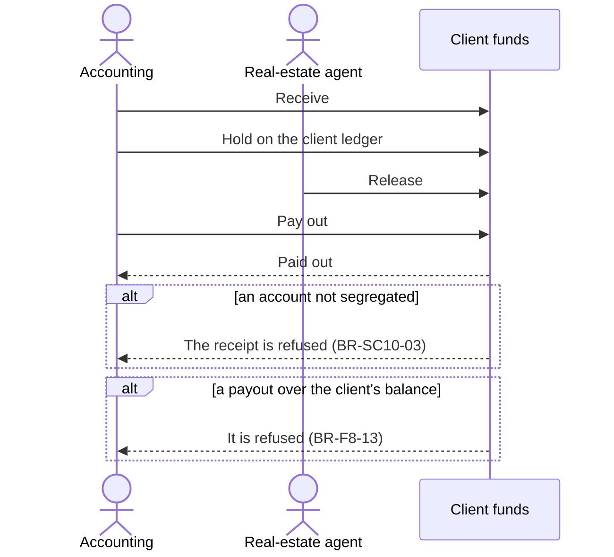

🏠 [Specs](../../../../README.md) › 🏷️ [Sectors](../../../README.md) › 🏘️ [SC10 Real estate](../../README.md) ›
📝 [Use cases](../README.md) › 📝 [Use cases: FL-SC10-02 Sales](README.md) ›
📝 UC-SC10-05 Hold client funds under the guarantee

# 📝 UC-SC10-05 Hold client funds under the guarantee

**Status:** ✅ specified

## Summary

Accounting receives deposits and funds held for clients on segregated accounts with the shared third-party client money
capability, and pays them out when due.

## Personas

- [U05 Accounting](../../../../01-users/personas/u05-accounting.md)
- [U35 Real-estate agent](../../../../01-users/personas/u35-real-estate-agent.md)

## Goal

Client money kept apart and never used for the agency.

## Trigger

A deposit or funds for a client.

## Frequency

Weekly.

## Preconditions

- The SC10 sector pack is installed for the company,
  [UC-F14-02](../../../../02-functional/f14-plugin-store/use-cases/01-find-and-install/uc-f14-02-install-a-plugin-or-sector-pack.md),
  and its users have their roles,
  [UC-F1-06](../../../../02-functional/f01-administration/use-cases/04-edit-a-role/uc-f01-06-edit-a-role-and-its-record-rules.md).

## Postconditions

- **Success:** the funds are held on the client's ledger and paid out when due.
- **Failed:** the receipt is refused.

## Main flow

1. Accounting receives the deposit on [S-SC10-05 Client funds](../../screens/02-sales/s-sc10-05-client-funds.md).
2. It goes to the client's ledger on the segregated account,
   [UC-F8-21](../../../../02-functional/f08-accounting/use-cases/07-client-money-grants-and-non-profits/uc-f08-21-keep-third-party-client-money.md),
   [BR-F8-13](../../../../02-functional/f08-accounting/business-rules/br-f08-13-client-money-is-segregated-and-never-negative-per-client.md).
3. At the deed, the agent releases the funds.
4. Accounting pays the notary.

## Alternative flows

- 3a. The sale falls through: the deposit is refunded.

## Error flows

- 2e. An account not segregated: the receipt is refused
  ([BR-SC10-03](../../business-rules/br-sc10-03-client-funds-kept-apart.md)).
- 4e. A payout over the client's balance: it is refused,
  [BR-F8-13](../../../../02-functional/f08-accounting/business-rules/br-f08-13-client-money-is-segregated-and-never-negative-per-client.md).
- Any step: a call to a service or an outside system fails: it is retried first
  ([BR-F3-32](../../../../02-functional/f03-assistant/business-rules/br-f03-32-retry-before-an-error.md)), then the
  error message pattern ([D122](../../../../06-decisions/ux/d122-error-message-standard.md)) says what failed; what was
  typed is kept.

## Business rules

- [BR-SC10-03 Client funds kept apart](../../business-rules/br-sc10-03-client-funds-kept-apart.md)
- [BR-F8-13 Client money is segregated and never negative per client](../../../../02-functional/f08-accounting/business-rules/br-f08-13-client-money-is-segregated-and-never-negative-per-client.md)

## Entities

- [E-SC10-05 Client fund](../../data/e-sc10-05-client-fund.md)
- [E-F8-17 Client money ledger](../../../../02-functional/f08-accounting/data/e-f08-17-client-money-ledger.md)

## Permissions

The accounting and real-estate agent roles; the record rules of their role and site apply,
[UC-F1-06](../../../../02-functional/f01-administration/use-cases/04-edit-a-role/uc-f01-06-edit-a-role-and-its-record-rules.md).

## Notifications

None beyond the in-app updates of the records concerned.

## Audit events

Every creation, change and state change of client fund, client money ledger records, with who, when and the values
before and after (T3).

## AI involvement

The AI assistant answers questions on the client fund, client money ledger records of this use case, with links, and
prepares them as drafts the user confirms. It works within the user's rights,
[BR-F3-34](../../../../02-functional/f03-assistant/business-rules/br-f03-34-every-capability-is-reachable-from-the-assistant.md),
and never deletes or does anything irreversible without the user's confirmation,
[BR-F3-07](../../../../02-functional/f03-assistant/business-rules/br-f03-07-no-deletes-no-irreversible-acts.md).

## API, MCP and A2A exposure

Through the API and webhooks (T5) and the MCP and A2A gateway (T6), with the caller's rights,
[BR-F3-34](../../../../02-functional/f03-assistant/business-rules/br-f03-34-every-capability-is-reachable-from-the-assistant.md),
reading, creating and changing the records of this use case; nothing irreversible without a person's confirmation.

## Screens

- [S-SC10-05 Client funds](../../screens/02-sales/s-sc10-05-client-funds.md)

## Flowchart

See [FL-SC10-02 Sales](../../flows/fl-sc10-02-sales.md#flowchart).

## Sequence diagram

## Acceptance criteria

1. **Given** the example estate agency's deposit of 15,500 EUR from A. Bauer **when** it is received **then** escrow 1's
   ledger for A. Bauer shows 15,500 EUR.
2. **Given** a deposit sent to the agency's own account **when** it is recorded **then** the receipt is refused
   ([BR-SC10-03](../../business-rules/br-sc10-03-client-funds-kept-apart.md)).

## Non-functional notes

[D408](../../../../06-decisions/technical/d408-performance-and-profiles.md)'s targets
([performance](../../../../05-non-functional/performance.md)): 95 % of screens within 1 second; lists paged on the
server, the first page within 1 second; reports within 5 seconds or in the background. WCAG 2.2 AA and RGAA
([D46](../../../../06-decisions/ux/d46-accessibility-standard.md)).

## Regulatory references

Legal values from the France country pack:
[CR-FR-139 Agents' card, client-funds guarantee and mandates register](../../../../10-country-packs/france/real-estate/cr-fr-139-hoguet-card-and-guarantee.md).

## Related use cases

- [UC-SC10-06 Bill and display agency fees](uc-sc10-06-bill-and-display-agency-fees.md)

## Open questions

None.

---

⬅️ [UC-SC10-04](uc-sc10-04-receive-offers-and-prepare-the-sale-agreement.md) · ⬆️ [Up](README.md) ·
➡️ [UC-SC10-06 Bill and display agency fees](uc-sc10-06-bill-and-display-agency-fees.md)
