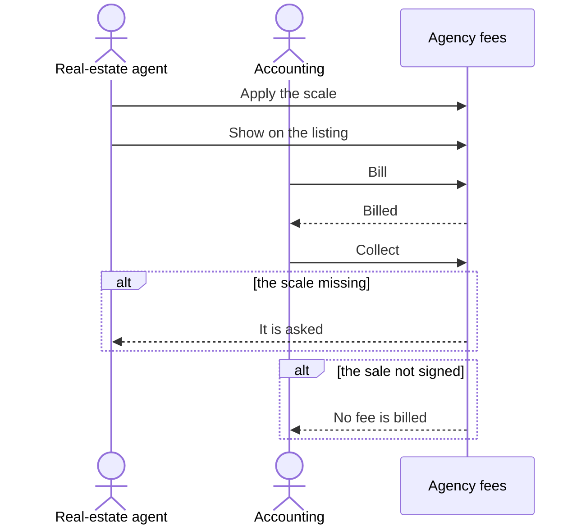

🏠 [Specs](../../../../README.md) › 🏷️ [Sectors](../../../README.md) › 🏘️ [SC10 Real estate](../../README.md) ›
📝 [Use cases](../README.md) › 📝 [Use cases: FL-SC10-02 Sales](README.md) › 📝 UC-SC10-06 Bill and display agency fees

# 📝 UC-SC10-06 Bill and display agency fees

**Status:** ✅ specified

## Summary

The agent applies the fee scale, shows the fees on the listing, and accounting bills them at the sale.

## Personas

- [U35 Real-estate agent](../../../../01-users/personas/u35-real-estate-agent.md)
- [U05 Accounting](../../../../01-users/personas/u05-accounting.md)

## Goal

Fees shown and billed by the scale.

## Trigger

A listing, then a sale.

## Frequency

Per sale.

## Preconditions

- The SC10 sector pack is installed for the company,
  [UC-F14-02](../../../../02-functional/f14-plugin-store/use-cases/01-find-and-install/uc-f14-02-install-a-plugin-or-sector-pack.md),
  and its users have their roles,
  [UC-F1-06](../../../../02-functional/f01-administration/use-cases/04-edit-a-role/uc-f01-06-edit-a-role-and-its-record-rules.md).

## Postconditions

- **Success:** the fees are billed.
- **Failed:** the scale is asked.

## Main flow

1. The scale gives the fee on [S-SC10-06 Agency fees](../../screens/02-sales/s-sc10-06-agency-fees.md).
2. The fee shows on the listing.
3. Accounting bills at the deed,
   [UC-F6-06](../../../../02-functional/f06-customers-and-sales/use-cases/03-invoice-and-get-paid/uc-f06-06-invoice-deposits-progress-and-final.md).
4. The fee is paid from the funds held, with the client's consent.

## Alternative flows

- 1a. Fees shared between agencies: each agency's share is recorded.

## Error flows

- 1e. The scale missing: it is asked.
- 3e. The sale not signed: no fee is billed.
- Any step: a call to a service or an outside system fails: it is retried first
  ([BR-F3-32](../../../../02-functional/f03-assistant/business-rules/br-f03-32-retry-before-an-error.md)), then the
  error message pattern ([D122](../../../../06-decisions/ux/d122-error-message-standard.md)) says what failed; what was
  typed is kept.

## Business rules

- [BR-SC10-01 Real estate follows the country pack](../../business-rules/br-sc10-01-real-estate-follows-the-country-pack.md)

## Entities

- [E-SC10-06 Fee scale](../../data/e-sc10-06-fee-scale.md)

## Permissions

The real-estate agent and accounting roles; the record rules of their role and site apply,
[UC-F1-06](../../../../02-functional/f01-administration/use-cases/04-edit-a-role/uc-f01-06-edit-a-role-and-its-record-rules.md).

## Notifications

None beyond the in-app updates of the records concerned.

## Audit events

Every creation, change and state change of fee scale records, with who, when and the values before and after (T3).

## AI involvement

The AI assistant answers questions on the fee scale records of this use case, with links, and prepares them as drafts
the user confirms. It works within the user's rights,
[BR-F3-34](../../../../02-functional/f03-assistant/business-rules/br-f03-34-every-capability-is-reachable-from-the-assistant.md),
and never deletes or does anything irreversible without the user's confirmation,
[BR-F3-07](../../../../02-functional/f03-assistant/business-rules/br-f03-07-no-deletes-no-irreversible-acts.md).

## API, MCP and A2A exposure

Through the API and webhooks (T5) and the MCP and A2A gateway (T6), with the caller's rights,
[BR-F3-34](../../../../02-functional/f03-assistant/business-rules/br-f03-34-every-capability-is-reachable-from-the-assistant.md),
reading, creating and changing the records of this use case; nothing irreversible without a person's confirmation.

## Screens

- [S-SC10-06 Agency fees](../../screens/02-sales/s-sc10-06-agency-fees.md)

## Flowchart

See [FL-SC10-02 Sales](../../flows/fl-sc10-02-sales.md#flowchart).

## Sequence diagram

## Acceptance criteria

1. **Given** the example estate agency's scale of 4 % between 200,000 and 400,000 EUR **when** the flat sells at 310,000
   EUR **then** the fee is 12,400 EUR.
2. **Given** a letting with no scale **when** fees are computed **then** it is asked.

## Non-functional notes

[D408](../../../../06-decisions/technical/d408-performance-and-profiles.md)'s targets
([performance](../../../../05-non-functional/performance.md)): 95 % of screens within 1 second; lists paged on the
server, the first page within 1 second; reports within 5 seconds or in the background. WCAG 2.2 AA and RGAA
([D46](../../../../06-decisions/ux/d46-accessibility-standard.md)).

## Regulatory references

None specific to this use case; the sector's legal rules are listed in [SC10 regulatory](../../regulatory.md).

## Related use cases

- [UC-SC10-05 Hold client funds under the guarantee](uc-sc10-05-hold-client-funds-under-the-guarantee.md)

## Open questions

None.

---

⬅️ [UC-SC10-05 Hold client funds under the guarantee](uc-sc10-05-hold-client-funds-under-the-guarantee.md) ·
⬆️ [Up](README.md) · ➡️ [UC-SC10-07 Let a property](../03-lettings/uc-sc10-07-let-a-property.md)
