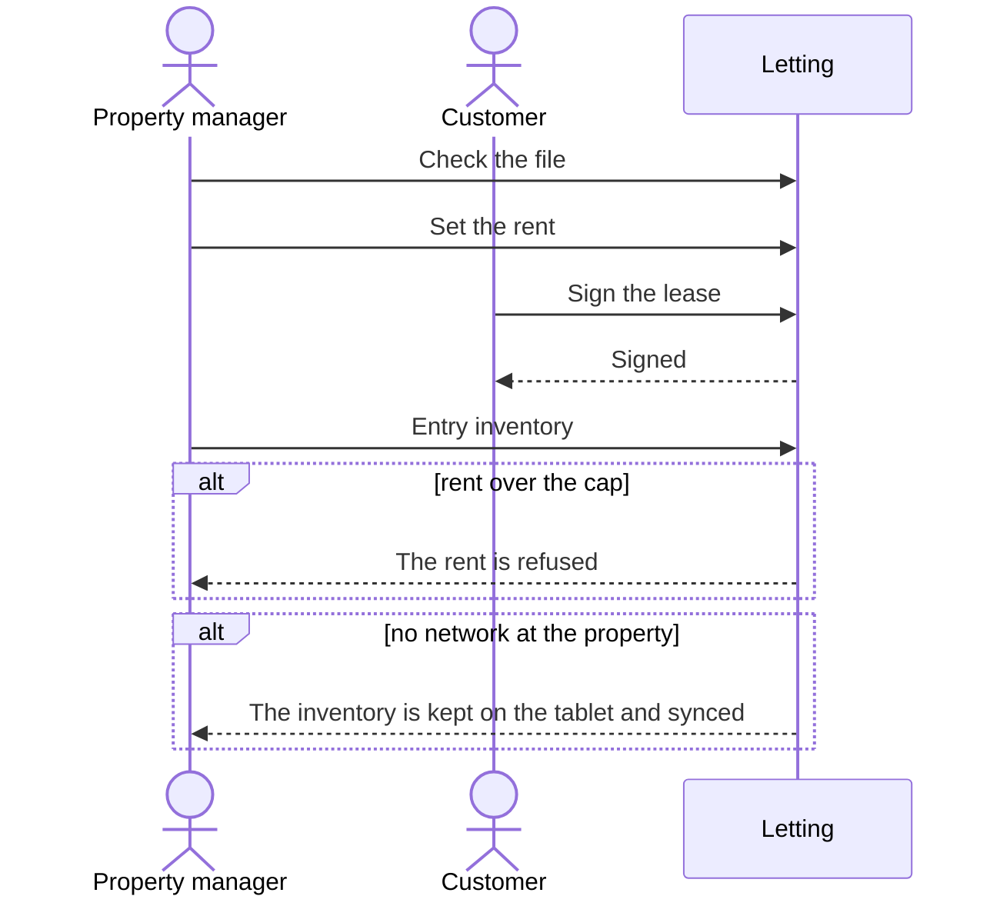

🏠 [Specs](../../../../README.md) › 🏷️ [Sectors](../../../README.md) › 🏘️ [SC10 Real estate](../../README.md) ›
📝 [Use cases](../README.md) › 📝 [Use cases: FL-SC10-03 Lettings](README.md) › 📝 UC-SC10-07 Let a property

# 📝 UC-SC10-07 Let a property

**Status:** ✅ specified

## Summary

The property manager checks the tenant's file, signs the lease within the rent caps, does the entry inventory and takes
the deposit.

## Personas

- [U34 Property manager](../../../../01-users/personas/u34-property-manager.md)
- [U09 Customer](../../../../01-users/personas/u09-customer.md)

## Goal

A legal lease with its deposit and inventory.

## Trigger

A tenant is chosen.

## Frequency

Weekly.

## Preconditions

- The SC10 sector pack is installed for the company,
  [UC-F14-02](../../../../02-functional/f14-plugin-store/use-cases/01-find-and-install/uc-f14-02-install-a-plugin-or-sector-pack.md),
  and its users have their roles,
  [UC-F1-06](../../../../02-functional/f01-administration/use-cases/04-edit-a-role/uc-f01-06-edit-a-role-and-its-record-rules.md).

## Postconditions

- **Success:** the lease is signed and the tenant moves in.
- **Failed:** the lease is not signed.

## Main flow

1. The property manager checks the tenant's file on [S-SC10-07 Letting](../../screens/03-lettings/s-sc10-07-letting.md).
2. SimpleERP checks the rent against the cap
   ([BR-SC10-07](../../business-rules/br-sc10-07-letting-rent-within-caps.md)).
3. The tenant signs,
   [UC-F2-14](../../../../02-functional/f02-no-code-configuration/use-cases/07-benchmark-additions/uc-f02-14-send-documents-for-e-signature.md).
4. The property manager does the inventory on the tablet and records the deposit
   ([UC-SC10-10](uc-sc10-10-manage-deposits-and-their-return.md)).

## Alternative flows

- 1a. A furnished lease: its own deposit cap and terms apply.

## Error flows

- 2e. Rent over the cap: the rent is refused.
- 4e. No network at the property: the inventory is kept on the tablet and synced.
- Any step: a call to a service or an outside system fails: it is retried first
  ([BR-F3-32](../../../../02-functional/f03-assistant/business-rules/br-f03-32-retry-before-an-error.md)), then the
  error message pattern ([D122](../../../../06-decisions/ux/d122-error-message-standard.md)) says what failed; what was
  typed is kept.

## Business rules

- [BR-SC10-04 Deposit within the cap](../../business-rules/br-sc10-04-deposit-within-the-cap.md)
- [BR-SC10-07 Letting rent within the caps](../../business-rules/br-sc10-07-letting-rent-within-caps.md)

## Entities

- [E-SC10-07 Lease](../../data/e-sc10-07-lease.md)
- [E-SC10-08 Deposit](../../data/e-sc10-08-deposit.md)

## Permissions

The property manager and customer roles; the record rules of their role and site apply,
[UC-F1-06](../../../../02-functional/f01-administration/use-cases/04-edit-a-role/uc-f01-06-edit-a-role-and-its-record-rules.md).

## Notifications

None beyond the in-app updates of the records concerned.

## Audit events

Every creation, change and state change of lease, deposit records, with who, when and the values before and after (T3).

## AI involvement

The AI assistant answers questions on the lease, deposit records of this use case, with links, and prepares them as
drafts the user confirms. It works within the user's rights,
[BR-F3-34](../../../../02-functional/f03-assistant/business-rules/br-f03-34-every-capability-is-reachable-from-the-assistant.md),
and never deletes or does anything irreversible without the user's confirmation,
[BR-F3-07](../../../../02-functional/f03-assistant/business-rules/br-f03-07-no-deletes-no-irreversible-acts.md).

## API, MCP and A2A exposure

Through the API and webhooks (T5) and the MCP and A2A gateway (T6), with the caller's rights,
[BR-F3-34](../../../../02-functional/f03-assistant/business-rules/br-f03-34-every-capability-is-reachable-from-the-assistant.md),
reading, creating and changing the records of this use case; nothing irreversible without a person's confirmation.

## Screens

- [S-SC10-07 Letting](../../screens/03-lettings/s-sc10-07-letting.md)

## Flowchart

See [FL-SC10-03 Lettings](../../flows/fl-sc10-03-lettings.md#flowchart).

## Sequence diagram

## Acceptance criteria

1. **Given** the example estate agency's lease of the flat in Lyon 3 to S. Roux from 1 December at 800 EUR and 90 EUR
   charges **when** it is signed **then** the lease shows the index clause and energy rating D.
2. **Given** a capped city with a reference of 760 EUR **when** 800 EUR is set **then** the rent is refused.

## Non-functional notes

[D408](../../../../06-decisions/technical/d408-performance-and-profiles.md)'s targets
([performance](../../../../05-non-functional/performance.md)): 95 % of screens within 1 second; lists paged on the
server, the first page within 1 second; reports within 5 seconds or in the background. WCAG 2.2 AA and RGAA
([D46](../../../../06-decisions/ux/d46-accessibility-standard.md)).

## Regulatory references

Legal values from the France country pack:
[CR-FR-143 Rent caps and energy-inefficient homes](../../../../10-country-packs/france/real-estate/cr-fr-143-rent-caps-and-energy-rules.md),
[CR-FR-140 Security deposit of a residential lease](../../../../10-country-packs/france/real-estate/cr-fr-140-security-deposit.md).

## Related use cases

- [UC-SC10-10 Manage deposits and their return](uc-sc10-10-manage-deposits-and-their-return.md)

## Open questions

None.

---

⬅️ [UC-SC10-06 Bill and display agency fees](../02-sales/uc-sc10-06-bill-and-display-agency-fees.md) ·
⬆️ [Up](README.md) ·
➡️ [UC-SC10-08 Call rents and issue receipts](../04-rents-and-landlords/uc-sc10-08-call-rents-and-issue-receipts.md)
