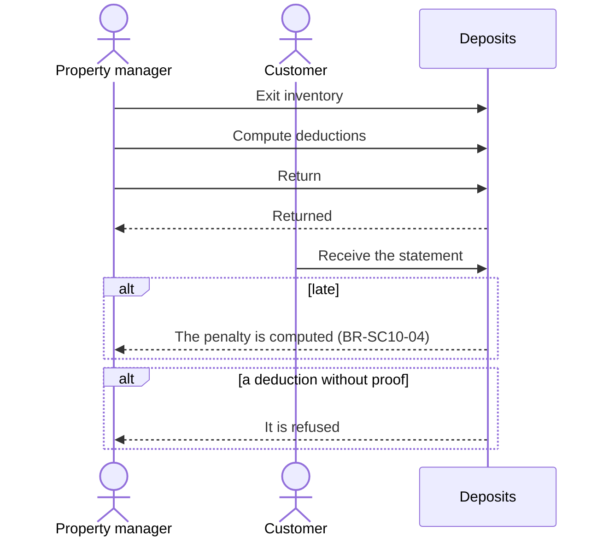

🏠 [Specs](../../../../README.md) › 🏷️ [Sectors](../../../README.md) › 🏘️ [SC10 Real estate](../../README.md) ›
📝 [Use cases](../README.md) › 📝 [Use cases: FL-SC10-03 Lettings](README.md) ›
📝 UC-SC10-10 Manage deposits and their return

# 📝 UC-SC10-10 Manage deposits and their return

**Status:** ✅ specified

## Summary

The property manager does the exit inventory, computes deductions, and returns the deposit by the deadline from the
client money ledger.

## Personas

- [U34 Property manager](../../../../01-users/personas/u34-property-manager.md)
- [U09 Customer](../../../../01-users/personas/u09-customer.md)

## Goal

Deposits returned on time.

## Trigger

A tenant leaves.

## Frequency

Weekly.

## Preconditions

- The SC10 sector pack is installed for the company,
  [UC-F14-02](../../../../02-functional/f14-plugin-store/use-cases/01-find-and-install/uc-f14-02-install-a-plugin-or-sector-pack.md),
  and its users have their roles,
  [UC-F1-06](../../../../02-functional/f01-administration/use-cases/04-edit-a-role/uc-f01-06-edit-a-role-and-its-record-rules.md).

## Postconditions

- **Success:** the deposit is returned on time.
- **Failed:** the penalty is computed.

## Main flow

1. The property manager compares exit and entry on
   [S-SC10-10 Deposits](../../screens/03-lettings/s-sc10-10-deposits.md).
2. Deductions are computed with proof.
3. The rest is returned from the client money ledger,
   [UC-F8-21](../../../../02-functional/f08-accounting/use-cases/07-client-money-grants-and-non-profits/uc-f08-21-keep-third-party-client-money.md).
4. The tenant gets the statement.

## Alternative flows

- 2a. A co-ownership provision held: part is held until the charges settle.

## Error flows

- 3e. Late: the penalty is computed ([BR-SC10-04](../../business-rules/br-sc10-04-deposit-within-the-cap.md)).
- 2e. A deduction without proof: it is refused.
- Any step: a call to a service or an outside system fails: it is retried first
  ([BR-F3-32](../../../../02-functional/f03-assistant/business-rules/br-f03-32-retry-before-an-error.md)), then the
  error message pattern ([D122](../../../../06-decisions/ux/d122-error-message-standard.md)) says what failed; what was
  typed is kept.

## Business rules

- [BR-SC10-04 Deposit within the cap](../../business-rules/br-sc10-04-deposit-within-the-cap.md)
- [BR-F8-13 Client money is segregated and never negative per client](../../../../02-functional/f08-accounting/business-rules/br-f08-13-client-money-is-segregated-and-never-negative-per-client.md)

## Entities

- [E-SC10-08 Deposit](../../data/e-sc10-08-deposit.md)

## Permissions

The property manager and customer roles; the record rules of their role and site apply,
[UC-F1-06](../../../../02-functional/f01-administration/use-cases/04-edit-a-role/uc-f01-06-edit-a-role-and-its-record-rules.md).

## Notifications

None beyond the in-app updates of the records concerned.

## Audit events

Every creation, change and state change of deposit records, with who, when and the values before and after (T3).

## AI involvement

The AI assistant answers questions on the deposit records of this use case, with links, and prepares them as drafts the
user confirms. It works within the user's rights,
[BR-F3-34](../../../../02-functional/f03-assistant/business-rules/br-f03-34-every-capability-is-reachable-from-the-assistant.md),
and never deletes or does anything irreversible without the user's confirmation,
[BR-F3-07](../../../../02-functional/f03-assistant/business-rules/br-f03-07-no-deletes-no-irreversible-acts.md).

## API, MCP and A2A exposure

Through the API and webhooks (T5) and the MCP and A2A gateway (T6), with the caller's rights,
[BR-F3-34](../../../../02-functional/f03-assistant/business-rules/br-f03-34-every-capability-is-reachable-from-the-assistant.md),
reading, creating and changing the records of this use case; nothing irreversible without a person's confirmation.

## Screens

- [S-SC10-10 Deposits](../../screens/03-lettings/s-sc10-10-deposits.md)

## Flowchart

See [FL-SC10-03 Lettings](../../flows/fl-sc10-03-lettings.md#flowchart).

## Sequence diagram

## Acceptance criteria

1. **Given** the example estate agency's deposit of 800 EUR from S. Roux with 120 EUR deductions **when** it is returned
   on 2027-01-05 **then** 680 EUR is paid back.
2. **Given** S. Roux's deposit returned after the deadline **when** it is returned **then** the penalty is computed
   ([BR-SC10-04](../../business-rules/br-sc10-04-deposit-within-the-cap.md)).

## Non-functional notes

[D408](../../../../06-decisions/technical/d408-performance-and-profiles.md)'s targets
([performance](../../../../05-non-functional/performance.md)): 95 % of screens within 1 second; lists paged on the
server, the first page within 1 second; reports within 5 seconds or in the background. WCAG 2.2 AA and RGAA
([D46](../../../../06-decisions/ux/d46-accessibility-standard.md)).

## Regulatory references

Legal values from the France country pack:
[CR-FR-140 Security deposit of a residential lease](../../../../10-country-packs/france/real-estate/cr-fr-140-security-deposit.md).

## Related use cases

- [UC-SC10-07 Let a property](uc-sc10-07-let-a-property.md)

## Open questions

None.

---

⬅️ [UC-SC10-09 Index rents within the caps](../04-rents-and-landlords/uc-sc10-09-index-rents-within-the-caps.md) ·
⬆️ [Up](README.md) ·
➡️ [UC-SC10-11 Settle service charges yearly](../04-rents-and-landlords/uc-sc10-11-settle-service-charges-yearly.md)
